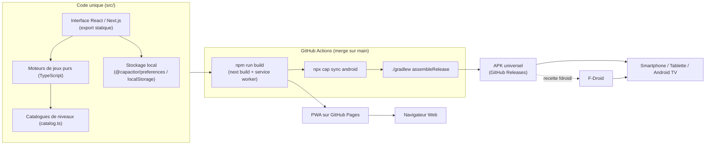
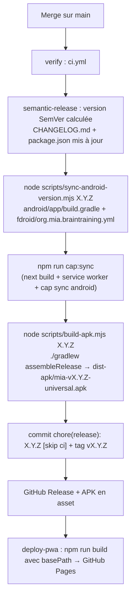

# Mia

[](https://github.com/youtix/mia/actions/workflows/ci.yml)
[](https://github.com/youtix/mia/actions/workflows/release-and-deploy.yml)

**Mia** est une application gratuite et open-source (GPL-3.0-or-later) d'entraînement cérébral pour toute la famille : mémoire de travail, repérage dans l'espace, logique et planification, et, pour les petits (dès 3 ans), raisonnement inductif sur des suites logiques, flexibilité mentale et inhibition. Une seule base de code pour trois usages :

- **Smartphone et tablette** : au doigt (tap, glisser-déposer).
- **Android TV** : à la télécommande (flèches, OK, Retour), avec de grands boutons, des aides à l'écran et des marges adaptées au téléviseur (« 10-foot UI »).
- **Navigateur Web** : la même application en PWA, installable et utilisable hors-ligne.

Mia fonctionne entièrement hors-ligne, sans compte, sans publicité, sans traqueur et sans service Google : toutes les données restent sur l'appareil.

## Sommaire

- [Fonctionnalités](#fonctionnalités)
- [Architecture](#architecture)
- [Installation](#installation)
- [Développement](#développement)
- [Release automatique](#release-automatique)
- [Ajouter des niveaux (et des étoiles)](#ajouter-des-niveaux-et-des-étoiles)
- [Ajouter un nouveau jeu](#ajouter-un-nouveau-jeu)
- [Structure du dépôt](#structure-du-dépôt)
- [Crédits de la voix](#crédits-de-la-voix)
- [Documentation et licence](#documentation-et-licence)

## Fonctionnalités

| Domaine             | Ce que Mia propose                                                                                                                                                                                                                                                                                                                                                                                                                                                                     |
| :------------------ | :------------------------------------------------------------------------------------------------------------------------------------------------------------------------------------------------------------------------------------------------------------------------------------------------------------------------------------------------------------------------------------------------------------------------------------------------------------------------------------- |
| **Memory**          | Retrouve les paires (ou les triplets) de cartes identiques : grilles de 2 × 2 à 6 × 6, aperçu initial (5 s, ajustable par joueur), quatre modes visuels (couleurs et formes distinctes, palette thématique, monochrome, formes abstraites orientées), limite d'erreurs et, dans les niveaux avancés, cartes qui échangent leur place après tes erreurs.                                                                                                                                |
| **Traffic Jam**     | Libère la voiture rouge du parking en déplaçant les autres véhicules (voitures de 2 cases, camions de 3, plots fixes) en un minimum de coups. Un solveur BFS calcule le nombre de coups optimal de chaque niveau et fournit un indice.                                                                                                                                                                                                                                                 |
| **Suites Logiques** | Premier jeu pour les petits (4 à 8 ans), sans aucun texte à lire : complète la suite logique parmi trois grands boutons, de la règle A-B à A-B-B, puis retrouve la structure dans des sons (cloche, tambour). On ne peut pas perdre une étoile, et un panneau STOP entraîne à se retenir.                                                                                                                                                                                              |
| **Attrape-Piège**   | Pour les 3 à 6 ans : range les ours dans la bonne boîte, par couleur ou par taille, jusqu'à ce qu'un panneau STOP change la règle pendant que d'autres ours attendent ; plus loin, « tous les ours, sauf… ». La mascotte dit les règles à voix haute, aucun texte à lire pendant la partie, et personne ne peut perdre : une étoile en finissant, une couronne sans aucun rebond. Un jeu qui exerce la flexibilité mentale et l'inhibition, sans prétention clinique ni thérapeutique. |
| **Progression**     | Cinq paliers cognitifs (Très Facile, Facile, Moyen, Difficile, Très Difficile), 20 étoiles par jeu au départ. Un niveau réussi rapporte une étoile, un sans-faute (ou le minimum de coups) une couronne (pour Suites Logiques : une série sans mauvaise réponse ni tape pendant un STOP). Le catalogue s'étend sans jamais casser les sauvegardes.                                                                                                                                     |
| **Profils**         | Plusieurs profils locaux sur le même appareil (famille, salon partagé), chacun avec sa progression, sans création de compte.                                                                                                                                                                                                                                                                                                                                                           |
| **Réglages**        | Mode TV forcé ou automatique, son (voix de la mascotte d'Attrape-Piège, sons de Suites Logiques), contraste élevé ; réglages de jeu par profil (temps de mémorisation et d'affichage des erreurs de Memory) ; export et import de la sauvegarde au format JSON, réinitialisation ; version de l'application et, dans la PWA, recherche de mise à jour et réparation.                                                                                                                   |

## Architecture

Mia est une application **Next.js en export statique** (`output: 'export'`) : le même dossier `out/` est servi tel quel par GitHub Pages (PWA) et embarqué par **Capacitor** dans un APK Android unique qui s'installe sur smartphone, tablette et Android TV.



### Stack technique

- **Next.js 16** (App Router, export statique, `basePath` injecté par la CI pour GitHub Pages), **React 19**, **TypeScript strict**.
- **Tailwind CSS v4** avec la variante `tv:` (marges anti-overscan, tailles lisibles à 3 mètres) pilotée par `<html data-tv>`.
- **Framer Motion** et transitions CSS accélérées pour rester fluide sur les boîtiers TV modestes.
- **Synthèse Web Audio** (`src/core/audio/`) : la cloche, le tambour et les jingles de Suites Logiques sont générés à la volée, sans aucun fichier audio à embarquer, à licencier (F-Droid) ni à pré-cacher (PWA).
- **Capacitor 8** (`@capacitor/android`, `@capacitor/app` pour le bouton Retour de la télécommande, `@capacitor/preferences` pour la sauvegarde native).
- **Service worker maison** (aucune dépendance à l'exécution) qui pré-cache tout l'export statique de la PWA ; une nouvelle version s'active à la demande du joueur (bannière du Hub) ou quand toutes les fenêtres de Mia sont fermées.
- **Web Audio API** (aucune dépendance) : voix de la mascotte d'Attrape-Piège en clips MP3 embarqués, effets sonores synthétisés.
- **Vitest + Testing Library**, **ESLint 9** (`strictTypeChecked`, `jsx-a11y` strict), **Prettier**, **Husky**, **commitlint**, **semantic-release**.

### Un code, trois supports

| Support                | Entrée                                              | Particularités                                                                                                                                                |
| :--------------------- | :-------------------------------------------------- | :------------------------------------------------------------------------------------------------------------------------------------------------------------ |
| Smartphone et tablette | Tactile (tap, glisser-déposer), toutes orientations | Icônes d'installation PNG et SVG, écran de lancement, sauvegarde dans les `SharedPreferences` natives.                                                        |
| Android TV             | D-Pad (flèches, OK, Retour), bannière Leanback      | Navigation spatiale entre tous les éléments, mode TV détecté par CSS et nativement (`UiModeManager`), bouton Retour physique géré, garde-fou WebView 111+.    |
| Navigateur Web (PWA)   | Souris, clavier, tactile                            | Installable (manifeste, icônes `any` et `maskable`), 100 % hors-ligne après la première visite, mises à jour atomiques proposées au joueur (bannière du Hub). |

## Installation

### PWA (navigateur Web)

1. Ouvre **<https://youtix.github.io/mia/>** (déployée automatiquement à chaque release).
2. Sur mobile, choisis « Ajouter à l'écran d'accueil » ; sur ordinateur, l'icône d'installation apparaît dans la barre d'adresse.
3. Après la première visite, Mia fonctionne hors-ligne. Une nouvelle version se télécharge en arrière-plan ; dès qu'elle est prête, une bannière du Hub te propose de l'activer (la page se recharge, ta progression est conservée). Sans action de ta part, elle s'active quand toutes les fenêtres de Mia sont fermées.
4. Dans Réglages › Application, tu vois la version installée, tu peux chercher une mise à jour tout de suite et, si Mia se comporte mal, la réparer : son service worker et son cache sont supprimés puis retéléchargés, ta sauvegarde n'est pas touchée (une connexion est nécessaire).

### APK Android (smartphone, tablette, Android TV)

Chaque [GitHub Release](https://github.com/youtix/mia/releases) publiée depuis l'intégration du projet Android contient l'asset **`mia-vX.Y.Z-universal.apk`** (« Mia Android / Android TV Universal APK ») : un seul fichier pour smartphone, tablette et Android TV.

1. Télécharge l'APK de la dernière release.
2. Autorise l'installation d'applications de sources inconnues pour l'application qui ouvre le fichier (gestionnaire de fichiers, navigateur).
3. Installe : Mia apparaît dans le lanceur (et, sur Android TV, dans le lanceur Leanback).

Les mises à jour de l'APK ne passent pas par l'application : F-Droid (une fois Mia publiée) ou la nouvelle release installée par-dessus. Mia ne contacte aucun serveur et ne prévient donc pas qu'une release plus récente existe : Réglages › Application affiche la version installée, à comparer avec la [dernière release](https://github.com/youtix/mia/releases).

> L'APK est signé avec la clé de release du projet quand elle est configurée dans la CI, sinon avec la clé de débogage du SDK (voir [Signature](#signature-de-lapk)). Android refuse de mettre à jour en place une application signée avec une autre clé : dans ce cas, exporte ta sauvegarde (Réglages), désinstalle, réinstalle, puis importe-la.

### Android TV sans Play Store (sideload)

- **Depuis un ordinateur** : active le débogage réseau sur le téléviseur (Paramètres › Options pour les développeurs), puis `adb connect <adresse-ip-de-la-tv>` et `adb install mia-vX.Y.Z-universal.apk`.
- **Depuis le téléviseur** : installe un gestionnaire de fichiers ou une application de téléchargement depuis le store du téléviseur, télécharge l'APK depuis la page de la release et ouvre-le.
- **Clé USB** : copie l'APK sur une clé USB et ouvre-le avec un gestionnaire de fichiers du téléviseur.

### F-Droid

Mia est prête pour **F-Droid** (aucune dépendance propriétaire, compilable par le serveur F-Droid à partir du tag de release) mais n'y est **pas encore publiée**. La recette de compilation au format `fdroiddata` est versionnée dans [`fdroid/org.mia.braintraining.yml`](./fdroid/org.mia.braintraining.yml) et synchronisée à chaque release (bloc de build et version courante). Pour soumettre l'application :

1. Attendre une release dont le tag contient le projet `android/` (le bloc de build pointe sur le tag de la dernière release).
2. Forker [fdroiddata](https://gitlab.com/fdroid/fdroiddata), copier le fichier dans `metadata/org.mia.braintraining.yml`, puis ouvrir une merge request. Les descriptions F-Droid sont lues dans `metadata/fr-FR/` (format Fastlane).
3. Une fois l'application acceptée, F-Droid suit les tags `vX.Y.Z` (`AutoUpdateMode: Version`) : chaque release est compilée et signée par F-Droid sans intervention.

## Développement

### Prérequis

- **Node.js 22** (`.nvmrc`), au minimum `22.22.2` (ou `>= 24.15.0`) : `engines` est appliqué strictement (`engine-strict=true`), `npm install` refuse une autre version.
- **npm 10** ou plus récent.
- Pour compiler l'APK en local uniquement : **JDK 21** et le **SDK Android** (`ANDROID_HOME`). La CI s'en charge à chaque release ; rien de tout cela n'est nécessaire pour développer et tester l'application Web.

```sh
nvm use          # Node 22 (.nvmrc)
npm ci           # installe les dépendances et les hooks Husky
npm run dev      # http://localhost:3000
```

### Scripts npm

| Script                    | Rôle                                                                                                                              |
| :------------------------ | :-------------------------------------------------------------------------------------------------------------------------------- |
| `npm run dev`             | Serveur de développement Next.js.                                                                                                 |
| `npm run build`           | Export statique dans `out/` puis génération du service worker (`scripts/build-sw.ts`).                                            |
| `npm start`               | Sert `out/` en local (`npx serve`).                                                                                               |
| `npm run cap:sync`        | `npm run build` puis `npx cap sync android` : copie `out/` et les plugins dans le projet Android.                                 |
| `npm run icons`           | Régénère les PNG d'installation depuis `public/icons/icon-512.svg` (à lancer seulement si le SVG change).                         |
| `npm run typecheck`       | `tsc --noEmit` sur l'application et sur le programme du service worker.                                                           |
| `npm run lint`            | ESLint strict, 0 avertissement toléré (`npm run lint:fix` corrige ce qui peut l'être).                                            |
| `npm run format:check`    | Prettier (`npm run format` reformate tout le dépôt).                                                                              |
| `npm test`                | Tests Vitest (`npm run test:watch` en continu, `npm run test:coverage` avec la couverture).                                       |
| `npm run validate:levels` | Valide les quatre catalogues (Memory, Traffic Jam avec solveur BFS, Suites Logiques, Attrape-Piège) et affiche un résumé par jeu. |
| `npm run validate:all`    | Enchaîne `format:check`, `lint`, `typecheck`, `validate:levels`, `test:coverage` et `build` : ce que la CI exécute.               |

Scripts de la chaîne de release, lancés par `semantic-release` (voir [Release automatique](#release-automatique)) : `node scripts/sync-android-version.mjs <version>` et `node scripts/build-apk.mjs <version>`.

Outil de développement, hors de la chaîne de build : `python scripts/generate-voice-clips.py --model <fichier .onnx>` régénère les phrases de la mascotte (voir [Attrape-Piège](#attrape-piège--un-objet-dans-bear_sort_catalog)).

### Qualité et hooks Git

- **Couverture** : 80 % minimum (lignes, fonctions, branches, instructions) sur `src/`, 90 % sur les moteurs purs de Memory, de Traffic Jam, de Suites Logiques et d'Attrape-Piège.
- **Hooks Husky** : `pre-commit` (`lint-staged` : ESLint `--fix` puis Prettier sur les fichiers indexés, puis `typecheck`), `commit-msg` (commitlint), `pre-push` (`test:coverage`).
- **Accessibilité** : règles `jsx-a11y` strictes, tout élément interactif est atteignable au clavier et à la télécommande.

### Conventions de commit (Conventional Commits)

Les messages de commit pilotent les releases : ils doivent respecter **[Conventional Commits](https://www.conventionalcommits.org/fr/)** (`type(scope): description`, description en minuscules, en anglais comme le changelog).

- **Types autorisés** : `feat`, `fix`, `docs`, `style`, `refactor`, `perf`, `test`, `build`, `ci`, `chore`, `revert`.
- **Scopes autorisés** (facultatif) : `core`, `ui`, `navigation`, `storage`, `profile`, `progression`, `hub`, `settings`, `memory`, `traffic-jam`, `patterns`, `bear-sort`, `android`, `pwa`, `release`, `quality`, `deps`, `deps-dev`.
- **Effet sur la version** : `feat` → version mineure, `fix` et `perf` → correctif, `!` après le type ou `BREAKING CHANGE:` en pied → version majeure. Les autres types ne publient rien.

```text
feat(memory): add 10 new very hard levels
fix(traffic-jam): keep the hero focus ring visible on tv
docs: clarify the level authoring guide
```

Le dépôt fonctionne en **pull requests avec squash merge** : le titre de la PR devient le message du commit sur `main`, il est validé par commitlint en CI (`pr-title.yml`). Les branches sont supprimées après merge.

### Intégration continue

- `ci.yml` (chaque PR vers `main`, et réutilisé au merge) : `npm ci`, `format:check`, `lint`, `typecheck`, `validate:levels`, `test:coverage`, `build`.
- `pr-title.yml` : titre de la PR validé par commitlint.
- `release-and-deploy.yml` (chaque push sur `main`) : vérification, release automatique puis déploiement de la PWA.
- **Dependabot** maintient chaque semaine les dépendances npm (`fix(deps)` / `chore(deps-dev)`) et les actions GitHub.

## Release automatique

À chaque merge sur `main`, **semantic-release** calcule la prochaine version à partir des commits puis publie tout, sans intervention manuelle :



1. **Version** : `@semantic-release/commit-analyzer` lit les commits depuis le dernier tag ; `CHANGELOG.md` et `package.json` sont mis à jour.
2. **Version Android** : `scripts/sync-android-version.mjs` écrit `versionName "X.Y.Z"` et `versionCode` dans `android/app/build.gradle`, avec `versionCode = major × 10000 + minor × 100 + patch` (`1.4.2` → `10402`, strictement croissant ; `minor` et `patch` doivent rester inférieurs à 100). Il aligne aussi la recette F-Droid.
3. **Build** : `npm run cap:sync` exporte l'application et la copie dans `android/app/src/main/assets/public`. `next.config.ts` y injecte la version de `package.json` (`NEXT_PUBLIC_APP_VERSION`) : c'est le numéro affiché dans Réglages › Application, celui de la release dans l'APK comme dans la PWA déployée depuis le tag.
4. **APK** : `scripts/build-apk.mjs` lance `./gradlew assembleRelease --no-daemon` (JDK 21 Temurin et cache Gradle installés par `actions/setup-java`, SDK Android préinstallé sur `ubuntu-latest`) et copie l'APK dans `dist-apk/` (ignoré par Git).
5. **Commit et tag** : `@semantic-release/git` commite `CHANGELOG.md`, `package.json`, `package-lock.json`, `android/app/build.gradle` et `fdroid/org.mia.braintraining.yml` (`chore(release): X.Y.Z [skip ci]`, poussé par la GitHub App de release), puis pose le tag `vX.Y.Z`.
6. **GitHub Release** : `@semantic-release/github` crée la release avec les notes de version et attache `dist-apk/*.apk`.
7. **PWA** : le job `deploy-pwa` compile l'export depuis le tag avec le `basePath` de GitHub Pages et le déploie.

Si une étape échoue avant le commit (par exemple le build Gradle), rien n'est publié : la release repart de zéro au prochain run.

> **Versions Android et Web toujours alignées** : `tests/android-manifest.test.ts` vérifie que `android/app/build.gradle` porte la version de `package.json`. Le projet Android et cette chaîne de release doivent donc atterrir dans la **même release** ; ensuite, chaque commit de release synchronise les deux fichiers.

### Signature de l'APK

La signature de release est **facultative** et configurée par quatre secrets du dépôt GitHub ; sans eux, l'APK de release est signé avec la clé de débogage du SDK et reste installable.

| Secret                  | Contenu                                                               |
| :---------------------- | :-------------------------------------------------------------------- |
| `MIA_KEYSTORE_BASE64`   | Le keystore (`.jks`) encodé en base64 (`base64 -w0 mia-release.jks`). |
| `MIA_KEYSTORE_PASSWORD` | Mot de passe du keystore.                                             |
| `MIA_KEY_ALIAS`         | Alias de la clé dans le keystore.                                     |
| `MIA_KEY_PASSWORD`      | Mot de passe de la clé.                                               |

```sh
keytool -genkeypair -v -keystore mia-release.jks -alias mia -keyalg RSA -keysize 4096 -validity 10000
base64 -w0 mia-release.jks   # valeur du secret MIA_KEYSTORE_BASE64
```

Le workflow décode le keystore hors du dépôt (`$RUNNER_TEMP`) seulement si `MIA_KEYSTORE_BASE64` est défini et transmet son chemin à Gradle par `MIA_KEYSTORE_PATH` ; `android/app/build.gradle` lit ces variables d'environnement et retombe sur `signingConfigs.debug` en leur absence. Les keystores sont ignorés par Git (`android/.gitignore`). Garde le keystore et ses mots de passe en lieu sûr : une clé perdue empêche toute mise à jour en place des installations existantes.

### Compiler l'APK en local (facultatif)

Avec un JDK 21 et le SDK Android installés (`ANDROID_HOME`) :

```sh
npm run cap:sync
node scripts/build-apk.mjs 0.0.0-local   # refusé : utilise une version SemVer, ex. 1.2.3
node scripts/build-apk.mjs 1.2.3         # → dist-apk/mia-v1.2.3-universal.apk
```

Ne lance pas `scripts/sync-android-version.mjs` à la main sur le dépôt : seule la release le fait, pour que `build.gradle` reste aligné sur `package.json`.

## Ajouter des niveaux (et des étoiles)

Les catalogues sont de simples tableaux TypeScript, **sans aucune fabrique** : un niveau se copie et s'édite champ par champ. Ajouter un objet ajoute une étoile ; le Hub, la Carte des Étoiles, la sauvegarde et le déblocage suivent automatiquement.

Règles communes aux quatre jeux (vérifiées par `npm run validate:levels` et par les tests) :

- `id` **unique et immuable** (`mem-021`, `tj-021`, `pat-021`, `bs-021` : minuscules, chiffres, tirets) : c'est la clé de la sauvegarde des joueurs. Un niveau publié n'est **jamais retiré ni renommé** ; changer son palier ou son `order` est sans risque.
- `tier` : `very_easy`, `easy`, `medium`, `hard` ou `very_hard` ; `order` : position dans le palier, **unique**. Les niveaux initiaux utilisent `10, 20, 30, 40` : un nouveau niveau s'intercale avec un `order` libre (`15`, `25`…) ou s'ajoute à la fin (`50`).
- `title` : titre court en français (jamais affiché, l'écran indique « Étoile #N »).
- Le numéro d'étoile est recalculé à partir de l'ordre des paliers puis des `order` : insérer un niveau au début ne bloque jamais un joueur avancé (règle de déblocage hybride du moteur de progression).

```sh
npm run validate:levels   # résumé par jeu + anomalies (code de sortie 1 si une règle est violée)
```

### Memory : un objet dans `MEMORY_CATALOG`

1. Ouvre [`src/games/memory/catalog.ts`](./src/games/memory/catalog.ts).
2. Ajoute un objet dans `MEMORY_CATALOG` (de préférence à sa place dans l'ordre de la carte) :

```ts
{
  id: 'mem-021',
  gameId: 'memory',
  tier: 'medium',
  order: 25, // s'intercale entre mem-010 (20) et mem-011 (30)
  title: 'Dix-huit cartes',
  config: {
    cols: 6,
    rows: 3,
    matchSize: 2,
    visualMode: 'thematic_palette',
    previewSeconds: 5,
    maxMistakes: 12,
    swapEveryNMistakes: null,
    perfectMaxMistakes: 5,
  },
},
```

| Champ                | Valeurs                                                                          | Règles                                                                                                                          |
| :------------------- | :------------------------------------------------------------------------------- | :------------------------------------------------------------------------------------------------------------------------------ |
| `cols`, `rows`       | Entiers positifs                                                                 | `cols × rows` divisible par `matchSize`, au moins 2 groupes ; garde `cols >= rows` (le plateau tourne de lui-même en portrait). |
| `matchSize`          | `2` (paires) ou `3` (triplets)                                                   |                                                                                                                                 |
| `visualMode`         | `distinct_color_shape`, `thematic_palette`, `monochrome`, `abstract_orientation` | Nombre maximal de groupes par mode : 10, 36, 36 et 32.                                                                          |
| `previewSeconds`     | Entier ≥ 0                                                                       | Multiplié par le facteur du joueur (FEAT-19) ; `0` = aucun aperçu, quel que soit le réglage.                                    |
| `maxMistakes`        | Entier ≥ 0 ou `null`                                                             | `null` = erreurs illimitées ; sinon la partie est perdue au-delà.                                                               |
| `swapEveryNMistakes` | Entier ≥ 1 ou `null`                                                             | Deux cartes cachées échangent leur place toutes les N erreurs ; `<= maxMistakes` quand les deux sont définis.                   |
| `perfectMaxMistakes` | Entier ≥ 0                                                                       | Nombre d'erreurs maximal pour la couronne ; `<= maxMistakes` quand il est défini.                                               |

3. Lance `npm run validate:levels` (ou `npx vitest run tests/memory-catalog.test.ts`) : `validateMemoryCatalog` signale chaque anomalie avec le nom du niveau, et instancie chaque configuration avec le moteur pour s'assurer qu'elle se joue.

### Traffic Jam : une grille ASCII 6 × 6 dans `TRAFFIC_JAM_CATALOG`

Chaque niveau est dessiné avec `parseTrafficJamAscii(lignes, { optimalMoves })` : une chaîne par ligne, un caractère par case.

| Caractère      | Signification                                                                                                                                            |
| :------------- | :------------------------------------------------------------------------------------------------------------------------------------------------------- |
| `.`            | Case libre.                                                                                                                                              |
| `#`            | Plot fixe (obstacle d'une case, immobile).                                                                                                               |
| `H`            | Ta voiture (rouge) : exactement 2 cases horizontales sur la **ligne de sortie** (ligne 2 en partant de 0, bord droit).                                   |
| `A`, `B`, `C`… | Un véhicule par lettre : 2 cases (voiture) ou 3 cases (camion), alignées horizontalement ou verticalement. Les couleurs sont attribuées automatiquement. |

1. Ouvre [`src/games/traffic-jam/catalog.ts`](./src/games/traffic-jam/catalog.ts).
2. Ajoute un objet dans `TRAFFIC_JAM_CATALOG` avec `optimalMoves: 0` (tu ne connais pas encore le minimum) :

```ts
{
  id: 'tj-021',
  gameId: 'traffic-jam',
  tier: 'very_easy',
  order: 25,
  title: 'Deux bloqueurs',
  config: parseTrafficJamAscii(
    [
      '......', //
      '..A...',
      'HHA.B.',
      '....B.',
      '..CC..',
      '......',
    ],
    { optimalMoves: 0 },
  ),
},
```

3. Lance `npm run validate:levels` : le solveur BFS résout le niveau et affiche le minimum exact, par exemple :

```text
✘ niveau n° 21 « tj-021 » : optimalMoves 0 au lieu de 3 (minimum mesuré par le solveur)
```

4. Reporte la valeur mesurée (`{ optimalMoves: 3 }`) et relance la commande : le catalogue est valide. Cette valeur est l'objectif de la couronne et doit être **exactement** celle du solveur.

Le validateur refuse aussi une grille non carrée ou mal formée (message avec ligne et colonne), un niveau insoluble ou déjà gagné au départ, un `optimalMoves` qui redescend par rapport à l'étoile précédente sur la carte, et un palier dont le `optimalMoves` moyen n'est pas supérieur au palier précédent : place ton niveau là où sa difficulté le mérite. Le solveur explore au plus 50 000 positions (`DEFAULT_MAX_STATES`), largement suffisant pour une grille 6 × 6.

### Suites Logiques : un objet dans `PATTERNS_CATALOG`

Un niveau ne contient **aucune suite** : le moteur tire les défis (éléments, couleurs, intrus, ordre des propositions, défis ouverts par un STOP) au hasard à chaque partie, si bien qu'une réponse ne se mémorise pas et qu'une étoile tient en dix champs.

1. Ouvre [`src/games/patterns/catalog.ts`](./src/games/patterns/catalog.ts).
2. Ajoute un objet dans `PATTERNS_CATALOG` (de préférence à sa place dans l'ordre de la carte) :

```ts
{
  id: 'pat-021',
  gameId: 'patterns',
  tier: 'medium',
  order: 35, // s'intercale entre pat-011 (30) et pat-012 (40)
  title: 'Animaux, une seule couleur',
  config: {
    rule: 'abb',
    family: 'animals',
    colorMode: 'same',
    visibleItems: 5,
    answerMode: 'visual',
    soundPairing: null,
    rounds: 5,
    stopRounds: 2,
    stopSeconds: 3,
    hasGuide: false,
  },
},
```

| Champ          | Valeurs                     | Règles                                                                                                                                                                                                                                |
| :------------- | :-------------------------- | :------------------------------------------------------------------------------------------------------------------------------------------------------------------------------------------------------------------------------------ |
| `rule`         | `ab` ou `abb`               | Unité répétée de la suite : A-B (deux éléments) ou A-B-B (trois).                                                                                                                                                                     |
| `family`       | `animals` ou `shapes`       | Banque d'éléments : 8 animaux ou 8 formes, tirés au hasard par le moteur.                                                                                                                                                             |
| `colorMode`    | `distinct` ou `same`        | `distinct` : une couleur par élément ; `same` : une seule couleur, seule la forme les distingue.                                                                                                                                      |
| `visibleItems` | Entier                      | Éléments de la ligne avant la case vide. Pièces : de la longueur de l'unité + 2 à 6 (A-B : 4 à 6 ; A-B-B : 5 ou 6). Sons : nombre de temps d'une réponse, un nombre entier d'unités (A-B : 4 ; A-B-B : 3 ou 6).                       |
| `answerMode`   | `visual` ou `sound`         | Trois pièces à placer, ou trois suites de sons à écouter (mêmes sons, même durée, seule leur disposition change).                                                                                                                     |
| `soundPairing` | `fixed`, `varied` ou `null` | `null` obligatoire avec `visual` ; `fixed` ou `varied` obligatoire avec `sound`. `fixed` : chaque élément garde son son pendant toute l'étoile ; `varied` : l'association change à chaque défi, seule la structure mène à la réponse. |
| `rounds`       | Entier ≥ 1                  | Défis de l'étoile, enchaînés sans écran de fin (5 au catalogue).                                                                                                                                                                      |
| `stopRounds`   | Entier de 0 à `rounds`      | Défis ouverts par un STOP, tirés au hasard à chaque partie.                                                                                                                                                                           |
| `stopSeconds`  | Nombre fini > 0             | Durée d'un STOP en secondes, qu'il soit prévu (`stopRounds`) ou déclenché par une mauvaise réponse en moins de 1,2 s (2 s en Très Facile et Facile au catalogue, 3 s ensuite).                                                        |
| `hasGuide`     | `true` ou `false`           | Main fantôme sur la bonne réponse au premier défi, pour apprendre le geste sans texte (`pat-001` et `pat-013` au catalogue).                                                                                                          |

3. Lance `npm run validate:levels` (ou `npx vitest run tests/patterns-catalog.test.ts`) : `validatePatternsCatalog` signale chaque anomalie avec le nom du niveau, et instancie chaque configuration avec le moteur (`createPatternsGame`) pour s'assurer qu'elle se joue.

### Attrape-Piège : un objet dans `BEAR_SORT_CATALOG`

1. Ouvre [`src/games/bear-sort/catalog.ts`](./src/games/bear-sort/catalog.ts).
2. Ajoute un objet dans `BEAR_SORT_CATALOG`, à sa place dans l'ordre de la carte :

```ts
{
  id: 'bs-021',
  gameId: 'bear-sort',
  tier: 'easy',
  order: 25, // s'intercale entre bs-006 (20) et bs-007 (30)
  title: 'Encore une série',
  config: {
    zones: [SMALL_BLUE, BIG_YELLOW],
    phases: [
      { rule: BY_COLOR, addBears: OPENING_BEARS, placements: 6 },
      {
        rule: BY_SIZE,
        addBears: { 'blue-big': 2, 'yellow-small': 1, 'yellow-big': 1 },
        placements: null,
      },
    ],
    showGestureHint: false,
  },
},
```

| Champ                 | Valeurs                                                                                              | Règles                                                                                                                                                                           |
| :-------------------- | :--------------------------------------------------------------------------------------------------- | :------------------------------------------------------------------------------------------------------------------------------------------------------------------------------- |
| `zones`               | Deux boîtes `{ color, size }`, de gauche à droite                                                    | Opposées par la couleur **et** par la taille, fixes pour toute l'étoile.                                                                                                         |
| `phases[].rule`       | `{ kind: 'sort', feature: 'color' \| 'size' }` ou `{ kind: 'except', forbidden: { color?, size? } }` | Une règle de tri change de caractéristique à chaque STOP ; une règle « sauf » termine toujours l'étoile.                                                                         |
| `phases[].addBears`   | Nombre d'ours par sorte : `blue-small`, `blue-big`, `yellow-small`, `yellow-big`                     | S'ajoutent aux ours restés. Tri : ils remplissent les deux boîtes, avec au moins un ours en conflit après un changement. « Sauf » : au moins un ours interdit et un ours permis. |
| `phases[].placements` | Entier ≥ 1, ou `null` à la dernière phase                                                            | Ours à ranger avant le STOP, strictement moins que la réserve : le STOP interrompt toujours des ours qui attendent.                                                              |
| `showGestureHint`     | `true` ou `false`                                                                                    | Une main montre le geste tant que le premier ours n'est pas rangé (première étoile).                                                                                             |

3. Lance `npm run validate:levels` : `validateBearSortCatalog` signale chaque anomalie avec le nom du niveau.

Les 2 règles de tri et les 8 règles « sauf » ont déjà leur phrase de mascotte. Pour changer une phrase, modifie [`voice-script.json`](./src/games/bear-sort/voice-script.json) puis relance le générateur (Python, avec `piper-tts`, `lameenc` et le modèle de voix : voir l'en-tête de [`scripts/generate-voice-clips.py`](./scripts/generate-voice-clips.py)) ; un test signale un clip dont le texte est périmé. Un MP3 enregistré par une vraie voix peut aussi remplacer un fichier du même nom, sans rien changer au jeu.

## Ajouter un nouveau jeu

1. Crée `src/games/<nouveau-jeu>/` avec un moteur en TypeScript pur (sans React ni DOM : testable et importable par `validate:levels`), ses composants (`'use client'` pour ceux qui ont un état) et son `catalog.ts` qui exporte un tableau de `BaseLevelDefinition<Config>` et une fonction `validate<Jeu>Catalog` (commence par `validateLevelCatalog(gameId, catalog)` de `@/core/progression/catalog-validator`).
2. Ajoute l'identifiant au type `GameId` (`src/types/mia.ts`) : le compilateur exige alors son entrée dans `GAME_REGISTRY` (`src/core/progression/game-registry.ts`, titre, faculté travaillée, route, catalogue), dans la table des icônes (`GAME_ICONS`, `src/components/progression/game-icons.ts`) et dans la table des jeux reconnus par la sauvegarde (`KNOWN_GAMES`, `src/core/storage`), sans laquelle sa progression serait écartée au chargement.
3. Crée la page `src/app/<nouveau-jeu>/page.tsx`, qui rend un écran client `<GameScreen gameId="…" catalog={…} renderLevel={(level, controls) => <TonPlateau … />} />` (`src/components/progression/GameScreen.tsx`) : Carte des Étoiles, déblocage, enregistrement des victoires et navigation sont fournis.
4. Branche le catalogue dans `scripts/validate-levels.ts`, ajoute une entrée au scope commitlint si nécessaire (`commitlint.config.mjs`) et un seuil de couverture de 90 % pour le moteur dans `vitest.config.ts`.
5. Facultatif, pour un jeu qui parle ou qui sonne : `useGameAudio` de `@/core/audio` joue une voix en clips embarqués et des effets, `useSoundPlayer` des sons synthétisés à la volée. Les deux suivent le réglage « Son », et le jeu doit rester jouable sans aucun son. Un média embarqué reste sous licence CC0 ou CC BY : F-Droid signale `NC` et `ND` comme « Non-Free ». Un écran sans texte à lire, pour les non-lecteurs, passe `isTextless` à `AppShell` et à `ModalDialog` (titres et libellés réservés aux lecteurs d'écran).

Le Hub, les profils, la sauvegarde locale et la Carte des Étoiles prennent automatiquement en charge le nouveau jeu.

## Structure du dépôt

```text
.
├── .github/workflows/       # ci.yml, pr-title.yml, release-and-deploy.yml
├── android/                 # Projet Android Gradle (Capacitor) : manifeste TV, plugin natif TvMode, signature
├── docs/                    # SPECIFICATION.md et FEAT-01 … FEAT-25 (spécifications et décisions)
├── fdroid/                  # Recette fdroiddata (org.mia.braintraining.yml)
├── metadata/fr-FR/          # Descriptions F-Droid (format Fastlane)
├── public/                  # manifest.json, icônes, page WebView obsolète, clips audio (audio/bear-sort/)
├── scripts/                 # build-sw.ts, generate-icons.mjs, generate-voice-clips.py, validate-levels.ts, sync-android-version.mjs, build-apk.mjs
├── src/
│   ├── app/                 # Pages statiques : Hub (/), /memory, /traffic-jam, /patterns, /bear-sort, /settings ; écran d'erreur global
│   ├── components/          # Design system (ui), profils, progression (Hub, Carte des Étoiles), réglages
│   ├── core/
│   │   ├── audio/           # Service audio (voix, effets) et synthèse (cloche, tambour, jingles), réglage Son
│   │   ├── navigation/      # Navigation spatiale D-Pad, bouton Retour Android
│   │   ├── progression/     # Registre des jeux, moteur de progression, validateur de catalogues
│   │   ├── pwa/             # Service worker, enregistrement, mises à jour et réparation
│   │   └── storage/         # Sauvegarde locale, migrations, profils, mode TV
│   ├── games/
│   │   ├── memory/          # Moteur, symboles, composants, catalog.ts
│   │   ├── patterns/        # Moteur, banque d'éléments, composants, catalog.ts
│   │   ├── traffic-jam/     # Moteur, parseur ASCII, solveur BFS, composants, catalog.ts
│   │   └── bear-sort/       # Moteur, voix (script, manifeste), composants, catalog.ts
│   └── types/               # Types partagés (sauvegarde, paliers, jeux)
├── tests/                   # Tests Vitest (moteurs, écrans, configuration, Android, PWA, release)
├── capacitor.config.ts
├── .releaserc.json          # semantic-release (changelog, version, APK, GitHub Release)
└── package.json
```

## Crédits de la voix

La voix de la mascotte d'Attrape-Piège (`public/audio/bear-sort/*.mp3`) est une **voix de synthèse**, sous une licence distincte de celle du code : **[Creative Commons Attribution 4.0 International](https://creativecommons.org/licenses/by/4.0/deed.fr) (CC BY 4.0)**.

| Élément            | Source                                                                                                                                                                                                                                                                                                            | Licence                             |
| :----------------- | :---------------------------------------------------------------------------------------------------------------------------------------------------------------------------------------------------------------------------------------------------------------------------------------------------------------- | :---------------------------------- |
| Corpus de voix     | _MLS: A Large-Scale Multilingual Dataset for Speech Research_ (Multilingual LibriSpeech), Vineel Pratap, Qiantong Xu, Anuroop Sriram, Gabriel Synnaeve, Ronan Collobert, 2020 ([arXiv:2012.03411](https://arxiv.org/abs/2012.03411), [OpenSLR 94](https://www.openslr.org/94/)), tiré de livres audio de LibriVox | CC BY 4.0                           |
| Modèle de voix     | [`fr_FR-mls-medium`](https://huggingface.co/rhasspy/piper-voices/tree/main/fr/fr_FR/mls/medium), projet Piper, entraîné de zéro selon sa fiche                                                                                                                                                                    | CC BY 4.0, selon la fiche du modèle |
| Moteur de synthèse | [Piper](https://github.com/OHF-Voice/piper1-gpl), outil de développement non livré avec l'application                                                                                                                                                                                                             | GPL-3.0                             |

**Modifications apportées** : chaque phrase de [`voice-script.json`](./src/games/bear-sort/voice-script.json) a été synthétisée par un seul locuteur du modèle, à la suite d'une amorce ensuite coupée, ralentie pour de jeunes enfants puis encodée en MP3 par [`scripts/generate-voice-clips.py`](./scripts/generate-voice-clips.py). Les effets sonores, eux, sont synthétisés à l'exécution par la Web Audio API : aucun fichier, aucune licence à suivre.

L'attribution figure aussi dans l'application (note du réglage Son). Parce que cette voix porte les règles du jeu, seules les licences CC0 et CC BY sont admises pour la remplacer. La voix `siwis`, utilisée au départ, a été écartée pour cette raison : sa fiche indique qu'elle a été affinée à partir de la voix américaine `lessac`, dont le corpus est réservé à la recherche ([FEAT-22 §4](./docs/FEAT-22.md#4-points-dattention)).

## Documentation et licence

- [`docs/SPECIFICATION.md`](./docs/SPECIFICATION.md) décrit la vision, l'architecture et le modèle de données ; chaque feature (`docs/FEAT-XX.md`) consigne sa spécification et ses décisions d'implémentation.
- [`CHANGELOG.md`](./CHANGELOG.md) est généré par semantic-release.
- Mia est distribuée sous licence **GPL-3.0-or-later** : voir [`LICENSE`](./LICENSE).
