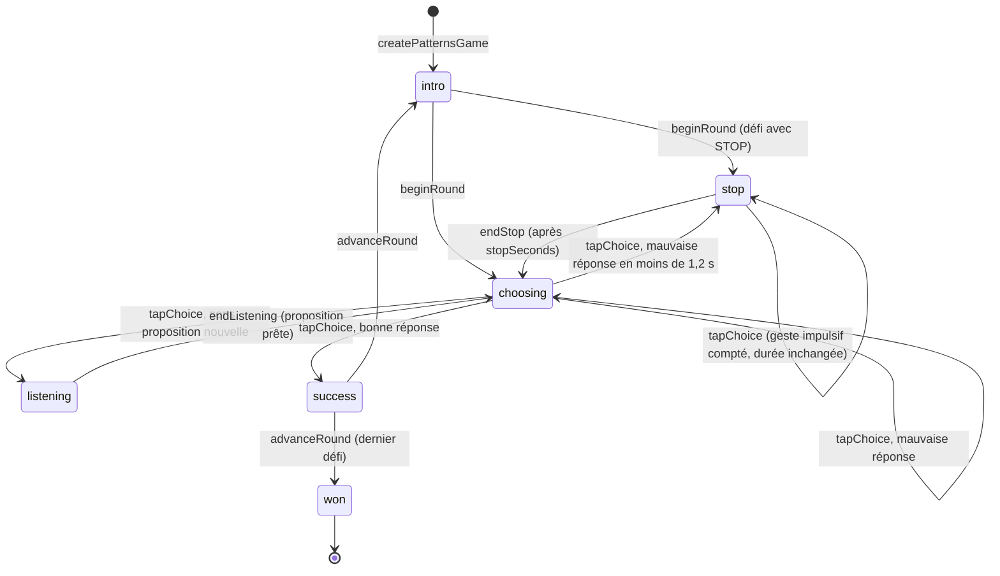

# FEAT-21 : Jeu n°3 (Suites Logiques) — Moteur, Interface sans Texte, Sons & Catalogue des 20 Étoiles

> **Document parent** : [SPECIFICATION.md](./SPECIFICATION.md)
> **ID Feature** : `FEAT-21`
> **Dépendances** : [FEAT-03](./FEAT-03.md), [FEAT-04](./FEAT-04.md), [FEAT-07](./FEAT-07.md), [FEAT-08](./FEAT-08.md), [FEAT-18](./FEAT-18.md)
> **Statut** : cadrée et implémentée ; les décisions prises pendant la session de cadrage sont consignées au [§6](#6-décisions-dimplémentation-session-de-cadrage).

---

## 1. Contexte & Objectif pour l'IA

Mia n'a jusqu'ici que des jeux pour toute la famille. **Suites Logiques** est son premier jeu pour les **petits (4 à 8 ans, non-lecteurs ou lecteurs débutants)**. L'objectif clinique est de stimuler l'**intelligence fluide inductive** par la reconnaissance de motifs : extraire une règle abstraite et utiliser la logique sérielle, en entraînant au passage le **contrôle inhibiteur**.

L'enfant observe une ligne d'éléments qui se répètent et dont le dernier manque, puis choisit la bonne réponse parmi trois grands boutons, **sans aucun texte à lire**. Les étoiles montent de la règle A-B à la règle A-B-B, puis au **transfert sensoriel** : la structure vue à l'écran se retrouve dans des suites de sons (cloche, tambour). Une erreur n'arrête jamais le jeu ; une pièce rebondit gentiment, et une échelle d'aide garantit qu'un enfant bloqué finit toujours le défi.

C'est aussi le premier jeu de Mia qui produit des sons : il introduit `src/core/audio/` et donne enfin un effet au réglage « Son » de [FEAT-18](./FEAT-18.md).

---

## 2. Fichiers à Créer / Modifier

```text
src/
├── types/mia.ts                       # GameId : 'patterns'
├── app/
│   ├── patterns/page.tsx              # Nouveau : route /patterns
│   └── globals.css                    # Utilitaire patterns-row (ligne de lecture sans défilement)
├── components/
│   ├── progression/game-icons.ts      # Icône du jeu (Shapes, pastille émeraude)
│   ├── settings/labels.ts             # Note du réglage « Son » : il a désormais un effet
│   └── ui/
│       ├── AppShell.tsx               # isTextless : titre et « Retour » réservés aux lecteurs d'écran
│       └── ModalDialog.tsx            # isTextless : titres réservés aux lecteurs d'écran ; restoreFocus
├── core/
│   ├── audio/                         # Nouveau : synth.ts (Web Audio), useSoundPlayer.ts, types.ts, index.ts
│   ├── navigation/NavigationContext.tsx # Une zone qu'on ne demande plus n'est plus active (§4)
│   ├── progression/game-registry.ts   # Entrée du registre
│   └── storage/migrations.ts          # KNOWN_GAMES
└── games/patterns/                    # Nouveau
    ├── types.ts, items.ts             # Types, banque d'éléments, couleurs
    ├── engine.ts                      # Moteur pur (machine à états, génération des défis)
    ├── catalog.ts                     # 20 étoiles, validatePatternsCatalog
    ├── index.ts                       # Barrel
    ├── PatternsGameScreen.tsx         # Écran client de la page
    └── components/                    # PatternsBoard, PatternRow, PatternChoiceButton, PatternStopOverlay,
                                       # PatternProgressDots, PatternParticles, PatternGuideHand,
                                       # PatternItemIcon, PatternsEndModal, labels.ts, index.ts
scripts/validate-levels.ts             # 3e catalogue
commitlint.config.mjs                  # Scope patterns
vitest.config.ts                       # 90 % sur src/games/patterns/*.ts
tests/
├── patterns-engine.test.ts, patterns-catalog.test.ts, patterns-board.test.tsx, audio.test.tsx  # Nouveaux
├── progression-engine.test.ts, quality-setup.test.ts, ui-components.test.tsx                   # Registre, seuils, isTextless, restoreFocus
└── memory-board.test.tsx, navigation.test.tsx                                                  # Échange de focus entre deux zones (§4)
docs/, README.md, metadata/fr-FR/      # Ce document, spécification, renvoi dans FEAT-18, FEAT-03 et FEAT-04 (restoreFocus, zone active), guide d'ajout de niveaux, description F-Droid
```

---

## 3. Spécifications

> Les décisions de la session de cadrage ([§6](#6-décisions-dimplémentation-session-de-cadrage)) donnent les motivations de ces spécifications et les alternatives écartées.

### 3.1. Boucle de jeu

Une **étoile** est une série de `rounds` défis (5 au catalogue), enchaînés sans écran de fin, avec des points de progression. **On ne peut pas perdre** : l'étoile est gagnée à la fin de la série. La **couronne** récompense une série sans mauvaise réponse **et** sans tape pendant un STOP.



### 3.2. Moteur pur (`src/games/patterns/engine.ts`)

Fonctions pures, sans React ni DOM ; le hasard passe par `rng` et le temps par `nowMs` (l'horloge de l'appelant). Une action ignorée renvoie **l'état reçu lui-même**.

* `createPatternsGame(config, rng = Math.random)` : tire tous les défis d'un coup, s'ouvre en `intro` ; lève une `Error` listant `getPatternsConfigErrors(config)`.
* `beginRound(state, nowMs)`, `endStop(state, nowMs)`, `endListening(state, nowMs)`, `advanceRound(state)` : transitions cadencées par le plateau.
* `tapChoice(state, index, nowMs)` : seule action du joueur.
  * `stop` : `impulsiveTaps + 1`, rien d'autre (**le STOP n'est ni abrégé ni rallongé**).
  * `choosing` + pièces : validation immédiate.
  * `choosing` + sons : une proposition différente de `armedIndex` passe en `listening` ; `armedIndex` lui-même est validé.
  * `listening`, `intro`, `success`, `won`, index invalide : ignorée. **Un double tap ne valide jamais**, et une réponse n'est jamais donnée sans avoir été entendue.
* Mauvaise réponse : `roundMistakes`, `mistakes`, `moves`, `wrongTick` + 1, `lastWrongIndex` posé, proposition désarmée et toujours disponible. Si elle tombe moins de `TOO_FAST_MS` (1 200 ms) après `unlockedAtMs` (dernier déverrouillage ou dernière erreur), la partie passe en `stop`. Une **bonne** réponse rapide n'est jamais pénalisée.
* `getHelpLevel(state)` : 0, puis 1 à la 2e mauvaise réponse du défi (la ligne montre son unité répétée), 2 à partir de la 3e (la bonne proposition luit).
* `isPerfectWin(state)` : `won`, `mistakes === 0` et `impulsiveTaps === 0`.
* **Génération des défis** :
  * *Pièces* : A, B et un intrus, distincts, tirés dans la famille. La ligne affiche les `visibleItems` premiers éléments de la suite ; la réponse est l'élément suivant. Propositions mélangées.
  * *Sons* : ligne d'exactement `visibleItems` éléments, autant de temps par proposition. Les trois propositions utilisent **les deux mêmes sons et le même nombre de temps**, seule leur disposition change : A-B-A-B contre A-A-B-B et A-B-B-A ; A-B-B contre A-A-B et A-B-A ; A-B-B-A-B-B contre A-A-B-A-A-B et A-B-A-A-B-A. Les trois commencent donc par le même son : le premier temps ne renseigne pas.
  * *`soundPairing: 'fixed'`* : deux éléments tirés pour toute l'étoile, chacun garde son son ; ils échangent les rôles A et B à chaque défi, pour que la bonne réponse change et que l'enfant doive traduire. *`'varied'`* : éléments tirés à nouveau à chaque défi, et le son de A change à chaque défi (alternance, départ tiré au hasard) : seule la structure mène à la réponse.
  * *Tirages indépendants* : chaque défi tire ses éléments sans regarder le précédent, en pièces comme en sons `varied`. Un élément peut donc rester d'un défi au suivant, et la même paire A-B revenir à la même place une fois sur 56 enchaînements (8 éléments par famille). La ligne s'anime et les points avancent quand même : le défi se voit comme nouveau.
  * *STOP prévus* : `stopRounds` défis tirés au hasard à chaque partie.

### 3.3. Catalogue (`src/games/patterns/catalog.ts`)

| Étoile | ID | Palier | Règle | Famille | Couleurs | Ligne | Réponses | STOP | Guide |
| :---: | :--- | :--- | :---: | :--- | :--- | :---: | :--- | :---: | :---: |
| 1 | `pat-001` | Très Facile | A-B | Animaux | Distinctes | 4 | Pièces | 0 (2 s) | ✔ |
| 2 | `pat-002` | Très Facile | A-B | Animaux | Distinctes | 4 | Pièces | 1 (2 s) | — |
| 3 | `pat-003` | Très Facile | A-B | Animaux | Distinctes | 5 | Pièces | 1 (2 s) | — |
| 4 | `pat-004` | Très Facile | A-B | Animaux | Unique | 4 | Pièces | 1 (2 s) | — |
| 5 | `pat-005` | Facile | A-B | Formes | Distinctes | 4 | Pièces | 1 (2 s) | — |
| 6 | `pat-006` | Facile | A-B | Formes | Distinctes | 5 | Pièces | 1 (2 s) | — |
| 7 | `pat-007` | Facile | A-B | Formes | Unique | 4 | Pièces | 2 (2 s) | — |
| 8 | `pat-008` | Facile | A-B | Formes | Unique | 5 | Pièces | 2 (2 s) | — |
| 9 | `pat-009` | Moyen | A-B-B | Animaux | Distinctes | 6 | Pièces | 1 (3 s) | — |
| 10 | `pat-010` | Moyen | A-B-B | Animaux | Distinctes | 5 | Pièces | 2 (3 s) | — |
| 11 | `pat-011` | Moyen | A-B-B | Formes | Distinctes | 5 | Pièces | 2 (3 s) | — |
| 12 | `pat-012` | Moyen | A-B-B | Formes | Unique | 5 | Pièces | 2 (3 s) | — |
| 13 | `pat-013` | Difficile | A-B | Formes | Distinctes | 4 | Sons `fixed` | 0 (3 s) | ✔ |
| 14 | `pat-014` | Difficile | A-B | Animaux | Distinctes | 4 | Sons `fixed` | 1 (3 s) | — |
| 15 | `pat-015` | Difficile | A-B | Formes | Distinctes | 4 | Sons `varied` | 1 (3 s) | — |
| 16 | `pat-016` | Difficile | A-B | Animaux | Unique | 4 | Sons `varied` | 2 (3 s) | — |
| 17 | `pat-017` | Très Difficile | A-B-B | Formes | Distinctes | 3 | Sons `varied` | 1 (3 s) | — |
| 18 | `pat-018` | Très Difficile | A-B-B | Animaux | Unique | 3 | Sons `varied` | 2 (3 s) | — |
| 19 | `pat-019` | Très Difficile | A-B-B | Formes | Distinctes | 6 | Sons `varied` | 2 (3 s) | — |
| 20 | `pat-020` | Très Difficile | A-B-B | Formes | Unique | 6 | Sons `varied` | 3 (3 s) | — |

Règles de `getPatternsConfigErrors` : pièces, `visibleItems` entier de la longueur de l'unité + 2 à `MAX_VISIBLE_ITEMS` (6), car une ligne plus courte serait ambiguë (après A-B-B-A, la suite pourrait être A ou B) ; sons, `visibleItems` parmi les longueurs prévues (A-B : 4 ; A-B-B : 3 ou 6) ; `soundPairing` obligatoire pour les sons et `null` pour les pièces ; `rounds` entier ≥ 1 ; `stopRounds` entier de 0 à `rounds` ; `stopSeconds` fini > 0.

### 3.4. Sons (`src/core/audio/`)

* **Synthèse Web Audio** (`synth.ts`) : aucun fichier à embarquer, à licencier (F-Droid) ni à pré-cacher (PWA). Cloche à partiels inharmoniques ; tambour audible sur un haut-parleur de téléphone (qui ne reproduit rien sous 300 Hz environ) : corps en onde triangle et partiel de membrane au-dessus de ce seuil, grave pour l'assise sur un téléviseur, attaque de bruit filtré ; deux jingles (`round`, `star`). Un seul son à la fois. Niveaux réglés à la mesure, pas à l'oreille : rendu hors ligne du vrai graphe, énergie pondérée A à travers un passe-haut de 300 Hz simulant un téléphone (tambour à moins de 3 dB de la cloche, contre 10 dB avec un corps plus grave). Crête du tambour à 0,88 en médiane : 2 frappes sur 500 dépassent 1,0 d'au plus 1,2 %, sur 1 ou 2 échantillons. Il reste donc peu de marge pour le monter encore.
* `useSoundPlayer()` : `{ isEnabled, playBeats, playJingle, stop }`, lit `state.settings.soundEnabled`, n'émet rien si le son est coupé, se tait au démontage. Sans `AudioContext` (tests, navigateur ancien), rien n'est joué et rien ne plante.
* **Le déroulé du jeu ne dépend jamais de l'audio** : temps et états sont cadencés par les minuteurs du plateau.
* **Son coupé** : une proposition « joue » sa suite sous forme d'images (cloche, tambour) qui apparaissent en rythme, sur le même minutage. Aucun blocage ; l'exercice est plus facile et n'est plus un vrai transfert sensoriel. Un appareil muet **n'est pas détectable** depuis le navigateur : ce cas reste non couvert.

### 3.5. Interface (`src/games/patterns/components/`)

* **Aucun texte visible** sur toute la boucle de jeu, écran de fin compris : `AppShell isTextless`, `ModalDialog isTextless`, boutons en icônes, pas de `DifficultyPill`, ni compteur en chiffres, ni aides de télécommande. Le Hub, la Carte des Étoiles et les Réglages gardent leur texte. **Les noms accessibles restent** (`aria-label`, `sr-only`, région `role="status"`) : ils ne sont pas affichés. Un enfant non lecteur qui utilise TalkBack entend tout en français.
* **Ligne de lecture** : au centre, de gauche à droite, sur une seule ligne et sans défilement de 360 × 640 à 960 × 540 (TV), terminée par la **cible** (case vide à bordure pointillée pulsée). Pas de « ? » : c'est un caractère à lire.
* **Trois grands boutons** ancrés en bas (`grid-cols-3`, au moins 96 px de haut). Pièce : icône de l'élément. Son : haut-parleur neutre, **qui ne révèle jamais le motif** ; une proposition en lecture pulse à chaque temps, à l'identique pour la cloche et le tambour. Une proposition prête est allumée avec une coche, à cheval sur le coin du bouton : elle ne couvre aucune image. Son coupé, les images se dimensionnent sur le bouton, du téléphone au téléviseur (deux lignes de deux pour 4 temps, lignes de trois pour 3 et 6 temps).
* **STOP** : panneau octogonal rouge orné d'une main ouverte (sans lettres) et petite mascotte au-dessus des boutons, assombris mais visibles (l'enfant doit pouvoir réfléchir à sa réponse), anneau qui se vide en `stopSeconds`. Rien ne cache les réponses : en paysage, panneau et mascotte se placent entre deux boutons ; en portrait, ils dépassent au-dessus, dans l'espace libre sous la ligne. Le calque laisse passer les tapes : une tape fait gigoter la mascotte, rien de plus. Un défi sonore ne s'écoute pas pendant le STOP.
* **Réussite** : la pièce se place dans la cible avec un mouvement joyeux, particules, jingle `round`. Sons : d'abord la **révélation** (la bonne suite rejouée pendant que les éléments de la ligne pulsent chacun sur son temps, ce qui fait comprendre le lien entre image et son ; avec le son coupé, une image de cloche ou de tambour apparaît sur chaque élément), puis la cible, les particules et le jingle.
* **Erreur** : la pièce rebondit doucement sur place, avec une brève baisse d'opacité, et reste disponible. Ni rouge, ni croix, ni grisé durable, ni son d'échec.
* **Aide** : niveau 1, les unités de la ligne pulsent l'une après l'autre ; niveau 2, cette pulsation continue et la bonne proposition luit doucement (lueur et anneau ambrés). L'ambre lui est réservé : le curseur D-Pad reste bleu ciel, comme partout dans Mia, pour ne pas se confondre avec elle.
* **Guide** (`hasGuide`, premier défi seulement) : une main fantôme indique la bonne proposition et mime la tape. Pour les sons, elle reste jusqu'à la validation : c'est elle qui apprend les deux appuis. Elle disparaît pendant un STOP : une main qui tape dirait le contraire.
* **Écran de fin** : grande étoile animée, couronne dorée si elle est gagnée ou déjà acquise (sinon contour gris), jingle `star`, trois boutons en icônes : étoile suivante (pré-focalisée, absente après la dernière), rejouer, carte. Une phrase sur la couronne décrit la boîte de dialogue pour les lecteurs d'écran. Les boutons n'agissent qu'après `END_INPUT_GUARD_MS` : un enfant qui tape encore, au même endroit que sa réponse, voit sa récompense. Les flèches et Retour répondent tout de suite.
* **Transitions** : `transform` et `opacity` seulement (boîtiers TV modestes), `MotionConfig reducedMotion="user"`. Si le système demande de réduire les animations, seule l'opacité subsiste : le rebond et les pulsations restent visibles par elle, la main du guide reste immobile, et l'anneau du STOP paraît vide d'emblée (le panneau reste jusqu'à la fin de la pause).

### 3.6. Minutages (`PatternsBoard.tsx`, constantes exportées)

| Constante | Valeur | Rôle |
| :--- | :---: | :--- |
| `INTRO_MS` | 450 ms | La ligne apparaît, propositions inertes (pas de tape comptée) |
| `BEAT_MS` | 550 ms | Intervalle entre deux temps d'une suite sonore |
| `LISTEN_TAIL_MS` | 250 ms | Fin de résonance avant de pouvoir revalider |
| `SUCCESS_MS` | 1 300 ms | Célébration avant le défi suivant (après la révélation pour les sons) |
| `END_INPUT_GUARD_MS` | 800 ms | Boutons de l'écran de fin sans effet, le temps que l'étoile et la couronne se posent (`PatternsEndModal.tsx`) |

### 3.7. D-Pad & clavier

Deux zones (`useGridNavigation`) : en-tête (Retour, 1 × 1) et propositions (1 × 3), curseur replacé sur la proposition du milieu à chaque défi. Haut depuis les propositions rejoint Retour, Bas en revient. OK agit comme un tap (`getItemRef` + clic du moteur), y compris pendant un STOP : c'est le même geste impulsif. Retour mène à la Carte des Étoiles. Les boutons ne sont jamais `disabled` : le focus resterait perdu et une tape pendant le STOP ne serait pas vue (`aria-disabled` à la place). « Rejouer » remet le curseur au milieu des propositions, même s'il était sur Retour quand l'étoile s'est terminée : OK y lance le défi, jamais une sortie vers la carte (`restoreFocus={false}` sur l'écran de fin).

### 3.8. Progression

`controls.recordVictory({ moves, timeSeconds, isPerfect })` une seule fois, à `won` : `moves` = réponses validées, `timeSeconds` depuis le premier `choosing`, `isPerfect` = `isPerfectWin`. **Aucune mesure ajoutée à la sauvegarde** ([§6](#6-décisions-dimplémentation-session-de-cadrage)).

---

## 4. Points d'attention

* **Le minuteur du STOP ne dépend pas de `game`** : `impulsiveTaps` crée un nouvel état à chaque tape ; un effet dépendant de l'objet `game` repartirait de zéro et rallongerait le STOP, ce que le cadrage interdit. Dépendre de `game.phase` et d'un compteur de STOP.
* **La fin du STOP se rend tout de suite (`flushSync`)** : `selectChoice` lit l'état du dernier rendu. Une tape tombée entre le minuteur et ce rendu réécrirait un état `stop` périmé par-dessus `endStop`, et plus aucun minuteur ne le terminerait : le jeu resterait en STOP pour toujours. Les autres minuteurs n'ont pas ce risque : leurs phases ignorent les tapes, qui n'écrivent donc rien.
* **Une zone qu'on ne demande plus n'est plus active** (`useNavigationScope`) : le magasin des zones ne suit qu'après les effets. Entre-temps, une zone tout juste quittée reprenait le focus à celle qu'on venait de demander, et les deux se le renvoyaient jusqu'au plantage de React. Le parcours touchait aussi Memory : curseur sur Retour quand la partie se termine, puis « Rejouer ».
* **Geste utilisateur et autoplay** : `playBeats` et le premier jingle partent du gestionnaire de clic, pas d'un effet : le contexte audio ne se débloque que pendant un geste. OK sur la télécommande compte comme un geste (`keydown`).
* **Le bouton ne doit pas trahir le motif** : même pulsation et même apparence pour la cloche et le tambour quand le son est actif. Les images n'apparaissent qu'avec le son coupé, sur les propositions comme à la révélation.
* **`Math.random` simulé à 0 dans les tests** : le mélange conserve l'ordre ; la bonne réponse d'un défi A-B à 4 éléments est donc à l'index 0, le rôle A est tenu par le premier élément de la famille.
* **Module de hasard de Memory** : `engine.ts` importe `@/games/memory/random` (pur, sans dépendance). Ne pas le dupliquer ; un déplacement vers `src/lib/` serait un refactoring à part.
* **Un `GameId` de plus** : `KNOWN_GAMES`, `GAME_REGISTRY` et `GAME_ICONS` sont exhaustifs, le compilateur les exige. La progression d'un joueur vit sous `gamesProgress.patterns` : **cet identifiant ne doit plus changer**.

---

## 5. Critères d'Acceptation (Definition of Done)

- [x] Les 20 étoiles se jouent au doigt, à la souris et à la télécommande, sans aucun texte visible de la première tape à l'écran de fin ; `npm run validate:levels` valide le catalogue.
- [x] Une étoile ne peut pas être perdue ; une erreur n'affiche ni rouge ni croix ; après 3 mauvaises réponses, la bonne proposition luit.
- [x] Une tape pendant un STOP ne change pas sa durée et fait perdre la couronne ; une mauvaise réponse en moins de 1,2 s déclenche un STOP.
- [x] Une réponse sonore n'est jamais validée sans avoir été entendue, et un double tap ne valide pas.
- [x] Son coupé : toutes les étoiles restent solubles, grâce aux images en rythme.
- [x] `npm run validate:all` passe, avec 90 % de couverture sur `src/games/patterns/*.ts`.
- [x] Si un commit est créé, il respecte le format **Conventional Commits** (ex: `feat(patterns): add the patterns game`).

---

## 6. Décisions d'implémentation (session de cadrage)

Décisions prises avant l'implémentation, avec leurs motivations et les alternatives écartées. Les lignes « Défaut » n'ont **pas** été tranchées par le demandeur, qui a arrêté l'entretien avant le 3e cycle : ce sont des choix par défaut, à revoir au besoin.

| Sujet | Décision |
| :--- | :--- |
| **Public** | Enfants de **4 à 8 ans**, non-lecteurs et lecteurs débutants : le palier le plus haut reste à leur portée, un adulte le trouvera facile. Mia aura des jeux pour les petits et d'autres pour toute la famille. Écartés : un enfant précis (réglages plus fins, moins généraux) ; toute la famille (exigerait des règles bien au-delà du cadrage). |
| **Progression** | Les 3 niveaux du cadrage s'étalent sur les **5 paliers** standard : A-B animaux, A-B formes, A-B-B, transfert sonore sur A-B, transfert sonore sur A-B-B. S'intègre à la Carte des Étoiles sans changement. Écartés : 3 paliers et 2 vides (trous sur la carte) ; de nouvelles règles dès le départ (A-A-B, A-B-C : le catalogue reste extensible plus tard). |
| **Étoile** | **Série de 5 défis, impossible à perdre** ; transitions fluides, points de progression, couronne sans mauvaise réponse (chance pure : 1 sur 243). Écartés : 1 défi par étoile (10 minutes de contenu, couronne à 1 chance sur 3) ; série jusqu'à 3 réussites d'affilée (durée imprévisible). |
| **Réponse sonore** | **Deux appuis sur le même bouton** : le premier écoute et arme, le second valide, saisie ignorée pendant la lecture. Trois grandes cibles conservées, identique au D-Pad, jamais de réponse non entendue. Écartés : lecture automatique des trois propositions (5 à 8 s d'attente par défi, charge de mémoire auditive, 4e commande) ; zones écouter / choisir séparées (cibles divisées par deux). |
| **Attrape-Piège** | **Go / no-go actif** : STOP sur une partie des défis (par étoile) et après une mauvaise réponse trop rapide ; une tape fait gigoter la mascotte, n'abrège pas la pause et fait perdre la couronne. Vrai entraînement à la retenue, sans punition. Écartés : verrou passif (n'achète que du temps, le chemin « je tape tout » reste ouvert) ; pause relancée à chaque tape (punitive). |
| **Son coupé** | **Images en rythme** : toutes les étoiles restent solubles ; exercice plus facile, ce n'est plus un vrai transfert sensoriel. Écartés : invitation à activer le son (bloque à l'étoile 12 les enfants malentendants ou qui doivent rester silencieux) ; ignorer le réglage (surprend un parent qui a demandé le silence). |
| **Zéro texte** | **Toute la boucle de jeu**, écran de fin compris ; Hub, carte et réglages gardent leur texte, les noms accessibles restent. Un enfant joue une étoile seul, mais un adulte ou les icônes l'y amènent. Écartés : tout le parcours (écrans partagés avec Memory et Traffic Jam) ; surface de jeu seule (boutons en texte à chaque fin d'étoile). |
| **Contenu sonore** | **Montée vers la structure pure** : haut-parleur neutre, mêmes sons, même durée, seule leur disposition change. Chaque élément garde son son dans les 2 premières étoiles de Difficile, puis l'association change à chaque défi. Écartés : structure pure d'emblée (marche trop haute, sans texte pour l'expliquer) ; association fixe partout (simple traduction, manque l'objectif clinique). |
| **Génération** | Chaque étoile déclare sa règle, sa famille et ses réglages ; le **moteur tire les défis à la partie**, comme Memory. Une réponse ne se mémorise pas d'une partie à l'autre, une étoile tient en quelques champs. Écartés : défis écrits à la main (100 à écrire, mémorisables) ; réserve par étoile (lourde, finit mémorisée). |
| **Enfant bloqué** | **Rebond et échelle d'aide** : la pièce rebondit et reste disponible ; 2e erreur, la ligne montre son unité ; 3e, la bonne proposition luit. Chaque défi finit, l'aide enseigne au lieu d'éliminer. Écartés : griser chaque erreur (récompense l'élimination) ; rebond seul (un enfant peut boucler sans fin). |
| **Défaut : apprentissage sans texte** | **Main fantôme** sur la bonne proposition au premier défi de `pat-001` (le geste) et de `pat-013` (les deux appuis), renforcée par la révélation qui relie images et sons. Aucun état sauvegardé : elle revient à chaque partie de ces étoiles. Le STOP n'a pas de guide : le panneau, l'anneau et les boutons assombris sont censés suffire, à confirmer en test. |
| **Défaut : mesure** | **Aucune mesure ajoutée** : temps de réponse et tapes pendant un STOP ne sont pas enregistrés, seuls `moves`, `timeSeconds` et `isPerfect` le sont, faute d'écran pour les consulter. L'objectif clinique n'est donc **pas mesurable** pour l'instant, et ce qui n'est pas enregistré ne se rattrape pas. |
| **Défaut : nom et Hub** | Identifiant **`patterns`** (clé de sauvegarde, définitive), titre **« Suites Logiques »**, route `/patterns`, niveaux `pat-NNN`, scope `patterns`. Public indiqué dans la ligne de faculté du Hub (« dès 4 ans »), sans nouveau champ dans le registre. |
| **Défaut : audio** | **Synthèse Web Audio** : ni fichier, ni licence, ni pré-cache ; une cloche et un tambour un peu moins réalistes qu'avec de vrais enregistrements. |
| **Seuils à ajuster en test** | `TOO_FAST_MS`, `stopSeconds`, `BEAT_MS` : valeurs de départ, à régler avec de vrais enfants. Pour les sons, la mesure « trop rapide » repart de la fin de l'écoute : un enfant qui confirme tout de suite une mauvaise réponse voit donc un STOP. |
| **Non vérifié** | Recette sur un vrai Android TV et dans l'APK ; TalkBack, Safari sur iOS et Firefox ; écoute des sons par une personne, sur haut-parleur de téléphone et de téléviseur ; test avec des enfants de la tranche d'âge, dont la distinction du rond et de l'hexagone d'une même couleur sur un téléphone. |
| **Git** | Commit suggéré : `feat(patterns): add the patterns game` (scope `patterns` ajouté à `commitlint.config.mjs`). |
