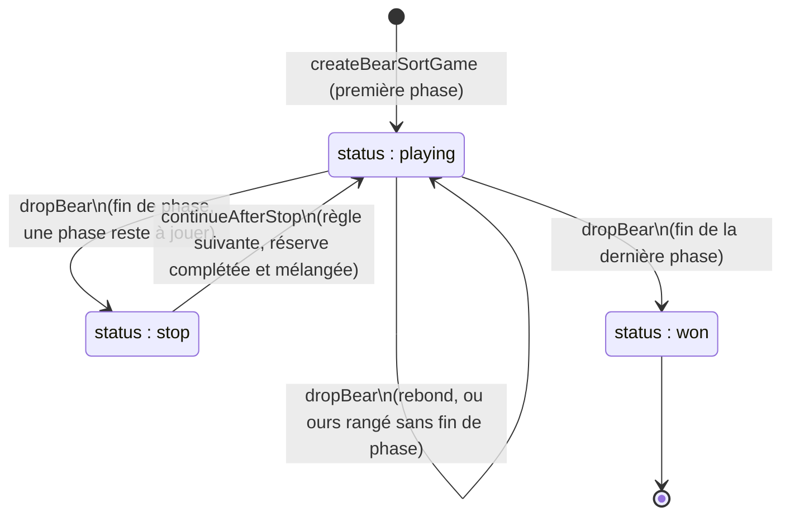

# FEAT-23 : Jeu n°3 (Attrape-Piège) — Moteur Logique Pur

> **Document parent** : [SPECIFICATION.md](./SPECIFICATION.md)
> **ID Feature** : `FEAT-23`
> **Dépendances** : [FEAT-07](./FEAT-07.md), [FEAT-09](./FEAT-09.md)
> **Statut** : cadrée et implémentée ; les décisions prises pendant la session de cadrage sont consignées au [§6](#6-décisions-dimplémentation-session-de-cadrage).

---

## 1. Contexte & Objectif pour l'IA

Le troisième jeu de **Mia** est **Attrape-Piège** (identifiant `bear-sort`). Il vise à stimuler la **flexibilité mentale** et le **contrôle inhibiteur** en adaptant à de jeunes enfants le test de classement de cartes du Wisconsin (*Wisconsin Card Sorting Test*). Sa forme préscolaire, le *Dimensional Change Card Sort* (DCCS), fait trier 6 cartes selon une règle, puis 6 selon l'autre. Le brief d'origine oppose le **Système 1** (l'habitude, rapide et intuitive) au **Système 3** (l'inhibition préfrontale) : le jeu installe une habitude, l'interrompt, puis demande de la retenir. **Mia exerce, elle ne soigne pas** : aucun effet clinique ou thérapeutique n'est revendiqué.

L'enfant range des ours, petits ou grands, bleus ou jaunes, dans deux boîtes qui portent chacune une couleur **et** une taille, fixes pour toute l'étoile : un grand ours bleu, face à une petite boîte bleue et une grande boîte jaune, tire dans les deux sens. Un panneau STOP interrompt la série pendant que des ours attendent encore, et la règle change. Personne ne peut perdre : un ours mal placé rebondit et attend de nouveau.

L'objectif de cette **FEAT-23** est de développer en TypeScript pur (sans React ni DOM, importable par le script `validate:levels`) dans `src/games/bear-sort/` :
1. **Le modèle d'une étoile (`types.ts`)** : deux boîtes fixes et une suite de phases, chacune avec sa règle (trier par couleur, trier par taille, « tous sauf… »), ses ours ajoutés et le nombre d'ours à ranger avant le STOP suivant.
2. **Le moteur (`engine.ts`)** : dépôt d'un ours, rebond et nature du rebond, panneau STOP, phase suivante, victoire, couronne, échelle d'indices, et validation d'une configuration.

L'interface est décrite par [FEAT-24](./FEAT-24.md), le catalogue par [FEAT-25](./FEAT-25.md), la voix par [FEAT-22](./FEAT-22.md).

---

## 2. Fichiers à Créer / Modifier

```text
src/
├── types/
│   └── mia.ts                         # GameId : ajout de 'bear-sort'
├── core/
│   └── storage/
│       └── migrations.ts              # KNOWN_GAMES : la progression de 'bear-sort' est conservée au chargement
└── games/
    └── bear-sort/
        ├── types.ts                   # Traits, règles, phases, configuration, état, rebonds, échelon d'indice
        ├── engine.ts                  # Fonctions pures de la partie, getBearSortConfigErrors()
        └── index.ts                   # Barrel du moteur, du catalogue et de la voix
tests/
└── bear-sort-engine.test.ts           # Tests unitaires du moteur
vitest.config.ts                       # Seuil de 90 % sur src/games/bear-sort/*.ts
commitlint.config.mjs                  # Scope bear-sort
```

---

## 3. Spécifications Techniques Détaillées

> Les décisions de la session de cadrage ([§6](#6-décisions-dimplémentation-session-de-cadrage)) donnent les motivations de ces spécifications et les alternatives écartées.

### 3.1. Types (`src/games/bear-sort/types.ts`)

```typescript
export type BearColor = 'blue' | 'yellow';
export type BearSize = 'small' | 'big';
export type SortFeature = 'color' | 'size';

/** Couleur et taille d'un ours, ou d'une boîte. */
export interface BearTraits {
  color: BearColor;
  size: BearSize;
}

/** Les quatre sortes d'ours (`couleur-taille`) ; une sorte absente n'en compte aucun. */
export type BearKind = `${BearColor}-${BearSize}`;
export type BearCounts = Partial<Record<BearKind, number>>;

/** Ours exclus par une règle « sauf » : une couleur, une taille, ou les deux à la fois. */
export type ForbiddenBears =
  | { color: BearColor; size?: undefined }
  | { color?: undefined; size: BearSize }
  | { color: BearColor; size: BearSize };

export type BearSortRule =
  | { kind: 'sort'; feature: SortFeature }
  | { kind: 'except'; forbidden: ForbiddenBears };

export interface BearSortPhaseConfig {
  rule: BearSortRule;
  /** Ours ajoutés à la réserve au début de la phase, aux côtés de ceux restés de la précédente */
  addBears: BearCounts;
  /** Ours à ranger avant le STOP suivant, moins que la réserve ; `null` pour la dernière phase */
  placements: number | null;
}

export interface BearSortLevelConfig {
  /** Boîtes des phases `sort`, de gauche à droite, fixes pour toute l'étoile */
  zones: readonly [BearTraits, BearTraits];
  /** Au moins une phase ; chaque changement de phase passe par le panneau STOP */
  phases: readonly BearSortPhaseConfig[];
  /** Montre le geste tant que le premier ours n'est pas rangé (première étoile) */
  showGestureHint: boolean;
}

export type BearSortZoneId = 'left' | 'right' | 'open';
export type BearBounceKind = 'old-rule' | 'slip' | 'forbidden';
export type BearSortStatus = 'playing' | 'stop' | 'won';
export type BearSortHintLevel = 0 | 1 | 2 | 3;

export interface BearSortState {
  config: BearSortLevelConfig;
  status: BearSortStatus;
  phaseIndex: number;
  rule: BearSortRule;
  /** Règle de la phase précédente, `null` dans la première phase */
  previousRule: BearSortRule | null;
  /** Ours à ranger avant le prochain STOP, `null` si la phase se joue jusqu'au bout */
  placementsLeft: number | null;
  /** Ours qui attendent, dans l'ordre de présentation à la télécommande */
  reserve: readonly Bear[];
  /** Boîtes de la phase en cours, de gauche à droite (`open` seule pour une règle « sauf ») */
  zones: readonly BearSortZone[];
  /** Dépôts dans une boîte, rebonds compris : un dépôt hors boîte n'est pas compté */
  moves: number;
  /** Rebonds de toute la partie */
  mistakes: number;
  /** Rebonds d'affilée depuis le dernier dépôt réussi : ils font monter l'échelle d'indices */
  errorStreak: number;
  /** Dernier rebond, `null` dès qu'un ours est rangé */
  lastBounce: BearBounce | null;
}
```

* `Bear` ajoute aux traits un `uid` stable dans la partie (`phase-rang`, par exemple `1-3`) : clé React et cible d'un dépôt. `BearSortZone` porte `id`, `traits` (`null` pour la boîte ouverte) et `bears` (rangés pendant la phase, dans l'ordre). `BearBounce` porte `bearUid`, `zoneId` et `kind`.
* **Ours en conflit** (`isConflictBear(zones, bear)`) : sa couleur et sa taille l'envoient dans deux boîtes différentes. Avec une petite boîte bleue et une grande boîte jaune, ce sont le grand ours bleu et le petit ours jaune ; un ours sans conflit va dans la même boîte quelle que soit la règle. Seuls les ours en conflit exigent d'inhiber l'ancienne règle : c'est leur part qui règle la difficulté.
* **Règle « sauf »** (`isBearForbidden(rule, bear)`) : un ours est interdit s'il porte **toutes** les caractéristiques de `forbidden`. Avec « sauf un petit ours bleu », le grand ours bleu et le petit ours jaune restent permis (les faux amis du dernier palier). Toujours faux pour une règle `sort`.

### 3.2. Déroulement (`src/games/bear-sort/engine.ts`)



Toutes les fonctions sont pures : une action renvoie un nouvel état sans modifier celui reçu, et une action ignorée renvoie **l'état reçu lui-même** (React n'a rien à redessiner). Le hasard passe par `rng` (`Math.random` par défaut, type `Rng` et `shuffle` de `@/games/memory/random`).

1. **`createBearSortGame(config, rng = Math.random): BearSortState`** : `status: 'playing'`, première phase, `previousRule: null`, `placementsLeft` de la phase, réserve mélangée, boîtes de la phase, compteurs à 0. Lève `Error('Configuration Attrape-Piège invalide : …')` listant les anomalies de `getBearSortConfigErrors`.
2. **`dropBear(state, bearUid, zoneId): BearSortState`** : ignorée hors `playing`, et pour un ours absent de la réserve ou une boîte absente de la phase (`left` pendant une règle « sauf », par exemple).
   * **Mauvaise boîte** (`getTargetZoneId(state, bear) !== zoneId`) : `moves` + 1, `mistakes` + 1, `errorStreak` + 1, `lastBounce` renseigné ; l'ours **reste dans la réserve**.
   * **Bonne boîte** : l'ours quitte la réserve et rejoint la boîte, `placementsLeft` − 1 (`null` reste `null`), `moves` + 1, `errorStreak` et `lastBounce` remis à zéro. Si la phase est finie, `status` passe à `won` à la dernière phase, à `stop` sinon.
   * **Fin de phase** : règle `sort` : `placementsLeft === 0` ou réserve vide ; règle `except` : il ne reste **que des ours interdits** (ou plus aucun ours).
3. **`continueAfterStop(state, rng = Math.random): BearSortState`** : ignorée hors `stop`. Phase suivante : `previousRule` reçoit la règle qui s'achève, `placementsLeft` et les boîtes sont ceux de la nouvelle phase (les ours rangés sortent des boîtes), les nouveaux ours rejoignent ceux qui attendaient dans un **nouvel ordre mélangé**, `errorStreak` et `lastBounce` repartent de zéro. `moves` et `mistakes` se cumulent sur toute la partie.
4. **`getUpcomingRule(state): BearSortRule | null`** : règle de la phase suivante, montrée en image pendant le panneau STOP ; `null` à la dernière phase.
5. **`getTargetZoneId(state, bear): BearSortZoneId | null`** : boîte voulue par la règle en vigueur (`left` / `right` selon la caractéristique triée, `open` pour un ours permis), `null` pour un ours interdit.
6. **`getNextBearUid(state, bearUid): string | null`** : ours suivant de la réserve, en boucle (« laisser cet ours » à la télécommande) ; `null` si la réserve est vide.
7. **`isPerfectWin(state): boolean`** : `status === 'won' && mistakes === 0` (couronne).

### 3.3. Nature d'un rebond

| `BearBounceKind` | Quand | Effet à l'écran ([FEAT-24](./FEAT-24.md)) |
| :--- | :--- | :--- |
| `old-rule` | La boîte visée est celle que voulait la règle **précédente** (règle `sort` après une règle `sort`). | Au premier rebond d'affilée : la règle, précédée de « Oh, ton cerveau a voulu te piéger. » |
| `slip` | Tout autre dépôt erroné d'une règle `sort` : première phase, ou ours sans conflit que les deux règles envoient dans l'autre boîte. | Au premier rebond d'affilée : la règle seule. |
| `forbidden` | Ours interdit déposé dans la boîte ouverte d'une règle `except`. | Au premier rebond d'affilée : la règle seule. |

Après un changement, avec deux boîtes, presque toute erreur est une erreur d'ancienne règle : seul un ours sans conflit, placé dans la boîte qu'aucune des deux règles ne veut, donne un `slip`.

### 3.4. Échelle d'indices

* **`getHintLevel(state): BearSortHintLevel`** : `errorStreak` plafonné à 3 ; un ours rangé la ramène à 0. Le moteur ne fait que compter : le rendu de chaque échelon (image de la règle qui pulse, ancien critère estompé, bonne boîte éclairée) appartient à [FEAT-24](./FEAT-24.md).
* **`getFadedFeature(state): SortFeature | null`** : à partir du 2ᵉ rebond d'affilée d'une règle `sort`, la caractéristique que la règle ignore (`color` quand on trie par taille, `size` quand on trie par couleur) ; `null` sinon, donc pendant une règle `except`, où l'interface pose à la place un badge « non » sur les ours interdits.

### 3.5. Validation d'une configuration (`getBearSortConfigErrors`)

`getBearSortConfigErrors(config): string[]` renvoie un message français par anomalie (liste vide : valide), préfixé de la phase concernée. Les messages sont destinés au développeur (`validate:levels`, [FEAT-25](./FEAT-25.md)) et aux tests :

* **Boîtes** : couleurs différentes **et** tailles différentes.
* **Phases** : au moins une ; pour chaque sorte d'ours, un nombre entier ≥ 0.
* **Règle `sort`** : les ours ajoutés remplissent les deux boîtes selon la caractéristique triée. Après une règle `sort`, la caractéristique change (« même règle que la phase précédente ») et au moins un ours ajouté est en conflit (« aucun ours en conflit après le changement de règle »).
* **Règle `except`** : uniquement en dernière phase (« une règle « sauf » termine toujours l'étoile ») ; au moins un ours interdit et un ours permis parmi les ours ajoutés.
* **`placements`** : `null` à la dernière phase ; sinon un entier ≥ 1 **strictement inférieur à la réserve au début de la phase** (ours ajoutés + ours restés de la précédente), pour que le STOP interrompe des ours qui attendent.

---

## 4. Points d'attention

* **La victoire ne vide pas toujours la réserve** : une étoile qui finit par une règle `except` est gagnée avec les ours interdits encore dans la réserve. Tester `status === 'won'`, jamais `reserve.length === 0`.
* **`moves − ours` n'est exact que sans négation** : un dépôt, rebond compris, vaut un coup, donc `bestMoves` (déjà sauvegardé, [FEAT-07](./FEAT-07.md)) donne le meilleur nombre d'erreurs. C'est exact pour les étoiles `bs-001` à `bs-012`, où tous les ours se rangent. Dans une étoile qui finit par une règle `except`, seuls les ours permis se rangent, et les ours restés du STOP précédent peuvent être permis ou non : une partie sans rebond compte de 10 à 12 coups pour `bs-013` (6 ours avant le STOP, 4 ours ajoutés permis, 0 à 2 ours restés permis) et de 19 à 21 pour `bs-020`. Sur ces étoiles, `bestMoves` reste un indicateur, pas un compte d'erreurs exact ; la couronne, elle, repose sur `mistakes` et n'est pas concernée.
* **Les ours restés dépendent de l'enfant** : au doigt, il choisit quel ours ranger avant le STOP. Le validateur ne vérifie donc le conflit que sur les ours **ajoutés** par une phase, seuls connus d'avance.
* **Pas de texte dans le moteur** : les messages de `getBearSortConfigErrors` citent les valeurs brutes (`tri par color`), ils ne sont jamais montrés à un joueur ; les libellés pour lecteur d'écran vivent dans `labels.ts` ([FEAT-24](./FEAT-24.md)).
* **Dépendance à Memory limitée à `random.ts`** : `engine.ts` importe `shuffle` et `Rng` de `@/games/memory/random`, module pur sans React. Le barrel `@/games/bear-sort` ré-exporte aussi les composants de [FEAT-24](./FEAT-24.md) : le registre et `validate:levels` importent les modules du jeu directement.
* **Les boîtes repartent vides à chaque phase** : `BearSortZone.bears` ne vaut que pour la phase en cours. Compter les ours de la partie par `moves` et `mistakes`, pas par les boîtes.

---

## 5. Critères d'Acceptation (Definition of Done)

- [x] `tests/bear-sort-engine.test.ts` couvre le dépôt, chaque nature de rebond, le STOP, les ours restés, la fin de phase d'une règle « sauf », la couronne, l'échelle d'indices et chaque règle de validation ; seuil de couverture de 90 % sur `src/games/bear-sort/*.ts`.
- [x] Le moteur reste en TypeScript pur, sans React ni DOM, et aucune action ne modifie l'état reçu.
- [x] Une étoile ne se perd jamais : aucun état `lost`, un rebond laisse l'ours dans la réserve.
- [x] La sauvegarde conserve la progression de `bear-sort` (`GameId`, `KNOWN_GAMES`), sans montée de version du schéma ni nouveau champ.
- [x] `npm run validate:all` (`format:check`, `lint`, `typecheck`, `validate:levels`, `test:coverage`, `build`) passe sans aucune erreur.
- [x] Si un commit est créé, il respecte le format **Conventional Commits** (`feat(bear-sort): implement pure sorting game engine`).

---

## 6. Décisions d'implémentation (session de cadrage)

Décisions prises avec le propriétaire au fil de trois séries de questions, avec leurs motivations et les alternatives écartées. Les arbitrages de Claude pendant l'implémentation sont signalés comme tels, pour relecture par le propriétaire ; les lignes purement techniques sont des choix d'implémentation.

| Sujet | Décision |
| :--- | :--- |
| **Boîtes** | **Deux caractéristiques par boîte, fixes pour toute l'étoile** (par exemple petite bleue + grande jaune : un grand ours bleu tire dans les deux sens). C'est le vrai conflit du DCCS : l'ancienne règle reste toujours une réponse possible. Écartés : des boîtes qui **changent d'apparence** au changement de règle (la couleur ne serait plus une réponse disponible : plus rien à inhiber, plus d'erreur d'ancienne règle à relever) ; des boîtes à **une seule caractéristique** au premier palier (entraîne une tâche plus simple que celle que les changements perturbent ensuite). |
| **Une étoile, une séance** | **Chaque étoile est une séance complète** : série d'activation, STOP, série sous la nouvelle règle. Les trois « niveaux » du brief d'origine deviennent des phases ; les paliers règlent la longueur des séries, la part d'ours en conflit, le nombre de changements, puis la négation. Écartés : **un niveau par étoile** (le changement tomberait entre deux étoiles, parfois à plusieurs jours d'écart, sans plus aucune habitude à briser) ; **trois étoiles en séquence imposée** (3 étoiles contre 20 ailleurs, et quitter en cours de séquence perd l'habitude). Exception unique : l'Étoile #1, sans changement ([FEAT-25](./FEAT-25.md)). |
| **Le STOP interrompt** *(arbitrage de Claude, à relire)* | **Le STOP coupe une série pendant que des ours attendent encore**, au lieu d'arriver comme une pause naturelle sur une réserve vide : il arrête un plan moteur en cours, comme le veut le brief d'origine. Les ours restés sont rangés sous la nouvelle règle. Conséquence dans la configuration : `placements` strictement inférieur à la réserve, vérifié par le validateur. |
| **Négation** | **Une seule boîte ouverte, et la manche se termine d'elle-même** dès qu'il ne reste que des ours interdits. Un ours interdit rebondit ; un ours permis laissé de côté garde la manche ouverte jusqu'à ce que la mascotte relance. Écartés : un **bouton « terminé »** (une commande abstraite de plus pour un enfant de 3 ans, et un appui trop tôt demanderait sa propre erreur) ; une **boîte « oui » + un panier « non »** (l'ours interdit serait activement trié : se retenir redeviendrait un tri de plus). |
| **Victoire et couronne** | **Une étoile en finissant, une couronne pour une étoile sans aucun rebond, aucune nouvelle donnée enregistrée.** Personne ne peut perdre, et une couronne manquée n'est jamais évoquée devant l'enfant. Le plateau transmet `moves` à `recordVictory` : `bestMoves`, déjà enregistré, donne le meilleur nombre d'erreurs (coups − ours ; limite sur les étoiles à négation au [§4](#4-points-dattention)). Écartés : une couronne pour « aucune erreur d'ancienne règle » (peu de gain : après un changement à deux boîtes, presque toute erreur en est une) ; enregistrer les erreurs d'ancienne règle et le temps de changement avec une vue parent (une feature à part entière, bonne suite possible). |
| **Nature des rebonds** | `old-rule`, `slip`, `forbidden` ([§3.3](#33-nature-dun-rebond)). La distinction ne sert qu'à l'instant du rebond, pour la phrase de la mascotte ; elle n'est ni cumulée ni sauvegardée. |
| **Échelle d'indices** | Le moteur compte les rebonds d'affilée (`errorStreak`, `getHintLevel`) et désigne le critère à estomper (`getFadedFeature`) ; motivations, rendu et alternatives écartées dans [FEAT-24 §6](./FEAT-24.md#6-décisions-dimplémentation-session-de-cadrage). |
| **Validation** | `getBearSortConfigErrors` plutôt qu'une fonction booléenne : un message par anomalie, repris tel quel par `validateBearSortCatalog` ([FEAT-25](./FEAT-25.md)), comme `getMemoryConfigErrors` ([FEAT-09](./FEAT-09.md)). La réserve est suivie d'une phase à l'autre : `placements` est comparé à ce qui attend réellement. |
| **Hasard** | Réserve mélangée à la création et à chaque STOP, par le `rng` injecté (partie reproductible en test). `uid` attribué avant le mélange : `phase-rang`, unique dans toute la partie. |
| **Couverture** | Seuil de 90 % sur `src/games/bear-sort/*.ts` dans `vitest.config.ts` (moteur, catalogue, voix, libellés ; pas les composants de [FEAT-24](./FEAT-24.md)), comme Memory et Traffic Jam. |
| **Tests** | `tests/bear-sort-engine.test.ts` (environnement `node`) : sortes d'ours, conflit, ours interdits et faux amis, chaque règle de `getBearSortConfigErrors` (réserve suivie d'une phase à l'autre, ordre des messages), création (réserve, ordre des boîtes, `rng` injecté et générateur défaillant, configuration invalide), `getTargetZoneId`, `dropBear` (dépôt, rebond, série de rebonds, cas ignorés, état reçu jamais modifié), nature des rebonds, enchaînement des phases (STOP, règle annoncée, ours restés, nouveau mélange, compteurs conservés), règle « sauf » (fin automatique, faux amis, jamais de STOP après), échelle d'indices, `getNextBearUid`, couronne, parties complètes à graine (aucun ours perdu). `tests/quality-setup.test.ts` fige le seuil de 90 % et le scope `bear-sort` ; `tests/progression-engine.test.ts`, le registre. |
| **Périmètre** | TypeScript pur, sans React ni DOM ; barrel `index.ts`. Aucune montée de version du schéma de sauvegarde : `GameId` et `KNOWN_GAMES` gagnent `bear-sort`, une sauvegarde plus ancienne se charge sans changement. |
| **Git** | Commit prévu à l'intégration : `feat(bear-sort): implement pure sorting game engine`. |
