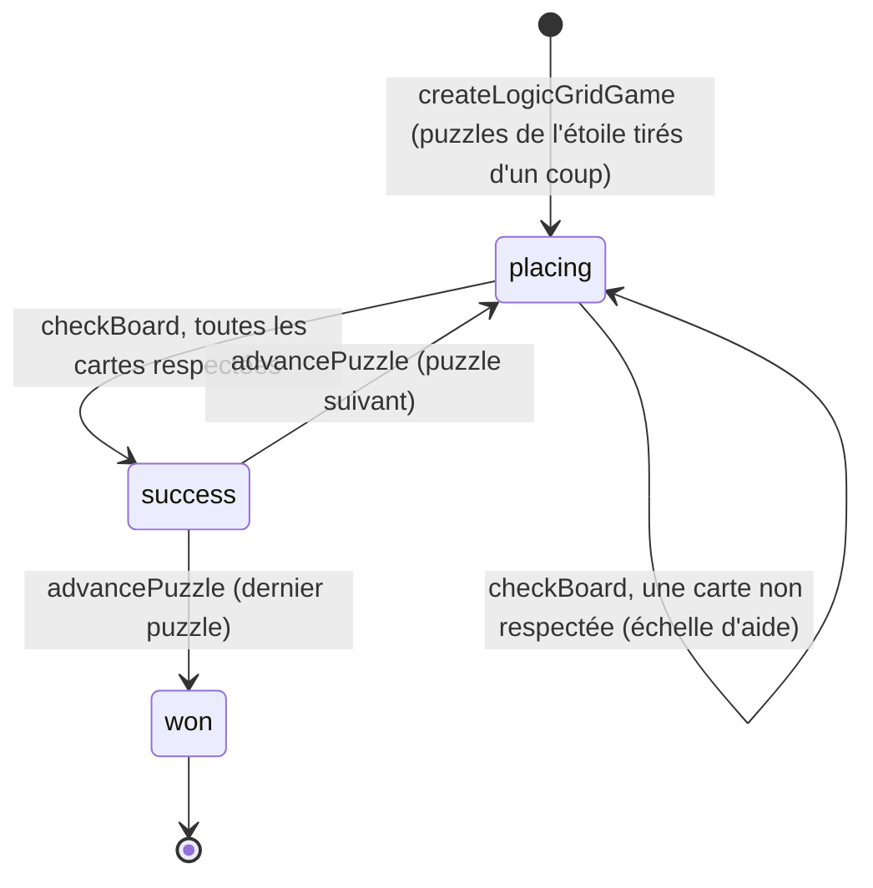

# FEAT-27 : Jeu n°5 (Chacun sa Place) — Logique sur Grille 3 × 3, Cartes sans Texte, Solveur « Enfant » & Catalogue des 20 Étoiles

> **Document parent** : [SPECIFICATION.md](./SPECIFICATION.md)
> **ID Feature** : `FEAT-27`
> **Dépendances** : [FEAT-03](./FEAT-03.md), [FEAT-04](./FEAT-04.md), [FEAT-07](./FEAT-07.md), [FEAT-08](./FEAT-08.md), [FEAT-21](./FEAT-21.md), [FEAT-24](./FEAT-24.md)
> **Statut** : cadrée et implémentée ; les décisions de la session de cadrage, et celles prises par défaut pendant l'implémentation, sont consignées au [§6](#6-décisions-dimplémentation-session-de-cadrage).

---

## 1. Contexte & Objectif pour l'IA

**Chacun sa Place** (identifiant `logic-grid`) est le cinquième jeu de **Mia**, pour les **enfants de 5 à 8 ans**, sans aucun texte à lire. L'enfant place des pièces sur une grille de morpion (3 × 3) : trois formes (rond, carré, triangle) en trois couleurs (rouge, jaune, bleu), neuf pièces toutes différentes. Des **cartes d'indices** en images disent où va une pièce (« le rond jaune est au centre »), où elle ne va pas (une croix), quelles pièces se touchent, ou où va toute une famille (« tous les carrés sont dans la colonne du milieu »). L'enfant croise ces cartes et élimine les impossibilités jusqu'à trouver la seule disposition qui les respecte toutes, puis sonne la **cloche** qui vérifie tout d'un coup.

Le brief d'origine vise l'**intelligence fluide** (l'« Indice de Raisonnement Fluide » des tests psychométriques) par la déduction et l'élimination systématique. Comme pour Suites Logiques et Attrape-Piège, **Mia exerce, elle ne soigne pas** : ces mécanismes servent le jeu, aucun effet clinique ou thérapeutique n'est revendiqué, et rien n'est mesuré au-delà de la progression habituelle.

Le jeu repose sur un **moteur pur** (pièces, cartes, déroulé d'une étoile), un **solveur « enfant »** qui raisonne avec des règles qu'un enfant applique (une carte seule, deux cartes croisées, la seule pièce qui peut aller dans une case) et un **générateur** qui tire un nouveau puzzle à chaque partie : une réponse ne se mémorise pas, et chaque puzzle a exactement une solution.

---

## 2. Fichiers à Créer / Modifier

```text
src/
├── types/mia.ts                          # GameId : 'logic-grid'
├── app/logic-grid/page.tsx               # Nouveau : route /logic-grid
├── components/progression/game-icons.ts  # Icône du jeu (Grid3x3, pastille rose)
├── core/progression/game-registry.ts     # Entrée du registre : titre, faculté, route, catalogue
└── games/logic-grid/
    ├── types.ts                          # Pièces, cartes, configuration, puzzle, état
    ├── grid.ts                           # Pièces et géométrie 3 × 3 (masques de 9 bits)
    ├── clues.ts                          # Cartes : pièces nommées, vérification, cartes vraies d'une solution
    ├── solver.ts                         # Solveur « enfant » et recherche exhaustive
    ├── generator.ts                      # Générateur de puzzles (graine pour la validation)
    ├── engine.ts                         # Déroulé d'une étoile, échelle d'aide, configuration
    ├── labels.ts                         # Phrases des lecteurs d'écran (rien n'est affiché)
    ├── catalog.ts                        # 20 étoiles et validateur
    ├── index.ts                          # Barrel
    ├── LogicGridGameScreen.tsx           # GameScreen + plateau
    └── components/
        ├── art.ts                        # Couleurs et tracés des pièces
        ├── PieceShapeIcon.tsx            # Pièce dessinée (forme et couleur)
        ├── ClueCard.tsx                  # Carte d'indice en image
        ├── LogicGridBoard.tsx            # Plateau : cartes, grille, réserve, cloche
        ├── LogicGridEndScreen.tsx        # Fin d'étoile, en icônes
        └── index.ts
scripts/validate-levels.ts                # Catalogue branché, résumé de chaque étoile
vitest.config.ts                          # 90 % de couverture sur src/games/logic-grid/*.ts
commitlint.config.mjs                     # Scope logic-grid
tests/logic-grid-engine.test.ts           # Grille, cartes, solveur, générateur, déroulé, textes
tests/logic-grid-catalog.test.ts          # Catalogue figé, puzzles tirés, validateur, sauvegarde
tests/logic-grid-board.test.tsx           # Plateau : zéro texte, gestes, cloche, aide, télécommande
tests/progression-engine.test.ts          # Registre : cinquième jeu
tests/quality-setup.test.ts               # Scope et seuil de couverture
```

Le plateau réutilise tels quels, plutôt que de les dupliquer, des modules d'Attrape-Piège (`useBearDrag`, `findDropZone`, `useTransient`, `GestureHand`, `StarAward`) et de Suites Logiques (`PatternProgressDots`), ainsi que le hasard de Memory (`@/games/memory/random`).

---

## 3. Spécifications

> Les décisions de la session de cadrage ([§6](#6-décisions-dimplémentation-session-de-cadrage)) donnent les motivations de ces spécifications et les alternatives écartées.

### 3.1. Boucle de jeu

Une **étoile** est une série de puzzles, dont le nombre dépend du plateau (`getSeriesLength`) : **3 puzzles** quand 3 pièces sont à placer, **2** à 4 pièces, **1** au-delà. Sur un petit plateau, un essai au hasard réussit la première vérification une fois sur 6 (3 pièces) : la couronne exige alors trois réussites du premier coup, une chance sur 216. **On ne peut pas perdre** : l'étoile est gagnée à la fin de la série. La **couronne** récompense une série sans aucune vérification ratée.

Chaque puzzle part d'un plateau où certaines pièces sont **déjà posées et verrouillées** (punaise) ; les autres attendent dans la **réserve**. L'enfant les pose, les déplace, les échange librement : rien n'est jugé avant la cloche, qui ne sonne qu'une fois **toutes les pièces posées**.



**Échelle d'aide** (vérifications ratées du puzzle en cours) :

1. **La première carte non respectée**, dans l'ordre d'affichage, pulse (anneau ambré), puis reste entourée jusqu'à la vérification suivante. Rien n'est barré sur la grille, aucune pièce ne bouge.
2. À la 2e, ses pièces posées par l'enfant **remuent** aussi.
3. À partir de la 3e (`HELP_LOCK_CHECK`), **une pièce mal placée de cette carte rejoint sa case et s'y fige** (elle luit) ; la pièce qui occupait la case prend sa place. Une carte contredite a toujours une pièce mal placée ; l'aide choisit celle que le raisonnement d'un enfant trouve en premier. Chaque nouvelle vérification ratée en fige une de plus : **chaque puzzle finit**.

### 3.2. Les cartes (`types.ts`, `clues.ts`, `ClueCard.tsx`)

Des **images littérales**, sans flèche ni mot : une carte montre un morceau de grille tel qu'il sera.

| Sorte (`ClueKind`) | Ce qu'elle dit | Dessin | Barrée (« pas ») |
| :--- | :--- | :--- | :--- |
| `cell` | La pièce est sur cette case | La pièce, puis une mini-grille 3 × 3, sa case éclairée | Une croix sur la case |
| `line` | La pièce est dans cette ligne ou colonne, ou dans deux voisines (« quelque part au-dessus de la ligne du bas ») | Mini-grille, la zone éclairée | Une croix sur chaque case d'une **seule** ligne ou colonne (deux barrées n'en laissent qu'une : la carte positive suffit) |
| `pair` | Les deux pièces sont collées : la seconde juste à droite de la première, ou juste dessous | Deux cases côte à côte, ou l'une sous l'autre | Jamais (trop faible pour être utile) |
| `next` | La seconde touche la première **par un côté** (jamais par un coin) | Comme une carte de place : la seconde à gauche ; à droite, la première au centre de ses quatre côtés éclairés (sans les coins) | Les quatre côtés vides, chacun barré d'une croix |
| Famille (`allowsGroups`) | **Toutes** les pièces d'une forme ou d'une couleur sont dans la zone ; barrée, **aucune** n'y est | Les trois pièces de la famille dans un cadre pointillé, puis la mini-grille | Comme `line` |

* Une carte de famille ne porte que sur une ligne ou une colonne (jamais une case ni deux pièces collées). Une carte « se touchent » met une pièce verrouillée au centre quand elle en nomme une : l'enfant part de ce qu'il voit.
* Toute carte tirée est **vraie** pour la solution et nomme au moins une pièce à placer.
* Les **cartes sont rangées dans l'ordre où un enfant s'en sert** (premier pas du raisonnement d'abord) : un échafaudage, et la première carte non respectée désigne la première étape fausse.
* Chaque carte a une phrase pour les lecteurs d'écran (`getClueLabel`, « Le carré bleu est juste à droite du rond rouge. ») : l'image ne dit rien à TalkBack.

### 3.3. Catalogue (`src/games/logic-grid/catalog.ts`)

En **dents de scie** : chaque palier apporte une sorte de carte sur un petit plateau, puis le plateau grandit sur ses quatre étoiles. Les trois niveaux du brief s'étalent sur les cinq paliers : déduction directe (Très Facile), relations et croisements (Facile), contraintes négatives (Moyen), puis les familles (Difficile) et tout à la fois (Très Difficile).

| Étoile | ID | Palier | Pièces à placer | Puzzles | Cartes | Barrées | Familles | Raisonnement | Exige | Guide |
| :---: | :--- | :--- | :---: | :---: | :--- | :---: | :---: | :--- | :--- | :---: |
| 1 | `lg-001` | Très Facile | 3 | 3 | case | — | — | direct | — | ✔ |
| 2 | `lg-002` | Très Facile | 3 | 3 | case, se touchent | — | — | direct | se touchent | — |
| 3 | `lg-003` | Très Facile | 4 | 2 | case, se touchent | — | — | direct | se touchent | — |
| 4 | `lg-004` | Très Facile | 5 | 1 | case, se touchent | — | — | direct | se touchent | — |
| 5 | `lg-005` | Facile | 3 | 3 | ligne | — | — | croiser | ligne, croiser | ✔ |
| 6 | `lg-006` | Facile | 3 | 3 | ligne, collées | — | — | croiser | collées, croiser | — |
| 7 | `lg-007` | Facile | 4 | 2 | ligne, collées, se touchent | — | — | croiser | croiser | — |
| 8 | `lg-008` | Facile | 5 | 1 | toutes | — | — | croiser | croiser | — |
| 9 | `lg-009` | Moyen | 3 | 3 | case, ligne | ✔ | — | croiser | barrée | ✔ |
| 10 | `lg-010` | Moyen | 4 | 2 | case, ligne, se touchent | ✔ | — | croiser | barrée | — |
| 11 | `lg-011` | Moyen | 5 | 1 | ligne, collées, se touchent | ✔ | — | croiser | barrée, croiser | — |
| 12 | `lg-012` | Moyen | 6 | 1 | toutes | ✔ | — | éliminer | barrée, croiser | — |
| 13 | `lg-013` | Difficile | 4 | 2 | ligne | — | ✔ | croiser | famille | ✔ |
| 14 | `lg-014` | Difficile | 5 | 1 | ligne, collées | — | ✔ | croiser | famille | — |
| 15 | `lg-015` | Difficile | 6 | 1 | ligne, collées, se touchent | ✔ | ✔ | éliminer | famille, barrée | — |
| 16 | `lg-016` | Difficile | 7 | 1 | toutes | ✔ | ✔ | éliminer | famille | — |
| 17 | `lg-017` | Très Difficile | 6 | 1 | toutes | ✔ | ✔ | éliminer | éliminer | — |
| 18 | `lg-018` | Très Difficile | 7 | 1 | toutes | ✔ | ✔ | éliminer | barrée, croiser | — |
| 19 | `lg-019` | Très Difficile | 7 | 1 | toutes | ✔ | ✔ | éliminer | famille, éliminer | — |
| 20 | `lg-020` | Très Difficile | 8 | 1 | toutes | ✔ | ✔ | éliminer | famille, barrée, croiser | — |

Champs de `LogicGridLevelConfig` : `freePieces` (3 à 8), `clueKinds`, `allowsNegation`, `allowsGroups`, `reasoning` (`direct`, `combine`, `exclude`), `focus` (exigences : `next`, `line`, `pair`, `not`, `group`, `combine`, `exclude`) et `hasGuide`. Règles de `getLogicGridConfigErrors` : `freePieces` entier de 3 à 8 ; `clueKinds` non vide, sortes connues et sans doublon ; une famille suppose `line` ; chaque exigence suppose ce qu'elle demande (la sorte de carte, `allowsNegation`, `allowsGroups`, un raisonnement assez fort), sans doublon.

`validateLogicGridCatalog` reprend les règles communes, puis tire **une partie par graine** de `VALIDATION_SEEDS` (1 à 4, générateur `createSeededRng` : la validation est reproductible) et vérifie chaque puzzle : au plus `MAX_CLUES` cartes, et **exactement une solution**, recomptée par recherche exhaustive (`countSolutions`).

### 3.4. Moteur pur, solveur et générateur

* **Moteur** (`engine.ts`) : fonctions pures ; une action ignorée renvoie l'état reçu lui-même. `createLogicGridGame(config, rng = Math.random)` tire tous les puzzles de l'étoile ; `movePiece` (de la réserve ou d'une case, échange avec la pièce déjà là ; jamais sur une case figée, jamais une pièce figée) ; `returnPiece` ; `checkBoard` (plateau plein seulement) ; `advancePuzzle` ; `getHelpStage` (0 à 3) ; `isPerfectWin` ; `getGuideStep` (premier pas du premier puzzle d'une étoile guidée, tant que rien n'est posé).
* **Solveur « enfant »** (`solveLikeAChild`) : cases possibles de chaque pièce en masques de 9 bits, trois règles de plus en plus exigeantes, la plus simple toujours préférée :
  * `direct` : une carte seule ne laisse qu'une case à une pièce (une carte « collées » ou « se touchent » se lit dès que l'autre pièce est posée) ; la dernière pièce va dans la dernière case ;
  * `combine` : les cartes d'une même pièce, croisées, ne lui laissent qu'une case ;
  * `exclude` : une case ne peut plus recevoir qu'une seule des pièces restantes.
  Chaque règle est une vraie déduction : un puzzle que le solveur finit n'a qu'une solution. Les règles ne font que gagner des pièces à mesure que le plateau se remplit, le résultat ne dépend donc pas de l'ordre des pas.
* **Générateur** (`generatePuzzle`) : un essai tire la solution, les cases libres et toutes les cartes vraies permises ; il ajoute d'abord une carte de chaque sorte exigée, puis, tour après tour, la carte d'un tirage (48 au hasard, plus 16 des sortes exigées) qui fait le plus avancer le raisonnement. Quand l'étoile exige un raisonnement, une carte qui laisse les règles plus simples avancer seules coûte des points : le puzzle bute ainsi sur le raisonnement voulu. L'essai retire ensuite toute carte dont le puzzle peut se passer (celles des sortes exigées en dernier), et n'est gardé que s'il tient en **6 cartes** et remplit toutes les exigences ; pour une étoile guidée, le premier pas doit lire une carte de la sorte nouvelle. Au-delà de `MAX_ATTEMPTS` (400) essais sans puzzle, il lève une `Error`.

### 3.5. Interface (`src/games/logic-grid/components/`)

* **Aucun texte visible** sur toute la boucle de jeu, écran de fin compris (`AppShell isTextless`, `ModalDialog isTextless`, boutons en icônes). Les noms accessibles restent : titre, cartes (`role="img"` et leur phrase), cases (« Case en haut à gauche, rond rouge, déjà en place »), pièces de la réserve, cloche (« Vérifier »), région `role="status"`.
* **Zonage** : portrait, les cartes en haut (deux rangées de trois au plus), la grille au centre, la réserve et la cloche en bas ; paysage et téléviseur, les cartes en colonne à gauche, la grille au centre, la réserve et la cloche à droite. **Au plus 6 cartes, toutes visibles à la fois**, de 360 × 640 à 960 × 540 sans défilement.
* **Pièces** : rouge sombre, bleu moyen, jaune clair, contour sombre ; trois luminosités distinctes (L* ≈ 48, 67, 84). Une pièce verrouillée porte une punaise et n'est pas un bouton ; une pièce de l'enfant a une ombre et se soulève.
* **Réserve** : une case par pièce à placer, toujours la même (un contour pointillé quand la pièce est sur la grille) : rien ne bouge sous le doigt pendant un puzzle.
* **Gestes** : glisser-déposer permissif (`useBearDrag` : tolérance de 40 px autour d'une case, lâché sur la réserve la pièce y retourne, ailleurs elle revient sans rien compter) ; ou toucher une pièce, puis une case. Une pièce posée sur une case occupée échange sa place avec celle qui s'y trouve ; une pièce de la grille choisie puis une pièce de la réserve : celle-ci prend sa case. Une case vide touchée sans pièce choisie fait remuer la réserve.
* **Cloche** : éteinte tant qu'une pièce attend (elle fait alors remuer la réserve, sans rien compter), dorée et qui se balance quand la grille est pleine. Elle sonne (`playBeats(['bell'])`) à chaque vérification.
* **Réussite** : les pièces sautent en vague, jingle `round` ; puis le puzzle suivant ou l'étoile (jingle `star`). **Erreur** : seule la carte désignée change ; ni rouge, ni croix, ni son d'échec.
* **Guide** (`hasGuide`, premier puzzle) : la carte du premier pas luit en bleu ciel ; au doigt, une main fantôme glisse la pièce de ce pas vers sa case, en boucle, jusqu'à la première pièce posée ; à la télécommande, la pièce et la case portent un anneau bleu ciel.
* **Écran de fin** : grande étoile souriante (celle d'Attrape-Piège), couronne si elle est gagnée ou déjà acquise, trois boutons en icônes (étoile suivante, rejouer, carte), sans effet pendant `END_SCREEN_GUARD_MS`.
* **Transitions** : `transform` et `opacity`, `MotionConfig reducedMotion="user"` ; la main reste sur sa pièce si le système réduit les animations, et un liseré remplace le gigotement.

### 3.6. Minutages (`LogicGridBoard.tsx`)

| Constante | Valeur | Rôle |
| :--- | :---: | :--- |
| `SUCCESS_MS` (exportée) | 1 400 ms | Célébration d'un puzzle réussi, avant le suivant |
| `JINGLE_DELAY_MS` | 450 ms | Le jingle suit la cloche (jouer l'un coupe l'autre) |
| `END_SCREEN_DELAY_MS` | 700 ms | Dernier puzzle visible avant l'écran de fin |
| `UNMET_PULSE_MS` | 2 700 ms | Pulsation de la carte désignée, avant l'anneau fixe |
| `WIGGLE_MS` | 1 800 ms | Pièces qui remuent (échelon 2, réserve) |
| `HELPED_GLOW_MS` | 1 800 ms | Lueur de la pièce mise en place par l'aide |
| `END_SCREEN_GUARD_MS` | 800 ms | Boutons de fin sans effet (FEAT-04) |

### 3.7. D-Pad & clavier

Une zone d'en-tête (Retour) et une zone de plateau à **curseur spatial** : les flèches vont à la cible la plus proche dans leur direction (`findNearestTarget`) parmi les pièces de la réserve, les cases libres, les pièces de l'enfant et la cloche ; les pièces verrouillées sont sautées. Tout en haut, `Haut` rejoint Retour ; `Bas` en revient. `OK` agit comme un tap sur la cible : choisir une pièce, puis la poser sur la case du curseur, où elle se devine en transparence. Après une pièce posée depuis la réserve, le curseur passe à la pièce suivante, puis à la cloche une fois la réserve vide. Retour mène à la Carte des Étoiles.

### 3.8. Progression

`controls.recordVictory({ moves, timeSeconds, isPerfect })` une seule fois, dès la vérification réussie du dernier puzzle, dans le gestionnaire de la cloche : l'enfant qui quitte pendant la célébration garde son étoile. `moves` compte les pièces posées, déplacées ou rendues ; `timeSeconds` court depuis le montage du plateau ; `isPerfect` exige zéro vérification ratée sur toute la série. La progression vit sous `gamesProgress['logic-grid']` : **cet identifiant ne doit plus changer**.

---

## 4. Points d'attention

* **Neuf pièces libres ne tiennent pas en six cartes** dans un délai raisonnable : mesuré sur l'ordinateur de développement, un puzzle à 9 pièces demandait 0,7 s en moyenne (2 s au pire) et échouait parfois. `MAX_FREE_PIECES` vaut donc 8 : une pièce reste posée d'avance jusqu'à la dernière étoile. À 8 pièces (`lg-020`), une partie se crée en 44 ms en moyenne et 146 ms au pire sur cette machine.
* **La génération est synchrone** (initialiseur de `useState`, « Rejouer ») : un téléviseur modeste peut la sentir sur les dernières étoiles. À mesurer sur un vrai boîtier ; un tirage différé derrière un écran d'attente serait la suite logique.
* **Un geste suit l'état du dernier rendu** : les gestionnaires lisent `game` capturé au rendu, comme ailleurs dans Mia ; aucune minuterie n'écrit un état que l'enfant pourrait modifier entre-temps (la célébration ignore les gestes).
* **Les sons partent du gestionnaire de la cloche** : le contexte audio ne se débloque que pendant un geste. Le jingle suit la cloche après 450 ms, une seule sortie de lecture jouant à la fois.
* **Ordre des cartes stable** : ranger les cartes peut changer la carte retenue pour un pas (deux cartes qui placent la même pièce) ; le générateur recommence jusqu'à ce que l'ordre d'usage ne bouge plus.
* **Tests du plateau** : le générateur y est remplacé par des puzzles écrits à la main ; jsdom n'ayant pas de mise en page, les tests de glisser-déposer et de télécommande posent des rectangles fictifs (`getBoundingClientRect`).
* **Un `GameId` de plus** : `GAME_REGISTRY` et `GAME_ICONS` sont exhaustifs, le compilateur les exige ; les tests du registre listent les cinq jeux.

---

## 5. Critères d'Acceptation (Definition of Done)

- [x] Les 20 étoiles se jouent au doigt, à la souris et à la télécommande, sans aucun texte visible de la première pièce à l'écran de fin ; `npm run validate:levels` valide le catalogue (chaque puzzle tiré a exactement une solution, en six cartes au plus).
- [x] La cloche ne vérifie qu'un plateau plein ; une vérification ratée ne montre qu'une carte, sans rouge ni croix sur la grille ; à la troisième, une pièce rejoint sa case : chaque puzzle finit.
- [x] Une étoile ne peut pas être perdue, et elle est enregistrée dès la vérification réussie du dernier puzzle ; la couronne exige une série sans vérification ratée.
- [x] Son coupé : toutes les étoiles restent jouables, rien ne dépend du son.
- [x] `npm run validate:all` passe, avec 90 % de couverture sur `src/games/logic-grid/*.ts`.
- [x] Si un commit est créé, il respecte le format **Conventional Commits** (ex: `feat(logic-grid): add the logic grid game`).

---

## 6. Décisions d'implémentation (session de cadrage)

Décisions prises avant l'implémentation, avec leurs motivations et les alternatives écartées. Le demandeur a tranché les deux premiers cycles de l'entretien (toujours l'option recommandée), puis demandé l'implémentation sans troisième cycle : les lignes « Défaut » sont des choix faits pendant l'implémentation, **à relire**.

| Sujet | Décision |
| :--- | :--- |
| **Public** | Enfants de **5 à 8 ans** : le palier le plus haut est le niveau 3 du brief à (presque) pleine taille, à la portée d'un enfant de 8 ans ; un adulte le trouvera facile. Comme Suites Logiques ; le catalogue pourra grandir. Écarté : toute la famille, de 5 ans à l'adulte (vingt étoiles sur un tel écart, des marches trop hautes). |
| **Premières étoiles** | **Pièces posées d'avance qui s'effacent** : 6 pièces verrouillées et 3 à placer avec 2 cartes au départ, de plus en plus de pièces à placer ensuite. L'élimination joue dès l'étoile 1 (la dernière pièce va dans la dernière case). Écartés : moins de pièces sur une grille vide (rien à éliminer, les cartes deviennent des consignes) ; neuf pièces dès l'étoile 1 (6 à 8 cartes à lire d'emblée). |
| **Ce que nomme une carte** | **Pièces exactes d'abord, familles ensuite** : une famille veut toujours dire « toutes ses pièces » (Attrape-Piège apprend déjà « tous les ours, sauf… »). Écartés : pièces exactes seules (plafond plus bas) ; familles dès l'étoile 1 (« un carré » et « tous les carrés » ne se distinguent pas en image). |
| **Vérification ratée** | **Une carte non respectée par vérification, et une échelle d'aide** : la carte luit, puis ses pièces remuent, puis une pièce rejoint sa case ; couronne = réussite à la première vérification. Le hasard paie mal, l'adulte a une seule chose à demander (« pourquoi penses-tu que ce bloc ne rentre pas ? »), chaque étoile finit. Écartés : toutes les cartes non respectées sans aide (l'enfant déplace jusqu'à ce que tout s'éteigne : l'essai-erreur que la cloche unique veut éviter) ; toutes, avec l'aide (trop de réponse donnée). |
| **Lecture des cartes** | **Images littérales, contact seulement** : zones éclairées sur une mini-grille, deux pièces dessinées collées comme sur la grille, « se touchent » par un côté (pas les coins), une croix pour « pas ». Écarté : flèches « quelque part » aux derniers paliers (« collé » et « quelque part » sont la paire la plus dure à distinguer sans mots). |
| **Courbe** | **Dents de scie** : une sorte de carte nouvelle par palier, sur un petit plateau qui grandit au fil des quatre étoiles. Écartés : escalier (chaque symbole nouveau sur un plateau plus grand) ; plateau plein d'abord (huit cartes de niveau 1, et chaque symbole nouveau sur le plus grand plateau). |
| **Une étoile** | **Une série selon le plateau** : 3 puzzles à 3 pièces, 2 à 4, puis 1. Écartés : un puzzle par étoile (une couronne au hasard sur les petits plateaux) ; cinq puzzles comme Suites Logiques (une longue séance à 6-8 pièces). |
| **Génération** | **À chaque partie, notée par un solveur « enfant »** : chaque étoile déclare ses pièces, ses sortes de cartes et le raisonnement exigé ; le même solveur sert l'aide et `validate:levels`. Écartés : puzzles écrits à la main (vingt à concevoir, une étoile rejouée se mémorise) ; réserve de puzzles vérifiés (à relire pour chaque étoile). |
| **Écran** | **Au plus 6 cartes, toutes visibles** : deux rangées de trois au-dessus de la grille en portrait, une colonne à gauche en paysage et à la télévision. Écartés : 8 cartes plus petites (illisibles sur téléphone) ; une bande qui défile (une carte cachée, et la télécommande doit défiler). |
| **Défaut : huit pièces au plus** | La dernière étoile place **8 pièces** (une reste verrouillée), pas 9 : un puzzle à 9 pièces en six cartes coûtait 0,7 s en moyenne et 2 s au pire sur l'ordinateur de développement, avec des échecs, soit plusieurs secondes sur un téléviseur. Le « plateau entier » du cadrage devient « 8 pièces sur 9 ». |
| **Défaut : apprendre les cartes sans texte** | La **première étoile de chaque palier** (sauf le dernier, qui n'apporte rien de nouveau) est guidée : la carte du premier pas luit et une main fantôme glisse sa pièce jusqu'à sa case ; le générateur garantit que ce pas lit une carte de la sorte nouvelle. Pas d'animation propre à chaque sorte de carte. **Risque principal du jeu, à confirmer avec des enfants**. |
| **Défaut : dessin des familles** | Les **trois pièces** de la famille dans un cadre pointillé, plutôt qu'un contour gris ou une tache de couleur : aucun nouveau symbole à apprendre. Une famille ne porte que sur une ligne ou une colonne. |
| **Défaut : négation** | Une croix sur chaque place exclue (cases de la mini-grille, quatre côtés autour d'une pièce) ; jamais de carte « collées » barrée ; une seule ligne ou colonne barrée. Une croix ne couvre jamais une pièce : toutes les cartes nomment leur pièce à gauche, puis montrent où elle va (éclairé) ou ne va pas (barré). Écarté : la pièce en pointillés sur chaque côté, barrée (premier dessin des cartes « se touchent ») : la croix la cachait, on ne savait plus quelle pièce ne touche pas. |
| **Défaut : gestes** | Glisser-déposer ou toucher-puis-toucher, échange de deux pièces, retour à la réserve en y glissant la pièce ; pièces verrouillées inertes ; aucune marque d'élimination à poser (le plateau sert de brouillon : rien n'est jugé avant la cloche). |
| **Défaut : télécommande** | Curseur spatial entre réserve, cases libres, pièces de l'enfant et cloche ; `OK` = tap ; après une pose, le curseur passe à la pièce suivante puis à la cloche ; aperçu en transparence de la pièce choisie. |
| **Défaut : cloche et sons** | La cloche sonne à chaque vérification, jingle `round` à chaque puzzle réussi, `star` à l'étoile, rien à l'échec. Cloche éteinte tant qu'une pièce attend. |
| **Défaut : ordre des cartes** | Ordre d'usage du raisonnement : la première carte est la première à lire. |
| **Défaut : daltonisme** | Trois luminosités bien séparées, sans motif par couleur ; le contraste élevé de Mia s'applique comme ailleurs. **À vérifier avec un simulateur et des enfants.** |
| **Défaut : mesure** | Aucune mesure ajoutée : `moves`, `timeSeconds` et `isPerfect` seulement, comme Suites Logiques. L'objectif du brief (raisonnement fluide) n'est donc **pas mesurable**. |
| **Défaut : nom et Hub** | Identifiant **`logic-grid`** (clé de sauvegarde, définitive), titre **« Chacun sa Place »**, route `/logic-grid`, niveaux `lg-NNN`, scope `logic-grid`, faculté « Déduction & Élimination · dès 5 ans », icône `Grid3x3` sur pastille rose. |
| **Seuils à ajuster en test** | `HELP_LOCK_CHECK` (3), `MAX_CLUES` (6), `UNMET_PULSE_MS`, `WIGGLE_MS`, `SUCCESS_MS`, et les poids du générateur (`SAMPLE_SIZE`, `STEP_POINTS`, `SIMPLER_STEP_PENALTY`) : valeurs de départ. |
| **Non vérifié** | Recette sur un vrai Android TV et dans l'APK (ni JDK ni SDK Android en local) ; temps de génération sur un boîtier TV modeste ; TalkBack, Safari sur iOS et Firefox ; test avec des enfants de la tranche d'âge, notamment la lecture des cartes « se touchent » barrées et des familles, et les couleurs pour un enfant daltonien ; écoute des sons par une personne (cloche et jingles existants de Suites Logiques). Vérifié : parties complètes au doigt et à la télécommande dans Chromium (sans tête), mises en page de 360 × 640, 412 × 860, 740 × 360, 768 × 1024, 1024 × 768 et 960 × 540 (TV) sans défilement. |
| **Git** | Commit suggéré : `feat(logic-grid): add the logic grid game` (scope `logic-grid` ajouté à `commitlint.config.mjs`). |
