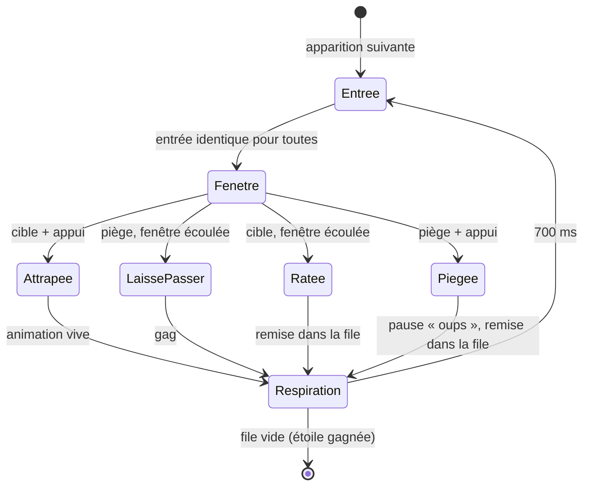

# FEAT-28 : Jeu n°6 (Pas si vite !) — Spécification Fonctionnelle : Inhibition Motrice, Buzzer Unique, Cadence Adaptative & 20 Étoiles

> **Document parent** : [SPECIFICATION.md](./SPECIFICATION.md)
> **ID Feature** : `FEAT-28`
> **Dépendances** : [FEAT-03](./FEAT-03.md), [FEAT-04](./FEAT-04.md), [FEAT-07](./FEAT-07.md), [FEAT-08](./FEAT-08.md), [FEAT-21](./FEAT-21.md), [FEAT-22](./FEAT-22.md), [FEAT-24](./FEAT-24.md)
> **Statut** : cadrage fonctionnel (session « grill-me » du 2026-11-08). Ce document ne décrit que les mécaniques, la progression et l'expérience ; la découpe technique (moteur, fichiers, tests) reste à écrire. Les décisions de cadrage, et celles prises par défaut pendant la rédaction, sont au [§11](#11-décisions-de-la-session-de-cadrage).

---

## 1. Contexte & Objectif

**Pas si vite !** (titre de travail) est le sixième jeu de **Mia**, pour les **enfants de 3 à 6 ans**, sans aucun texte à lire. Il s'inspire de « Jacques a dit » et de « Pigeon vole » : des images défilent à un rythme soutenu, l'enfant appuie sur **un seul grand buzzer** quand une condition est remplie, et **retient son geste** quand elle ne l'est pas (le **piège**).

Le but est d'**entraîner l'inhibition motrice** : retenir une réponse que l'habitude a rendue automatique (le « Système 1 »), en une fraction de seconde. C'est le paradigme *Go / No-Go*, puis, au dernier palier, le *Stop-Signal* (annuler un geste déjà lancé). Comme pour les autres jeux, **Mia exerce, elle ne soigne pas** : aucun effet clinique ou thérapeutique n'est revendiqué, et le jeu parle d'**entraînement**.

**Ce qu'il ajoute aux jeux existants.** Suites Logiques glisse un STOP dans un jeu de raisonnement, et Attrape-Piège travaille la **flexibilité** (changer de règle de tri). *Pas si vite !* est le seul jeu où la difficulté vient de la **vitesse** : l'enfant doit freiner un geste que l'habitude lance tout seul.

---

## 2. Public & Principes Hérités de Mia

* **Âge** : 3 à 6 ans, non-lectrices et non-lecteurs. **Aucun texte visible** du début d'une étoile à son écran de fin ; le Hub et la Carte des Étoiles restent écrits (pour l'adulte).
* **Une étoile ne se perd pas** : elle se termine toujours, et toujours sur une réussite ([§6](#6-rétroaction--échelle-daide)).
* **Double ergonomie** : au doigt, ou à la télécommande, où `OK` sert de buzzer ([§8](#8-interface--ergonomie)).
* **Jouable son coupé** : chaque signal sonore a son équivalent visuel ; la mascotte mime ses phrases.
* **Couleurs réservées** : le **rouge** n'apparaît que sur le panneau STOP. Le buzzer n'est donc **jamais rouge**, contrairement aux buzzers de jeux télévisés.
* **Mascotte** : la **chouette violette** d'Attrape-Piège, avec la même voix et le même vocabulaire (« ton cerveau a voulu te piéger »).
* **Aucune pression affichée** : ni score, ni chronomètre, ni compteur d'erreurs. Une couronne manquée n'est jamais évoquée.

---

## 3. Boucle de Jeu

### 3.1. Une apparition

L'étoile est une file d'**apparitions**. Chacune est une **cible** (il faut appuyer) ou un **piège** (il faut s'abstenir) :

1. **Entrée** : l'image entre sur la scène, **de la même façon pour toutes**. Aucun mouvement ne trahit la réponse avant la décision : un oiseau n'entre pas en volant, ni une vache en marchant.
2. **Fenêtre** : pendant une durée `F` (la **fenêtre**, réglée par la cadence adaptative, [§5](#5-cadence-adaptative)), un appui compte.
3. **Issue** : l'une des quatre du tableau ci-dessous.
4. **Respiration** : la scène reste vide pendant 700 ms, puis l'apparition suivante entre. Le rythme reste régulier, et c'est ce qui installe l'automatisme.

| | Elle appuie | Elle n'appuie pas |
| :--- | :--- | :--- |
| **Cible** | **Attrapée** : petite animation vive et son de réussite, le rythme continue. | **Ratée** : la cible s'en va doucement, avec un son neutre, et **repasse plus tard**. Aucune pause, aucun reproche. |
| **Piège** | **Piégée** : le rythme s'interrompt un instant, avec un « oups » calme et bref ([§6.2](#62-erreur--un-piège-touché)). Le piège **repasse plus tard**. | **Laissé passer** : c'est là qu'arrive le **gag** ([§6.1](#61-réussites)). Le spectacle récompense le STOP. |

### 3.2. Ce qui compte comme un appui

* **Au doigt** : un **nouveau** contact posé (`pointerdown`, pas le relâchement, pour ne rien ajouter au temps de réaction), n'importe où dans l'aire de jeu : sur le buzzer, mais aussi sur la scène. Une enfant de 3 ans touche souvent l'oiseau lui-même, et « j'ai tapé dessus et rien ne s'est passé » serait vécu comme injuste. Seul le bouton Retour est exclu.
* **Un doigt resté posé** depuis l'apparition précédente ne compte pas ; seul un contact posé pendant la fenêtre compte.
* **Un appui par apparition** : le premier compte, les suivants sont ignorés.
* **Entre deux apparitions** (respiration, animations, pause « oups ») : le buzzer s'enfonce visuellement, rien n'est compté. Taper sans arrêt ne rapporte rien, puisque chaque piège coûte une pause.
* **Télécommande et clavier** : `OK` (ou `Entrée`, `Espace`) au `keydown`, répétitions d'une touche maintenue ignorées (`event.repeat`). Les flèches ne font rien pendant le défilement.

### 3.3. File, remises et fin d'étoile

* **Composition** : environ **75 % de cibles et 25 % de pièges** (les proportions classiques du Go / No-Go chez l'enfant d'âge préscolaire : assez de cibles pour créer l'habitude, assez de pièges pour s'exercer). **Aucun piège** dans les 3 premières apparitions, et **jamais deux pièges d'affilée** aux paliers 1 et 2.
* **Remise dans la file** : une cible ratée ou un piège touché revient **2 à 4 apparitions plus tard**, en respectant les règles ci-dessus.
* **Fin** : l'étoile est gagnée quand **toute la file est réussie** : chaque cible attrapée, chaque piège laissé passer, au moins une fois. Rester passive ne mène nulle part, et taper sur tout non plus.
* **Garde-fou de durée** : si l'étoile dépasse 1,5 fois sa longueur prévue, toutes les apparitions restantes passent à l'échelon 3 de l'aide ([§6.4](#64-échelle-daide)), qui garantit une fin rapide. Une étoile dure environ 1 à 3 min.
* **Guirlande de progression** : en haut de l'écran, une perle par apparition prévue, sans chiffre. Une perle s'allume quand son apparition est réussie, y compris plus tard après une remise. L'enfant voit la fin approcher, ce qui aide à tenir l'attention.

---

## 4. Les Trois Règles

### 4.1. Règle 1 : « La chouette a dit » (paliers 1 et 2)

* **Scène** : un petit castelet. À chaque apparition, un personnage surgit d'une cachette et **fait le signal** : il lève les deux bras (ou ailes), avec un même son synthétisé (deux notes vives).
* **Cible** : c'est la **chouette**.
* **Piège** : c'est un **imposteur bien visible**, qui fait exactement le même signal avec le même son : le **renard** (orange, jamais rouge), puis au palier 2 aussi le **chat** gris. L'imposteur diffère de la chouette par l'espèce, la silhouette et la couleur : la différence saute aux yeux. La difficulté vient du rythme et de l'habitude, jamais de la finesse visuelle. Ainsi, une erreur reste lisible comme un geste trop rapide, et « ton cerveau est allé trop vite » est juste.
* **Palier 2** : trois cachettes au lieu d'une (le personnage surgit de l'une des trois), ce qui demande d'orienter l'attention.
* **Pendant le défilement**, la chouette n'apparaît que dans le castelet : une seconde chouette à l'écran serait elle-même un signal.

### 4.2. Règle 2 : « Ça vole ? » (paliers 3 et 4)

* **Scène** : une image par apparition, qui entre toujours de la même façon (elle surgit de derrière une colline). La chouette, à côté de la scène, mène le jeu.
* **Cible** : ce qui **vole vraiment**. **Piège** : ce qui ne vole pas.
* **Images évidentes uniquement** : une image n'entre au catalogue que si une enfant de 3 ans y répond sans hésiter. La liste est relue par l'adulte avant publication.

| Volent (cibles) | Ne volent pas (pièges) | **Exclus** (discutables) |
| :--- | :--- | :--- |
| oiseau (pigeon), avion, hélicoptère, papillon, abeille, fusée | vache, cochon, chien, poisson, escargot, tortue, voiture, train, bateau, chaise, maison, arbre | nuage, ballon, cerf-volant, montgolfière, feuille, plume, bulle ; poule, manchot, autruche, chauve-souris, canard ; éléphant (Dumbo), dragon, fée, super-héros |

* **Palier 4 : la chouette tend le piège.** Comme le meneur du vrai « Pigeon vole », la chouette dit « *Vache vole !* », « *Avion vole !* »… et **bat des ailes à chaque image**, cibles comme pièges. Seule l'image décide. L'image reste évidente : la pression vient de l'imitation, pas d'un doute sur l'objet. Son coupé, le battement d'ailes porte le leurre seul.

### 4.3. Règle 3 : le STOP tardif (palier 5)

* **Principe** : une cible apparaît, et parfois, **juste après**, le **panneau STOP** rouge (le dessin d'Attrape-Piège) surgit dessus, avec l'effet `stop`. Elle doit **annuler un geste déjà lancé** : c'est l'« annuler sa commande motrice » au sens strict.
* **Délai du STOP** : il est réglé par la cadence adaptative ([§5.2](#52-délai-du-stop-tardif)) ; plus il est long, plus le geste est engagé, plus c'est dur.
* **Appui avant l'arrivée du STOP** : la cible compte comme **attrapée**, sans aucune erreur (elle n'a pas vu le STOP). En revanche, le STOP suivant arrivera plus tôt : taper plus vite que le STOP ne paie donc pas longtemps.
* **Appui après l'arrivée du STOP** : c'est un piège touché ([§6.2](#62-erreur--un-piège-touché)).
* **Étoiles 17 et 18** : toutes les images volent, et environ 25 % reçoivent un STOP tardif. **Étoiles 19 et 20** : « Ça vole ? » et STOP tardif mêlés (environ 60 % de cibles simples, 15 à 20 % d'images qui ne volent pas, 20 % de STOP tardifs), sans le leurre de la chouette, pour que chaque erreur reste interprétable.

---

## 5. Cadence Adaptative

La vitesse n'est pas un niveau : c'est un **réglage invisible**, présent dans chaque étoile. L'enfant joue toujours à sa limite, et l'étoile finit toujours.

### 5.1. Fenêtre d'appui

* Chaque étoile fixe une **fenêtre de départ** et une **fenêtre la plus rapide** (sa vitesse maximale, voir le tableau du [§7](#7-progression-des-20-étoiles)). La fenêtre la plus lente vaut **3 s** partout : n'importe quelle enfant peut alors attraper une cible.
* **Accélération** : après **3 réussites d'affilée** (cibles attrapées ou pièges laissés passer), la fenêtre raccourcit de 10 %, sans descendre sous la vitesse maximale de l'étoile.
* **Ralentissement** : une cible ratée allonge la fenêtre de 10 %, un piège touché de 15 %, sans dépasser 3 s.
* Avec cette règle (3 réussites pour accélérer, 1 erreur pour ralentir), la cadence se stabilise autour de **80 % de réussite**. La vitesse maximale bornée par étoile garde la couronne possible aux premiers paliers et la rend exigeante aux derniers.
* La cadence repart de la fenêtre de départ à chaque partie : rien n'est retenu d'une partie à l'autre.

### 5.2. Délai du STOP tardif

* Il part de 150 ms après l'entrée de la cible, sans descendre sous 100 ms (un STOP presque immédiat est facile : il fait l'effet d'un piège ordinaire). Il ne dépasse pas le plafond de l'étoile, ni la fenêtre moins 300 ms.
* **STOP réussi** : +50 ms au délai. **STOP manqué**, ou appui avant le STOP : −100 ms. Ces pas inégaux stabilisent la réussite des STOP autour des deux tiers, au lieu de la moitié habituelle des protocoles de recherche : trop d'échecs pour une enfant de cet âge.

---

## 6. Rétroaction & Échelle d'Aide

### 6.1. Réussites

* **Cible attrapée** : animation vive et courte (environ 400 ms), son de réussite, et la perle de la guirlande s'allume. Règle 1 : la chouette hulule de joie et replonge dans un éclat d'étincelles. Règle 2 : la cible s'envole joyeusement.
* **Piège laissé passer, le gag** (environ 900 ms) : c'est la récompense du STOP.
  * **Règle 1** : le renard refait son signal, constate que personne ne réagit, boude et redescend lentement.
  * **Règle 2** : la vache (ou la chaise, ou le poisson) tente de s'envoler quand même, bat des oreilles, retombe doucement sur son derrière et s'en va.
  * **STOP tardif** : l'oiseau se fige en plein vol comme une statue (« 1, 2, 3, soleil ! »), vacille, puis repart quand le panneau disparaît.
* Le gag est **le moment le plus drôle du jeu** et n'arrive **que** sur une abstention réussie : l'erreur ne doit jamais devenir plus amusante que la réussite.

### 6.2. Erreur : un piège touché

* **Le rythme s'interrompt** environ 2 s ; le buzzer est grisé pendant la pause (rien n'y est compté).
* **Aucune sanction** : pas de buzzer d'erreur, pas de son agressif. Un son doux de deux notes descendantes, et le piège **ne fait rien de drôle** : la vache reste immobile et regarde l'enfant, intriguée ; le renard fait un clin d'œil complice, sans moquerie.
* **La chouette** dit « *Oh, ton cerveau a voulu te piéger.* » (phrase déjà enregistrée pour Attrape-Piège).
* **Pour l'adulte**, cette pause est le moment d'étayage (« Oups, ton cerveau est allé trop vite sur ce coup-là ! ») ; le jeu ne dépend pourtant pas de sa présence, car la mascotte dit l'essentiel.
* Le piège **repasse plus tard**, et la fenêtre ralentit ([§5.1](#51-fenêtre-dappui)).

### 6.3. Cible ratée

* La cible s'en va doucement (l'oiseau s'envole tout seul), avec un son neutre. Pas de pause, pas de phrase : la prudence n'est jamais punie. La cible **repasse plus tard**, et la fenêtre ralentit.

### 6.4. Échelle d'aide

Comme dans Attrape-Piège, deux compteurs d'erreurs **d'affilée**. Le premier compte les pièges touchés et se remet à zéro au prochain piège laissé passer ; le second compte les cibles ratées et se remet à zéro à la prochaine cible attrapée. L'échelle finit toujours par une réussite.

| D'affilée | Pièges touchés | Cibles ratées |
| :--- | :--- | :--- |
| **1** | « Oups » et la phrase de la chouette | La cible repart et repassera |
| **2** | Plus « *Regarde bien.* » (phrase existante) ; le piège suivant entre plus lentement, avec une fenêtre plus longue | La cible suivante arrive avec le buzzer qui pulse |
| **3 et plus** | Le piège suivant porte le **signe « non » gris** d'Attrape-Piège : un indice fort, mais c'est toujours elle qui retient son geste | La cible suivante **attend** sur la scène, sans limite de temps, avec le buzzer qui pulse et la main qui montre le geste |

### 6.5. Inaction et interruption

* **Inaction** : après 12 s sans aucun appui (une cible qui attend à l'échelon 3 y mène vite), le défilement **se met en pause**. La chouette s'assoit, le buzzer pulse, et la chouette rappelle la règle. L'appui qui relance ne compte pas. Au plus 3 relances, puis silence jusqu'au prochain appui : un écran laissé allumé finit par se taire.
* **Page masquée** (appel, autre application, écran éteint) : pause immédiate, rien n'est compté. Au retour, l'écran attend un appui pour repartir.

---

## 7. Progression des 20 Étoiles

Les valeurs sont des **valeurs de départ**, à régler avec une vraie enfant ([§10](#10-points-dattention--non-vérifié)). « Fenêtre » : fenêtre de départ → vitesse maximale de l'étoile.

| Étoile | Palier | Règle | Apparitions (dont pièges) | Fenêtre | Particularité |
| :---: | :--- | :--- | :---: | :---: | :--- |
| ⭐ 1 | Très Facile | La chouette a dit | 12 (3) | 2,5 → 2,0 s | **Démo et 4 essais guidés** ([§9](#9-introduction--entraînement)). Une cachette, imposteur : le renard. |
| ⭐ 2 | Très Facile | La chouette a dit | 16 (4) | 2,4 → 1,8 s | |
| ⭐ 3 | Très Facile | La chouette a dit | 16 (4) | 2,2 → 1,6 s | |
| ⭐ 4 | Très Facile | La chouette a dit | 20 (5) | 2,2 → 1,5 s | Série plus longue. |
| ⭐ 5 | Facile | La chouette a dit | 20 (5) | 2,0 → 1,4 s | **Trois cachettes.** |
| ⭐ 6 | Facile | La chouette a dit | 20 (5) | 2,0 → 1,3 s | **Second imposteur** : le chat gris. |
| ⭐ 7 | Facile | La chouette a dit | 24 (5) | 1,8 → 1,2 s | Moins de pièges : l'habitude se renforce. |
| ⭐ 8 | Facile | La chouette a dit | 24 (5) | 1,8 → 1,1 s | |
| ⭐ 9 | Moyen | Ça vole ? | 16 (4) | 2,4 → 1,8 s | **Démo et 4 essais guidés.** Nouvelle règle, départ plus lent. |
| ⭐ 10 | Moyen | Ça vole ? | 20 (5) | 2,2 → 1,6 s | |
| ⭐ 11 | Moyen | Ça vole ? | 20 (5) | 2,0 → 1,4 s | |
| ⭐ 12 | Moyen | Ça vole ? | 24 (6) | 1,8 → 1,3 s | |
| ⭐ 13 | Difficile | Ça vole ? + leurre | 20 (5) | 2,0 → 1,5 s | **Démo courte et 4 essais** : la chouette prévient qu'elle dira toujours « vole ! ». |
| ⭐ 14 | Difficile | Ça vole ? + leurre | 20 (5) | 1,8 → 1,3 s | |
| ⭐ 15 | Difficile | Ça vole ? + leurre | 24 (6) | 1,8 → 1,2 s | |
| ⭐ 16 | Difficile | Ça vole ? + leurre | 24 (5) | 1,6 → 1,1 s | |
| ⭐ 17 | Très Difficile | STOP tardif | 20 (5 STOP) | 1,8 → 1,4 s | **Démo et 4 essais guidés.** Toutes les images volent. Délai du STOP : au plus 300 ms. |
| ⭐ 18 | Très Difficile | STOP tardif | 24 (6 STOP) | 1,6 → 1,3 s | Délai : au plus 350 ms. |
| ⭐ 19 | Très Difficile | Ça vole ? + STOP tardif | 24 (4 + 5 STOP) | 1,8 → 1,3 s | Délai : au plus 350 ms. |
| ⭐ 20 | Très Difficile | Ça vole ? + STOP tardif | 28 (5 + 6 STOP) | 1,6 → 1,1 s | Le grand final. Délai : au plus 400 ms. |

* **Repères** : chez l'enfant de 3 à 5 ans, un appui sur une cible prend souvent 0,7 à 1 s. Aucune vitesse maximale ne descend donc sous 1,1 s, et la latence d'une télécommande ou d'un téléviseur s'ajoute ([§10](#10-points-dattention--non-vérifié)).
* **Déblocage** : la règle hybride de Mia (étoile précédente gagnée, ou assez d'étoiles dans le jeu) s'applique telle quelle.

---

## 8. Interface & Ergonomie

### 8.1. Disposition

* **Portrait** (téléphone, tablette) : la guirlande en haut, la **scène** au milieu (environ 55 % de la hauteur), le **buzzer** en bas, sur toute la largeur moins les marges (environ 35 % de la hauteur). **Paysage** (tablette, téléviseur) : la scène au centre, le buzzer en large bandeau en bas. Zéro défilement.
* **Le buzzer** : un énorme bouton rond, jamais rouge, qui s'enfonce et s'illumine à l'appui ; il se grise pendant les pauses. Toute l'aire de jeu compte comme lui ([§3.2](#32-ce-qui-compte-comme-un-appui)), mais il donne au geste un endroit évident où taper, et où reposer la main.
* **La mascotte** : règle 1, dans le castelet seulement ; règles 2 et 3, à côté de la scène. Pendant le défilement, la toucher ne rejoue rien (ce serait un appui) : la règle se rejoue pendant les pauses.

### 8.2. Télécommande (Android TV)

| Touche | Pendant le défilement | Pendant une pause | Écran de fin |
| :--- | :--- | :--- | :--- |
| `OK` | Appui sur le buzzer | Relance le défilement après une inaction ou un retour sur la page ; rien pendant un « oups » | Choisit l'action |
| Flèches | Rien | Rien | Déplacent le curseur |
| `Retour` | Carte des Étoiles | Carte des Étoiles | Carte des Étoiles |

* En mode D-Pad, le buzzer porte l'**icône du bouton OK** de la télécommande (dessinée, sans texte).
* **Latence** : télécommande, boîtier et téléviseur ajoutent un retard ; la cadence adaptative l'absorbe. La vitesse tenue ne se compare donc que **sur un même appareil** ([§10](#10-points-dattention--non-vérifié)).

### 8.3. Son et accessibilité

* **Son coupé** : le signal de la règle 1 est doublé par le geste du personnage, le leurre du palier 4 par le battement d'ailes, le STOP par le panneau. Les phrases sont mimées par la chouette pendant au moins 2 s, comme dans Attrape-Piège.
* **Animations réduites** (réglage du système) : les entrées et sorties deviennent des fondus, le gag une pose fixe ; les durées de fenêtre ne changent pas.
* **Lecteurs d'écran** : le buzzer est un bouton nommé (« Taper »), et la règle et la fin d'étoile sont annoncées. Un jeu de vitesse visuel reste toutefois **peu adapté** à TalkBack : aucune annonce par apparition, elle arriverait après la fenêtre.

---

## 9. Introduction & Entraînement

On apprend le STOP en le faisant, pas en l'écoutant. L'introduction complète se joue à la **première étoile de chaque règle** (⭐ 1, ⭐ 9, ⭐ 17) tant que cette étoile n'est pas gagnée. Une fois gagnée, l'étoile rejouée garde la phrase de rappel et les 4 essais guidés, sans la démo ; la sauvegarde sait déjà si l'étoile est gagnée, donc aucune donnée nouvelle. À ⭐ 13, la démo se réduit à la chouette qui annonce son piège (« *Attention, je vais essayer de te piéger !* ») et en montre un exemple.

1. **La chouette montre la règle** en image, à vitesse lente : une cible, puis la main fantôme qui appuie, puis « Bravo ! ».
2. **La chouette se fait piéger elle-même** : un piège arrive, elle tape par réflexe avec son aile, s'en rend compte et **rit d'elle-même** : « *Oups ! Même moi, mon cerveau est allé trop vite !* ». Personne n'est à l'abri, et l'erreur n'a rien de grave. Règle 1 : elle se tient près du buzzer pendant que le renard surgit du castelet. STOP tardif : la main fantôme part vers le buzzer et se fige en l'air quand le panneau surgit.
3. **La mise en garde**, dite en entier : « *Ton cerveau va vouloir taper très vite pour tout attraper. Attention, il risque de te tendre un piège ! Prépare-toi à faire STOP.* » (« taper », pas « cliquer » : c'est le mot des enfants, au doigt comme à la télécommande).
4. **4 essais guidés**, à fenêtre longue (3 s) et sans conséquence : par exemple cible, cible, piège, cible. La main fantôme montre le premier appui ; rien n'est compté, rien n'est remis dans la file.
5. Puis l'étoile commence, à sa fenêtre de départ.

**Aux autres étoiles**, une seule phrase de rappel : « *Tape quand c'est moi !* », « *Tape seulement si ça vole !* », « *Tape, sauf si le STOP arrive !* ». Au palier 4 : « *Attention, je vais essayer de te piéger !* ».

---

## 10. Points d'Attention & Non Vérifié

* **Rien n'a été essayé avec une vraie enfant.** Fenêtres, pas de la cadence, délais du STOP, durée des pauses et longueur des étoiles sont des valeurs de départ. Points à observer en priorité : la compréhension du leurre (palier 4), le STOP tardif à 5 ans, et si le gag reste drôle sans pousser à l'erreur.
* **Précision du temps** : sur un boîtier Android TV modeste, l'appui doit être daté par l'horodatage de l'évènement, pas par l'image suivante, et les animations doivent tenir 60 images par seconde (`transform` et `opacity` seulement).
* **Le son peut arriver en retard** : sortie HDMI ou Bluetooth (300 ms de réveil, [FEAT-22](./FEAT-22.md)). L'**image fait foi** ; le son n'est jamais le seul signal, et le leurre « … vole ! » doit tenir dans la fenêtre la plus courte du palier 4 (1,1 s).
* **Écran de fin et enfant qui tape encore** : en fin d'étoile, l'enfant est lancée et tapera sur l'écran de fin. Ses boutons n'agissent qu'après une garde de 1,5 s (au lieu des 800 ms d'Attrape-Piège), et **aucun n'est placé sous l'ancien buzzer** : la récompense ne se saute pas par élan.
* **Une main posée sur l'écran** (fréquent à cet âge) crée un contact au moment où elle se pose. Si cela tombe sur un piège, l'erreur compte ; à observer.
* **Terminaison** : les remises dans la file, l'échelle d'aide, la fenêtre lente de 3 s et le garde-fou de 1,5 fois la longueur garantissent ensemble que l'étoile finit. Le futur validateur du catalogue devra le vérifier par simulation (enfant qui ne tape jamais, qui tape sans arrêt, qui alterne).
* **Mesure** : la vitesse tenue dépend de l'appareil, et un progrès dans le jeu ne prouve aucun transfert à la vie quotidienne. On montre une vitesse, jamais un diagnostic.

---

## 11. Décisions de la Session de Cadrage

### 11.1. Tranchées pendant la session (2026-11-08)

| Question | Décision | Alternatives écartées |
| :--- | :--- | :--- |
| Que faire d'une cible ratée ? | Elle **repasse plus tard** ; l'étoile finit quand tout est réussi. | Réaction neutre sans conséquence (rester passive gagnait) ; seuil de réussite (une étoile se perdrait) ; même traitement qu'un piège (punit la prudence). |
| Où placer le gag ? | Sur le **STOP réussi** ; l'erreur reçoit un « oups » bref et calme. | Gag sur l'erreur, court ou tel quel (pousse à se tromper exprès) ; aucun gag. |
| Quel piège en règle 1 ? | Un **imposteur bien visible** (renard, puis chat). | Accessoire manquant, dès le début ou aux paliers hauts (mêle perception et impulsivité) ; signal seulement sonore (injouable son coupé). |
| Quelles images en règle 2 ? | **Cas évidents uniquement.** | Leurres sémantiques en fin de parcours (autruche, chauve-souris) ; images ambiguës (nuage) ; tri préalable à chaque partie. |
| Comment régler la vitesse ? | **Cadence adaptative**, bornée par étoile ; le « Niveau 3 » de la note d'intention devient un réglage transversal. | Cadence fixe (mur, voire boucle sans fin avec les remises) ; facteur réglé par l'adulte ; niveau de vitesse séparé. |
| Que rend le palier 5 plus dur ? | Le **STOP tardif** (annuler un geste lancé). | Deux règles combinées (une erreur pourrait venir d'un oubli de règle) ; règle inversée (c'est de la flexibilité, déjà dans Attrape-Piège) ; seulement plus vite. |
| Comment savoir que ça marche ? | La **vitesse tenue**, lue par l'adulte ; on parle d'entraînement, pas de clinique. | Rien de plus que les étoiles ; suivi détaillé par séance (lecture diagnostique) ; rien dans l'application. |
| Comment ouvrir la partie ? | **Démo, la chouette piégée, puis 4 essais lents**, à la première étoile de chaque règle. | Phrase seule à chaque étoile ; rituel physique ; aucune introduction. |

### 11.2. Prises par défaut pendant la rédaction (à relire par le propriétaire)

* **Le nom** « Pas si vite ! » (titre de travail), la faculté du Hub (« Inhibition & Attention · dès 3 ans ») et l'identifiant proposé `go-no-go`, **immuable une fois publié** ([SPECIFICATION §7.3](./SPECIFICATION.md#73-ajouter-un-6e-7e-ou-8e-jeu-cérébral-dans-le-futur)).
* **Le leurre de la chouette au palier 4** (« Vache vole ! » et battement d'ailes) : il n'a pas été discuté pendant la session ; il reprend le vrai « Pigeon vole » sans rendre aucune image ambiguë.
* **75 % de cibles**, aucun piège dans les 3 premières apparitions, jamais deux pièges d'affilée aux paliers 1 et 2, remise 2 à 4 apparitions plus tard.
* **Toute l'aire de jeu compte comme le buzzer**, au doigt ; `OK` seul à la télécommande, flèches sans effet.
* **Pas de la cadence** : 3 réussites pour accélérer de 10 % ; ralentir de 10 % (cible ratée) ou de 15 % (piège touché) ; plancher de 3 s ; respiration de 700 ms.
* **Délai du STOP tardif** : départ 150 ms, +50 ms ou −100 ms, de 100 ms au plafond de l'étoile.
* **La couronne** : **aucun piège touché** de toute l'étoile (STOP tardifs compris) ; les cibles ratées ne la font pas perdre, la prudence n'est jamais punie.
* **Sauvegarde, sans nouvelle donnée** : `moves` reçoit le nombre de pièges touchés, et `timeSeconds` la **vitesse tenue**, c'est-à-dire la fenêtre la plus courte sur laquelle l'enfant a enchaîné 8 réussites d'affilée (à défaut d'une telle série, la fenêtre de fin de partie). Le moteur de progression garde déjà le minimum des deux. La tuile de la Carte des Étoiles affiche pour ce jeu la vitesse (« 1,2 s ») au lieu des coups : petit changement à prévoir dans `StarLevelTile`.
* **Phrases nouvelles** à générer avec la voix Piper (CC BY 4.0) : la mise en garde avec « taper », « Oups ! Même moi… », les trois rappels de règle, « Attention, je vais essayer de te piéger ! » et les « … vole ! » des images. Sont réutilisées telles quelles « Oh, ton cerveau a voulu te piéger. », « Regarde bien. », « Bravo ! Tu as gagné une étoile. » et « Et une couronne, c'est parfait ! ».

---

## 12. Critères d'Acceptation Fonctionnels

- [ ] Aucun texte visible du début d'une étoile à son écran de fin ; le jeu reste jouable son coupé.
- [ ] Un seul geste : un nouvel appui n'importe où dans l'aire de jeu au doigt, `OK` à la télécommande ; un doigt resté posé ou une touche maintenue ne comptent pas.
- [ ] Les quatre issues (attrapée, ratée, piégée, laissé passer) ont chacune leur retour ; seul « piégée » interrompt le rythme.
- [ ] Le gag n'arrive que sur un piège laissé passer ; une erreur n'est jamais plus spectaculaire qu'une réussite.
- [ ] Toute cible ratée et tout piège touché repassent plus tard ; l'étoile finit quand toute la file est réussie, et toujours, quoi que fasse l'enfant.
- [ ] La cadence s'adapte dans les bornes de chaque étoile ; le délai du STOP tardif s'adapte au palier 5.
- [ ] L'échelle d'aide à trois échelons s'applique aux pièges touchés comme aux cibles ratées.
- [ ] L'introduction (démo, chouette piégée, mise en garde, 4 essais) se joue à la première étoile de chaque règle, une phrase de rappel ailleurs.
- [ ] Le défilement se met en pause sur inaction et page masquée, et ne repart que sur un appui.
- [ ] L'écran de fin résiste à une enfant qui tape encore ; la couronne manquée n'est jamais évoquée.
- [ ] La vitesse tenue est visible pour l'adulte sur la Carte des Étoiles, sans nouvelle donnée dans la sauvegarde.
- [ ] Recette avec une vraie enfant, sur un vrai Android TV et dans l'APK.
