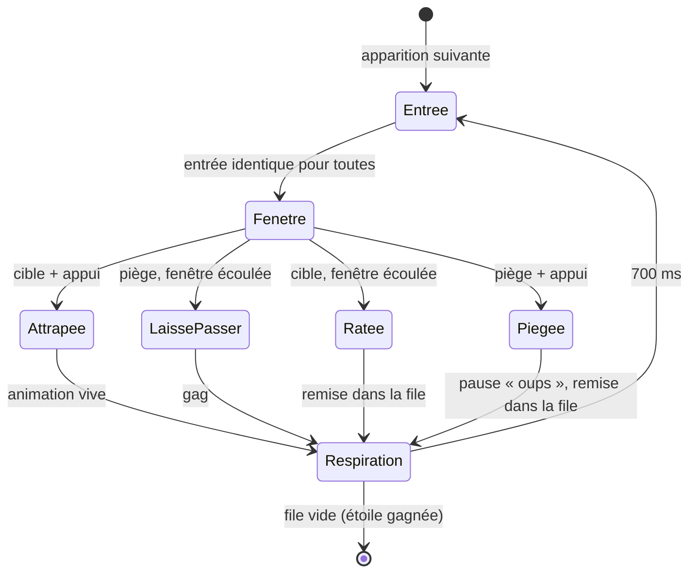
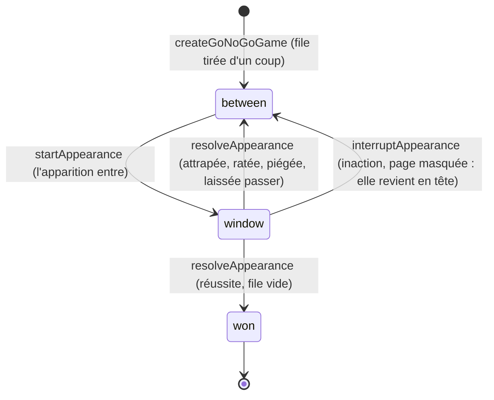
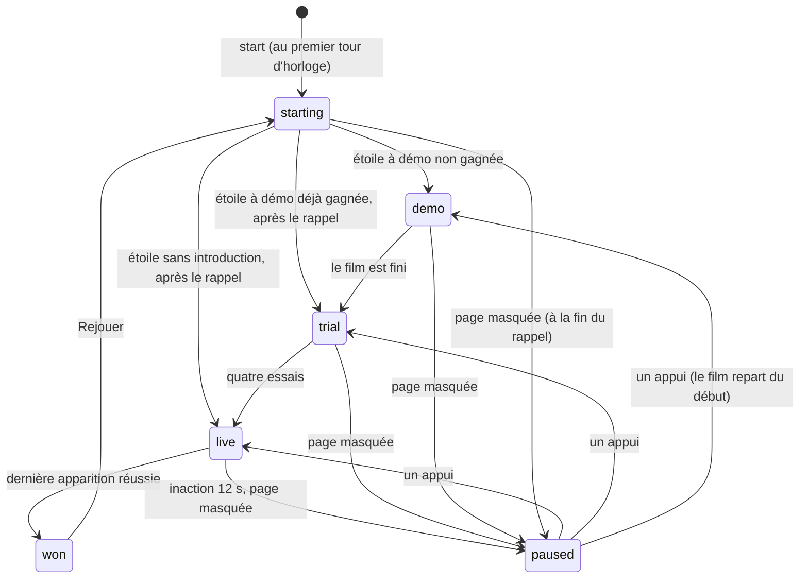

# FEAT-28 : Jeu n°6 (Pas si vite !) — Inhibition Motrice, Buzzer Unique, Cadence Adaptative & 20 Étoiles

> **Document parent** : [SPECIFICATION.md](./SPECIFICATION.md)
> **ID Feature** : `FEAT-28`
> **Dépendances** : [FEAT-03](./FEAT-03.md), [FEAT-04](./FEAT-04.md), [FEAT-07](./FEAT-07.md), [FEAT-08](./FEAT-08.md), [FEAT-21](./FEAT-21.md), [FEAT-22](./FEAT-22.md), [FEAT-24](./FEAT-24.md)
> **Statut** : cadrée et implémentée. Les §1 à §12 sont le cadrage fonctionnel (session « grill-me » du 2026-11-08, [§11](#11-décisions-de-la-session-de-cadrage)) ; la découpe technique (fichiers, moteur, déroulé en temps réel, interface, voix, tests) est aux [§13 à §17](#13-fichiers-à-créer--modifier), avec les décisions prises pendant l'implémentation ([§17](#17-décisions-dimplémentation)). **Rien n'a été essayé avec une vraie enfant, ni sur un vrai Android TV** ([§10](#10-points-dattention--non-vérifié)).

---

## 1. Contexte & Objectif

**Pas si vite !** (titre de travail) est le sixième jeu de **Mia**, pour les **enfants de 3 à 6 ans**, sans aucun texte à lire. Il s'inspire de « Jacques a dit » et de « Pigeon vole » : des images défilent à un rythme soutenu, l'enfant appuie sur **un seul grand buzzer** quand une condition est remplie, et **retient son geste** quand elle ne l'est pas (le **piège**).

Le but est d'**entraîner l'inhibition motrice** : retenir une réponse que l'habitude a rendue automatique (le « Système 1 »), en une fraction de seconde. C'est le paradigme *Go / No-Go*, puis, au dernier palier, le *Stop-Signal* (annuler un geste déjà lancé). Comme pour les autres jeux, **Mia exerce, elle ne soigne pas** : aucun effet clinique ou thérapeutique n'est revendiqué, et le jeu parle d'**entraînement**.

**Ce qu'il ajoute aux jeux existants.** Suites Logiques glisse un STOP dans un jeu de raisonnement, et Attrape-Piège travaille la **flexibilité** (changer de règle de tri). *Pas si vite !* est le seul jeu où la difficulté vient de la **vitesse** : l'enfant doit freiner un geste que l'habitude lance tout seul.

---

## 2. Public & Principes Hérités de Mia

* **Âge** : 3 à 6 ans, non-lectrices et non-lecteurs. **Aucun texte visible** du début d'une étoile à son écran de fin ; le Hub et la Carte des Étoiles restent écrits (pour l'adulte).
* **Une étoile ne se perd pas** : elle se termine toujours, et toujours sur une réussite ([§6](#6-rétroaction--échelle-daide)).
* **Double ergonomie** : au doigt, ou à la télécommande, où `OK` sert de buzzer ([§8](#8-interface--ergonomie)).
* **Jouable son coupé** : chaque signal sonore a son équivalent visuel ; la mascotte mime ses phrases.
* **Couleurs réservées** : le **rouge** n'apparaît que sur le panneau STOP. Le buzzer n'est donc **jamais rouge**, contrairement aux buzzers de jeux télévisés.
* **Mascotte** : la **chouette violette** d'Attrape-Piège, avec la même voix et le même vocabulaire (« ton cerveau a voulu te piéger »).
* **Aucune pression affichée** : ni score, ni chronomètre, ni compteur d'erreurs. Une couronne manquée n'est jamais évoquée.

---

## 3. Boucle de Jeu

### 3.1. Une apparition

L'étoile est une file d'**apparitions**. Chacune est une **cible** (il faut appuyer) ou un **piège** (il faut s'abstenir) :

1. **Entrée** : l'image entre sur la scène, **de la même façon pour toutes**. Aucun mouvement ne trahit la réponse avant la décision : un oiseau n'entre pas en volant, ni une vache en marchant.
2. **Fenêtre** : pendant une durée `F` (la **fenêtre**, réglée par la cadence adaptative, [§5](#5-cadence-adaptative)), un appui compte.
3. **Issue** : l'une des quatre du tableau ci-dessous.
4. **Respiration** : la scène reste vide pendant 700 ms, puis l'apparition suivante entre. Le rythme reste régulier, et c'est ce qui installe l'automatisme.

| | Elle appuie | Elle n'appuie pas |
| :--- | :--- | :--- |
| **Cible** | **Attrapée** : petite animation vive et son de réussite, le rythme continue. | **Ratée** : la cible s'en va doucement, avec un son neutre, et **repasse plus tard**. Aucune pause, aucun reproche. |
| **Piège** | **Piégée** : le rythme s'interrompt un instant, avec un « oups » calme et bref ([§6.2](#62-erreur--un-piège-touché)). Le piège **repasse plus tard**. | **Laissé passer** : c'est là qu'arrive le **gag** ([§6.1](#61-réussites)). Le spectacle récompense le STOP. |



### 3.2. Ce qui compte comme un appui

* **Au doigt** : un **nouveau** contact posé (`pointerdown`, pas le relâchement, pour ne rien ajouter au temps de réaction), n'importe où dans l'aire de jeu : sur le buzzer, mais aussi sur la scène. Une enfant de 3 ans touche souvent l'oiseau lui-même, et « j'ai tapé dessus et rien ne s'est passé » serait vécu comme injuste. Seul le bouton Retour est exclu.
* **Un doigt resté posé** depuis l'apparition précédente ne compte pas ; seul un contact posé pendant la fenêtre compte.
* **Un appui par apparition** : le premier compte, les suivants sont ignorés.
* **Entre deux apparitions** (respiration, animations) : le buzzer s'enfonce visuellement, rien n'est compté. Pendant la pause « oups », il est grisé et rien n'y est compté ([§6.2](#62-erreur--un-piège-touché)). Taper sans arrêt ne rapporte rien, puisque chaque piège coûte une pause.
* **Télécommande et clavier** : `OK` (ou `Entrée`, `Espace`) au `keydown`, répétitions d'une touche maintenue ignorées (`event.repeat`). Les flèches ne font rien pendant le défilement.

### 3.3. File, remises et fin d'étoile

* **Composition** : environ **75 % de cibles et 25 % de pièges** (les proportions classiques du Go / No-Go chez l'enfant d'âge préscolaire : assez de cibles pour créer l'habitude, assez de pièges pour s'exercer). **Aucun piège** dans les 3 premières apparitions, et **jamais deux pièges d'affilée** aux paliers 1 et 2.
* **Remise dans la file** : une cible ratée ou un piège touché revient **2 à 4 apparitions plus tard**, en respectant les règles ci-dessus.
* **Fin** : l'étoile est gagnée quand **toute la file est réussie** : chaque cible attrapée, chaque piège laissé passer, au moins une fois. Rester passive ne mène nulle part, et taper sur tout non plus.
* **Garde-fou de durée** : si l'étoile dépasse 1,5 fois sa longueur prévue, toutes les apparitions restantes passent à l'échelon 3 de l'aide ([§6.4](#64-échelle-daide)), qui garantit une fin rapide. Une étoile dure environ 1 à 3 min.
* **Guirlande de progression** : en haut de l'écran, une perle par apparition prévue, sans chiffre. Une perle s'allume quand son apparition est réussie, y compris plus tard après une remise. L'enfant voit la fin approcher, ce qui aide à tenir l'attention.

---

## 4. Les Trois Règles

### 4.1. Règle 1 : « La chouette a dit » (paliers 1 et 2)

* **Scène** : un petit castelet. À chaque apparition, un personnage surgit d'une cachette et **fait le signal** : il lève les deux bras (ou ailes), avec un même son synthétisé (deux notes vives).
* **Cible** : c'est la **chouette**.
* **Piège** : c'est un **imposteur bien visible**, qui fait exactement le même signal avec le même son : le **renard** (orange, jamais rouge), puis au palier 2 aussi le **chat** gris. L'imposteur diffère de la chouette par l'espèce, la silhouette et la couleur : la différence saute aux yeux. La difficulté vient du rythme et de l'habitude, jamais de la finesse visuelle. Ainsi, une erreur reste lisible comme un geste trop rapide, et « ton cerveau est allé trop vite » est juste.
* **Palier 2** : trois cachettes au lieu d'une (le personnage surgit de l'une des trois), ce qui demande d'orienter l'attention.
* **Pendant le défilement**, la chouette n'apparaît que dans le castelet : une seconde chouette à l'écran serait elle-même un signal.

### 4.2. Règle 2 : « Ça vole ? » (paliers 3 et 4)

* **Scène** : une image par apparition, qui entre toujours de la même façon (elle surgit de derrière une colline). La chouette, à côté de la scène, mène le jeu.
* **Cible** : ce qui **vole vraiment**. **Piège** : ce qui ne vole pas.
* **Images évidentes uniquement** : une image n'entre au catalogue que si une enfant de 3 ans y répond sans hésiter. La liste est relue par l'adulte avant publication.

| Volent (cibles) | Ne volent pas (pièges) | **Exclus** (discutables) |
| :--- | :--- | :--- |
| oiseau (pigeon), avion, hélicoptère, papillon, abeille, fusée | vache, cochon, chien, poisson, escargot, tortue, voiture, train, bateau, chaise, maison, arbre | nuage, ballon, cerf-volant, montgolfière, feuille, plume, bulle ; poule, manchot, autruche, chauve-souris, canard ; éléphant (Dumbo), dragon, fée, super-héros |

* **Palier 4 : la chouette tend le piège.** Comme le meneur du vrai « Pigeon vole », la chouette dit « *Vache vole !* », « *Avion vole !* »… et **bat des ailes à chaque image**, cibles comme pièges. Seule l'image décide. L'image reste évidente : la pression vient de l'imitation, pas d'un doute sur l'objet. Son coupé, le battement d'ailes porte le leurre seul.

### 4.3. Règle 3 : le STOP tardif (palier 5)

* **Principe** : une cible apparaît, et parfois, **juste après**, le **panneau STOP** rouge (le dessin d'Attrape-Piège) surgit dessus, avec l'effet `stop`. Elle doit **annuler un geste déjà lancé** : c'est l'« annuler sa commande motrice » au sens strict.
* **Délai du STOP** : il est réglé par la cadence adaptative ([§5.2](#52-délai-du-stop-tardif)) ; plus il est long, plus le geste est engagé, plus c'est dur.
* **Appui avant l'arrivée du STOP** : la cible compte comme **attrapée**, sans aucune erreur (elle n'a pas vu le STOP). En revanche, le STOP suivant arrivera plus tôt : taper plus vite que le STOP ne paie donc pas longtemps.
* **Appui après l'arrivée du STOP** : c'est un piège touché ([§6.2](#62-erreur--un-piège-touché)).
* **Étoiles 17 et 18** : toutes les images volent, et environ 25 % reçoivent un STOP tardif. **Étoiles 19 et 20** : « Ça vole ? » et STOP tardif mêlés (environ 60 % de cibles simples, 15 à 20 % d'images qui ne volent pas, 20 % de STOP tardifs), sans le leurre de la chouette, pour que chaque erreur reste interprétable.

---

## 5. Cadence Adaptative

La vitesse n'est pas un niveau : c'est un **réglage invisible**, présent dans chaque étoile. L'enfant joue toujours à sa limite, et l'étoile finit toujours.

### 5.1. Fenêtre d'appui

* Chaque étoile fixe une **fenêtre de départ** et une **fenêtre la plus rapide** (sa vitesse maximale, voir le tableau du [§7](#7-progression-des-20-étoiles)). La fenêtre la plus lente vaut **3 s** partout : n'importe quelle enfant peut alors attraper une cible.
* **Accélération** : après **3 réussites d'affilée** (cibles attrapées ou pièges laissés passer), la fenêtre raccourcit de 10 %, sans descendre sous la vitesse maximale de l'étoile.
* **Ralentissement** : une cible ratée allonge la fenêtre de 10 %, un piège touché de 15 %, sans dépasser 3 s.
* Avec cette règle (3 réussites pour accélérer, 1 erreur pour ralentir), la cadence se stabilise autour de **80 % de réussite**. La vitesse maximale bornée par étoile garde la couronne possible aux premiers paliers et la rend exigeante aux derniers.
* La cadence repart de la fenêtre de départ à chaque partie : rien n'est retenu d'une partie à l'autre.

### 5.2. Délai du STOP tardif

* Il part de 150 ms après l'entrée de la cible, sans descendre sous 100 ms (un STOP presque immédiat est facile : il fait l'effet d'un piège ordinaire). Il ne dépasse pas le plafond de l'étoile, ni la fenêtre moins 300 ms.
* **STOP réussi** : +50 ms au délai. **STOP manqué**, ou appui avant le STOP : −100 ms. Ces pas inégaux stabilisent la réussite des STOP autour des deux tiers, au lieu de la moitié habituelle des protocoles de recherche : trop d'échecs pour une enfant de cet âge.

---

## 6. Rétroaction & Échelle d'Aide

### 6.1. Réussites

* **Cible attrapée** : animation vive et courte (environ 400 ms), son de réussite, et la perle de la guirlande s'allume. Règle 1 : la chouette hulule de joie et replonge dans un éclat d'étincelles. Règle 2 : la cible s'envole joyeusement.
* **Piège laissé passer, le gag** (environ 900 ms) : c'est la récompense du STOP.
  * **Règle 1** : le renard refait son signal, constate que personne ne réagit, boude et redescend lentement.
  * **Règle 2** : la vache (ou la chaise, ou le poisson) tente de s'envoler quand même, bat des oreilles, retombe doucement sur son derrière et s'en va.
  * **STOP tardif** : l'oiseau se fige en plein vol comme une statue (« 1, 2, 3, soleil ! »), vacille, puis repart quand le panneau disparaît.
* Le gag est **le moment le plus drôle du jeu** et n'arrive **que** sur une abstention réussie : l'erreur ne doit jamais devenir plus amusante que la réussite.

### 6.2. Erreur : un piège touché

* **Le rythme s'interrompt** environ 2 s ; le buzzer est grisé pendant la pause (rien n'y est compté).
* **Aucune sanction** : pas de buzzer d'erreur, pas de son agressif. Un son doux de deux notes descendantes, et le piège **ne fait rien de drôle** : la vache reste immobile et regarde l'enfant, intriguée ; le renard fait un clin d'œil complice, sans moquerie.
* **La chouette** dit « *Oh, ton cerveau a voulu te piéger.* » (phrase déjà enregistrée pour Attrape-Piège).
* **Pour l'adulte**, cette pause est le moment d'étayage (« Oups, ton cerveau est allé trop vite sur ce coup-là ! ») ; le jeu ne dépend pourtant pas de sa présence, car la mascotte dit l'essentiel.
* Le piège **repasse plus tard**, et la fenêtre ralentit ([§5.1](#51-fenêtre-dappui)).

### 6.3. Cible ratée

* La cible s'en va doucement (l'oiseau s'envole tout seul), avec un son neutre. Pas de pause, pas de phrase : la prudence n'est jamais punie. La cible **repasse plus tard**, et la fenêtre ralentit.

### 6.4. Échelle d'aide

Comme dans Attrape-Piège, deux compteurs d'erreurs **d'affilée**. Le premier compte les pièges touchés et se remet à zéro au prochain piège laissé passer ; le second compte les cibles ratées et se remet à zéro à la prochaine cible attrapée. L'échelle finit toujours par une réussite.

| D'affilée | Pièges touchés | Cibles ratées |
| :--- | :--- | :--- |
| **1** | « Oups » et la phrase de la chouette | La cible repart et repassera |
| **2** | Plus « *Regarde bien.* » (phrase existante) ; le piège suivant entre plus lentement, avec une fenêtre plus longue | La cible suivante arrive avec le buzzer qui pulse |
| **3 et plus** | Le piège suivant porte le **signe « non » gris** d'Attrape-Piège : un indice fort, mais c'est toujours elle qui retient son geste | La cible suivante **attend** sur la scène, sans limite de temps, avec le buzzer qui pulse et la main qui montre le geste |

### 6.5. Inaction et interruption

* **Inaction** : après 12 s sans aucun appui (une cible qui attend à l'échelon 3 y mène vite), le défilement **se met en pause**. La chouette s'assoit, le buzzer pulse, et la chouette rappelle la règle. L'appui qui relance ne compte pas. Au plus 3 relances, puis silence jusqu'au prochain appui : un écran laissé allumé finit par se taire.
* **Page masquée** (appel, autre application, écran éteint) : pause immédiate, rien n'est compté. Au retour, l'écran attend un appui pour repartir. Pendant la phrase de rappel du départ (1,2 s au moins), la pause part dès qu'elle est finie : la partie ne se joue pas sans personne.

---

## 7. Progression des 20 Étoiles

Les valeurs sont des **valeurs de départ**, à régler avec une vraie enfant ([§10](#10-points-dattention--non-vérifié)). « Fenêtre » : fenêtre de départ → vitesse maximale de l'étoile.

| Étoile | Palier | Règle | Apparitions (dont pièges) | Fenêtre | Particularité |
| :---: | :--- | :--- | :---: | :---: | :--- |
| ⭐ 1 | Très Facile | La chouette a dit | 12 (3) | 2,5 → 2,0 s | **Démo et 4 essais guidés** ([§9](#9-introduction--entraînement)). Une cachette, imposteur : le renard. |
| ⭐ 2 | Très Facile | La chouette a dit | 16 (4) | 2,4 → 1,8 s | |
| ⭐ 3 | Très Facile | La chouette a dit | 16 (4) | 2,2 → 1,6 s | |
| ⭐ 4 | Très Facile | La chouette a dit | 20 (5) | 2,2 → 1,5 s | Série plus longue. |
| ⭐ 5 | Facile | La chouette a dit | 20 (5) | 2,0 → 1,4 s | **Trois cachettes.** |
| ⭐ 6 | Facile | La chouette a dit | 20 (5) | 2,0 → 1,3 s | **Second imposteur** : le chat gris. |
| ⭐ 7 | Facile | La chouette a dit | 24 (5) | 1,8 → 1,2 s | Moins de pièges : l'habitude se renforce. |
| ⭐ 8 | Facile | La chouette a dit | 24 (5) | 1,8 → 1,1 s | |
| ⭐ 9 | Moyen | Ça vole ? | 16 (4) | 2,4 → 1,8 s | **Démo et 4 essais guidés.** Nouvelle règle, départ plus lent. |
| ⭐ 10 | Moyen | Ça vole ? | 20 (5) | 2,2 → 1,6 s | |
| ⭐ 11 | Moyen | Ça vole ? | 20 (5) | 2,0 → 1,4 s | |
| ⭐ 12 | Moyen | Ça vole ? | 24 (6) | 1,8 → 1,3 s | |
| ⭐ 13 | Difficile | Ça vole ? + leurre | 20 (5) | 2,0 → 1,5 s | **Démo courte et 4 essais** : la chouette prévient qu'elle dira toujours « vole ! ». |
| ⭐ 14 | Difficile | Ça vole ? + leurre | 20 (5) | 1,8 → 1,3 s | |
| ⭐ 15 | Difficile | Ça vole ? + leurre | 24 (6) | 1,8 → 1,2 s | |
| ⭐ 16 | Difficile | Ça vole ? + leurre | 24 (5) | 1,6 → 1,1 s | |
| ⭐ 17 | Très Difficile | STOP tardif | 20 (5 STOP) | 1,8 → 1,4 s | **Démo et 4 essais guidés.** Toutes les images volent. Délai du STOP : au plus 300 ms. |
| ⭐ 18 | Très Difficile | STOP tardif | 24 (6 STOP) | 1,6 → 1,3 s | Délai : au plus 350 ms. |
| ⭐ 19 | Très Difficile | Ça vole ? + STOP tardif | 24 (4 + 5 STOP) | 1,8 → 1,3 s | Délai : au plus 350 ms. |
| ⭐ 20 | Très Difficile | Ça vole ? + STOP tardif | 28 (5 + 6 STOP) | 1,6 → 1,1 s | Le grand final. Délai : au plus 400 ms. |

* **Repères** : chez l'enfant de 3 à 5 ans, un appui sur une cible prend souvent 0,7 à 1 s. Aucune vitesse maximale ne descend donc sous 1,1 s, et la latence d'une télécommande ou d'un téléviseur s'ajoute ([§10](#10-points-dattention--non-vérifié)).
* **Déblocage** : la règle hybride de Mia (étoile précédente gagnée, ou assez d'étoiles dans le jeu) s'applique telle quelle.

---

## 8. Interface & Ergonomie

### 8.1. Disposition

* **Portrait** (téléphone, tablette) : la guirlande en haut, la **scène** au milieu (environ 55 % de la hauteur), le **buzzer** en bas, sur toute la largeur moins les marges (environ 35 % de la hauteur). **Paysage** (tablette, téléviseur) : la scène au centre, le buzzer en large bandeau en bas. Zéro défilement.
* **Le buzzer** : un énorme bouton rond, jamais rouge, qui s'enfonce et s'illumine à l'appui ; il se grise pendant les pauses. Toute l'aire de jeu compte comme lui ([§3.2](#32-ce-qui-compte-comme-un-appui)), mais il donne au geste un endroit évident où taper, et où reposer la main.
* **La mascotte** : règle 1, dans le castelet seulement ; règles 2 et 3, à côté de la scène. Pendant le défilement, la toucher ne rejoue rien (ce serait un appui) : la règle se rejoue pendant les pauses.

### 8.2. Télécommande (Android TV)

| Touche | Pendant le défilement | Pendant une pause | Écran de fin |
| :--- | :--- | :--- | :--- |
| `OK` | Appui sur le buzzer | Relance le défilement après une inaction ou un retour sur la page ; rien pendant un « oups » | Choisit l'action |
| Flèches | Rien | Rien | Déplacent le curseur |
| `Retour` | Carte des Étoiles | Carte des Étoiles | Carte des Étoiles |

* En mode D-Pad, le buzzer porte l'**icône du bouton OK** de la télécommande (dessinée, sans texte).
* **Latence** : télécommande, boîtier et téléviseur ajoutent un retard ; la cadence adaptative l'absorbe. La vitesse tenue ne se compare donc que **sur un même appareil** ([§10](#10-points-dattention--non-vérifié)).

### 8.3. Son et accessibilité

* **Son coupé** : le signal de la règle 1 est doublé par le geste du personnage, le leurre du palier 4 par le battement d'ailes, le STOP par le panneau. Les phrases sont mimées par la chouette pendant au moins 2 s, comme dans Attrape-Piège.
* **Animations réduites** (réglage du système) : les entrées et sorties deviennent des fondus, le gag une pose fixe ; les durées de fenêtre ne changent pas.
* **Lecteurs d'écran** : le buzzer est un bouton nommé (« Taper »), et la règle et la fin d'étoile sont annoncées. Un jeu de vitesse visuel reste toutefois **peu adapté** à TalkBack : aucune annonce par apparition, elle arriverait après la fenêtre.

---

## 9. Introduction & Entraînement

On apprend le STOP en le faisant, pas en l'écoutant. L'introduction complète se joue à la **première étoile de chaque règle** (⭐ 1, ⭐ 9, ⭐ 17) tant que cette étoile n'est pas gagnée. Une fois gagnée, l'étoile rejouée garde la phrase de rappel et les 4 essais guidés, sans la démo ; la sauvegarde sait déjà si l'étoile est gagnée, donc aucune donnée nouvelle. À ⭐ 13, la démo se réduit à la chouette qui annonce son piège (« *Attention, je vais essayer de te piéger !* ») et en montre un exemple.

1. **La chouette montre la règle** en image, à vitesse lente : une cible, puis la main fantôme qui appuie, puis « Bravo ! ».
2. **La chouette se fait piéger elle-même** : un piège arrive, elle tape par réflexe avec son aile, s'en rend compte et **rit d'elle-même** : « *Oups ! Même moi, mon cerveau est allé trop vite !* ». Personne n'est à l'abri, et l'erreur n'a rien de grave. Règle 1 : elle se tient près du buzzer pendant que le renard surgit du castelet. STOP tardif : la main fantôme part vers le buzzer et se fige en l'air quand le panneau surgit.
3. **La mise en garde**, dite en entier : « *Ton cerveau va vouloir taper très vite pour tout attraper. Attention, il risque de te tendre un piège ! Prépare-toi à faire STOP.* » (« taper », pas « cliquer » : c'est le mot des enfants, au doigt comme à la télécommande).
4. **4 essais guidés**, à fenêtre longue (3 s) et sans conséquence : par exemple cible, cible, piège, cible. La main fantôme montre le premier appui ; rien n'est compté, rien n'est remis dans la file.
5. Puis l'étoile commence, à sa fenêtre de départ.

**Aux autres étoiles**, une seule phrase de rappel : « *Tape quand c'est moi !* », « *Tape seulement si ça vole !* », « *Tape, sauf si le STOP arrive !* ». Au palier 4 : « *Attention, je vais essayer de te piéger !* ».

---

## 10. Points d'Attention & Non Vérifié

* **Rien n'a été essayé avec une vraie enfant.** Fenêtres, pas de la cadence, délais du STOP, durée des pauses et longueur des étoiles sont des valeurs de départ. Points à observer en priorité : la compréhension du leurre (palier 4), le STOP tardif à 5 ans, et si le gag reste drôle sans pousser à l'erreur.
* **Précision du temps** : sur un boîtier Android TV modeste, l'appui doit être daté par l'horodatage de l'évènement, pas par l'image suivante, et les animations doivent tenir 60 images par seconde (`transform` et `opacity` seulement).
* **Le son peut arriver en retard** : sortie HDMI ou Bluetooth (300 ms de réveil, [FEAT-22](./FEAT-22.md)). L'**image fait foi** ; le son n'est jamais le seul signal, et le leurre « … vole ! » doit tenir dans la fenêtre la plus courte du palier 4 (1,1 s).
* **Écran de fin et enfant qui tape encore** : en fin d'étoile, l'enfant est lancée et tapera sur l'écran de fin. Ses boutons n'agissent qu'après une garde de 1,5 s (au lieu des 800 ms d'Attrape-Piège), et **aucun n'est placé sous l'ancien buzzer** : la récompense ne se saute pas par élan.
* **Une main posée sur l'écran** (fréquent à cet âge) crée un contact au moment où elle se pose. Si cela tombe sur un piège, l'erreur compte ; à observer.
* **Terminaison** : les remises dans la file, l'échelle d'aide, la fenêtre lente de 3 s et le garde-fou de 1,5 fois la longueur garantissent ensemble que l'étoile finit. Le futur validateur du catalogue devra le vérifier par simulation (enfant qui ne tape jamais, qui tape sans arrêt, qui alterne).
* **Mesure** : la vitesse tenue dépend de l'appareil, et un progrès dans le jeu ne prouve aucun transfert à la vie quotidienne. On montre une vitesse, jamais un diagnostic.

---

## 11. Décisions de la Session de Cadrage

### 11.1. Tranchées pendant la session (2026-11-08)

| Question | Décision | Alternatives écartées |
| :--- | :--- | :--- |
| Que faire d'une cible ratée ? | Elle **repasse plus tard** ; l'étoile finit quand tout est réussi. | Réaction neutre sans conséquence (rester passive gagnait) ; seuil de réussite (une étoile se perdrait) ; même traitement qu'un piège (punit la prudence). |
| Où placer le gag ? | Sur le **STOP réussi** ; l'erreur reçoit un « oups » bref et calme. | Gag sur l'erreur, court ou tel quel (pousse à se tromper exprès) ; aucun gag. |
| Quel piège en règle 1 ? | Un **imposteur bien visible** (renard, puis chat). | Accessoire manquant, dès le début ou aux paliers hauts (mêle perception et impulsivité) ; signal seulement sonore (injouable son coupé). |
| Quelles images en règle 2 ? | **Cas évidents uniquement.** | Leurres sémantiques en fin de parcours (autruche, chauve-souris) ; images ambiguës (nuage) ; tri préalable à chaque partie. |
| Comment régler la vitesse ? | **Cadence adaptative**, bornée par étoile ; le « Niveau 3 » de la note d'intention devient un réglage transversal. | Cadence fixe (mur, voire boucle sans fin avec les remises) ; facteur réglé par l'adulte ; niveau de vitesse séparé. |
| Que rend le palier 5 plus dur ? | Le **STOP tardif** (annuler un geste lancé). | Deux règles combinées (une erreur pourrait venir d'un oubli de règle) ; règle inversée (c'est de la flexibilité, déjà dans Attrape-Piège) ; seulement plus vite. |
| Comment savoir que ça marche ? | La **vitesse tenue**, lue par l'adulte ; on parle d'entraînement, pas de clinique. | Rien de plus que les étoiles ; suivi détaillé par séance (lecture diagnostique) ; rien dans l'application. |
| Comment ouvrir la partie ? | **Démo, la chouette piégée, puis 4 essais lents**, à la première étoile de chaque règle. | Phrase seule à chaque étoile ; rituel physique ; aucune introduction. |

### 11.2. Prises par défaut pendant la rédaction (à relire par le propriétaire)

* **Le nom** « Pas si vite ! » (titre de travail), la faculté du Hub (« Inhibition & Attention · dès 3 ans ») et l'identifiant proposé `go-no-go`, **immuable une fois publié** ([SPECIFICATION §7.3](./SPECIFICATION.md#73-ajouter-un-nouveau-jeu-cérébral-dans-le-futur)).
* **Le leurre de la chouette au palier 4** (« Vache vole ! » et battement d'ailes) : il n'a pas été discuté pendant la session ; il reprend le vrai « Pigeon vole » sans rendre aucune image ambiguë.
* **75 % de cibles**, aucun piège dans les 3 premières apparitions, jamais deux pièges d'affilée aux paliers 1 et 2, remise 2 à 4 apparitions plus tard.
* **Toute l'aire de jeu compte comme le buzzer**, au doigt ; `OK` seul à la télécommande, flèches sans effet.
* **Pas de la cadence** : 3 réussites pour accélérer de 10 % ; ralentir de 10 % (cible ratée) ou de 15 % (piège touché) ; plancher de 3 s ; respiration de 700 ms.
* **Délai du STOP tardif** : départ 150 ms, +50 ms ou −100 ms, de 100 ms au plafond de l'étoile.
* **La couronne** : **aucun piège touché** de toute l'étoile (STOP tardifs compris) ; les cibles ratées ne la font pas perdre, la prudence n'est jamais punie.
* **Sauvegarde, sans nouvelle donnée** : `moves` reçoit le nombre de pièges touchés, et `timeSeconds` la **vitesse tenue**, c'est-à-dire la fenêtre la plus courte sur laquelle l'enfant a enchaîné 8 réussites d'affilée (à défaut d'une telle série, la fenêtre de fin de partie). Le moteur de progression garde déjà le minimum des deux. La tuile de la Carte des Étoiles affiche pour ce jeu la vitesse (« 1,2 s ») au lieu des coups : petit changement à prévoir dans `StarLevelTile`.
* **Phrases nouvelles** à générer avec la voix Piper (CC BY 4.0) : la mise en garde avec « taper », « Oups ! Même moi… », les trois rappels de règle, « Attention, je vais essayer de te piéger ! » et les « … vole ! » des images. Sont réutilisées telles quelles « Oh, ton cerveau a voulu te piéger. », « Regarde bien. », « Bravo ! Tu as gagné une étoile. » et « Et une couronne, c'est parfait ! ».

---

## 12. Critères d'Acceptation Fonctionnels

- [x] Aucun texte visible du début d'une étoile à son écran de fin ; le jeu reste jouable son coupé.
- [x] Un seul geste : un nouvel appui n'importe où dans l'aire de jeu au doigt, `OK` à la télécommande ; un doigt resté posé ou une touche maintenue ne comptent pas.
- [x] Les quatre issues (attrapée, ratée, piégée, laissé passer) ont chacune leur retour ; seul « piégée » interrompt le rythme.
- [x] Le gag n'arrive que sur un piège laissé passer ; une erreur n'est jamais plus spectaculaire qu'une réussite.
- [x] Toute cible ratée et tout piège touché repassent plus tard ; l'étoile finit quand toute la file est réussie, pour toute enfant qui joue (le validateur le vérifie pour quatre profils simulés). Celle qui tape sur tout, ou ne touche à rien, n'avance pas, comme le [§3.3](#33-file-remises-et-fin-détoile) le dit : le « toujours » du §2 se lit ainsi ([§17](#17-décisions-dimplémentation), « Terminaison »).
- [x] La cadence s'adapte dans les bornes de chaque étoile ; le délai du STOP tardif s'adapte au palier 5.
- [x] L'échelle d'aide à trois échelons s'applique aux pièges touchés comme aux cibles ratées.
- [x] L'introduction (démo, chouette piégée, mise en garde, 4 essais) se joue à la première étoile de chaque règle, une phrase de rappel ailleurs.
- [x] Le défilement se met en pause sur inaction et page masquée, et ne repart que sur un appui.
- [x] L'écran de fin résiste à une enfant qui tape encore ; la couronne manquée n'est jamais évoquée.
- [x] La vitesse tenue est visible pour l'adulte sur la Carte des Étoiles, sans nouvelle donnée dans la sauvegarde.
- [ ] Recette avec une vraie enfant, sur un vrai Android TV et dans l'APK.

---

# Découpe technique

Les §1 à §12 décrivent le jeu tel que le cadrage l'a voulu. Les §13 à §17 décrivent comment il est construit, dans la forme des autres jeux ([FEAT-23](./FEAT-23.md), [FEAT-24](./FEAT-24.md), [FEAT-27](./FEAT-27.md)) : un moteur pur, un catalogue que `validate:levels` fait jouer, un plateau qui n'affiche qu'un instantané, et un déroulé en temps réel entre les deux.

---

## 13. Fichiers à Créer / Modifier

```text
src/
├── types/mia.ts                             # GameId : 'go-no-go'
├── app/go-no-go/page.tsx                    # Nouveau : route /go-no-go
├── components/
│   ├── progression/
│   │   ├── game-icons.ts                    # Icône du jeu (Hand, pastille orange)
│   │   ├── labels.ts                        # formatSpeed(), getBestScore() : la vitesse tenue
│   │   └── StarLevelTile.tsx                # La tuile montre la vitesse tenue, pas les coups
│   └── settings/labels.ts                   # GAME_TITLES et GAME_RESET_ORDER : sixième jeu
├── core/
│   ├── audio/types.ts, audio-service.ts     # Quatre effets synthétisés : signal, oops, neutral, gag
│   └── progression/game-registry.ts         # Entrée du registre : titre, faculté, route, catalogue
└── games/
    ├── bear-sort/components/OwlMascot.tsx   # Humeur `flap` : ailes levées qui battent
    └── go-no-go/
        ├── types.ts                         # Règles, apparitions, configuration, état du moteur
        ├── subjects.ts                      # Personnages du castelet, 18 images (6 volent, 12 non)
        ├── engine.ts                        # Moteur pur : file, cadence, STOP tardif, aide, remises
        ├── simulation.ts                    # Six enfants simulés, qui jouent une étoile avec le moteur seul
        ├── catalog.ts                       # 20 étoiles et validateur
        ├── demo.ts                          # Le film de la démo, par règle (actions, sans React)
        ├── run.ts                           # Déroulé en temps réel : minuteurs, appuis, pauses, essais
        ├── labels.ts                        # Noms pour lecteurs d'écran (rien n'est affiché)
        ├── voice-script.json                # Texte de chaque phrase nouvelle : source de vérité
        ├── voice-script.ts                  # GoNoGoClipId, chemins, phrases de la règle, phrases reprises d'Attrape-Piège
        ├── voice-manifest.json              # Généré : les 25 clips (texte, durée, ralentissement des « … vole ! »)
        ├── GoNoGoGameScreen.tsx             # GameScreen + plateau
        └── components/
            ├── GoNoGoBoard.tsx              # Plateau : aire de jeu, gestes, télécommande, fin
            ├── Stage.tsx                    # Scène : castelet, collines, STOP, mascotte, animations
            ├── Buzzer.tsx                   # Le buzzer, l'icône OK, la main fantôme
            ├── Garland.tsx                  # Guirlande de perles
            ├── GoNoGoEndScreen.tsx          # Fin d'étoile : celle d'Attrape-Piège, garde de 1,5 s, en haut
            ├── ImageArt.tsx                 # Dessin d'une image
            ├── art/flying.tsx               # Pigeon, avion, hélicoptère, papillon, abeille, fusée
            ├── art/grounded.tsx             # Vache, cochon, chien, poisson, escargot, tortue, voiture, train, bateau, chaise, maison, arbre
            ├── art/puppets.tsx              # Renard et chat, bras animables
            ├── art-tokens.ts                # Couleurs, contour commun, images clés CSS, animations réduites
            └── index.ts
scripts/validate-levels.ts                   # Catalogue branché, résumé de chaque étoile
scripts/generate-voice-clips.py              # Un script de phrases par jeu (--game), leurre à vitesse normale
vitest.config.ts                             # 90 % de couverture sur src/games/go-no-go/*.ts
commitlint.config.mjs                        # Scope go-no-go
tests/go-no-go-engine.test.ts                # Configuration, file, issues, cadence, STOP, aide, remises
tests/go-no-go-catalog.test.ts               # Catalogue figé, enfants simulés, validateur, sauvegarde
tests/go-no-go-run.test.ts                   # Déroulé : fenêtres, STOP, pauses, démo, essais, victoire
tests/go-no-go-board.test.tsx                # Plateau : zéro texte, gestes, télécommande, scènes, fin
tests/go-no-go-voice.test.ts                 # Phrases, chemins, pré-cache, libellés
tests/star-level-tile.test.tsx               # La vitesse tenue sur la tuile
tests/audio-service.test.ts                  # Les quatre effets nouveaux
tests/progression-engine.test.ts, tests/quality-setup.test.ts, tests/settings-*.test.tsx   # Sixième jeu
```

Le plateau réutilise tels quels, plutôt que de les dupliquer, des modules d'Attrape-Piège (`OwlMascot`, `StopSign`, `NoBadge`, `StarAward`, `GestureHand`, la voix de la mascotte `useMascotVoice`, devenue générique sur des chemins de clips, et l'écran de fin `BearSortEndScreen`, qui reçoit sa garde, sa zone D-Pad et sa place) et le hasard de Memory (`@/games/memory/random`). Le générateur à graine du validateur vient de Chacun sa Place.

---

## 14. Spécifications Techniques

### 14.1. Configuration d'une étoile (`GoNoGoLevelConfig`)

| Champ | Rôle |
| :--- | :--- |
| `rule` | `owl-says` (règle 1), `flies` (règle 2, avec ou sans leurre), `late-stop` (règle 3, seule ou mêlée à « Ça vole ? ») |
| `appearances`, `traps`, `stops` | Apparitions prévues (une perle chacune), dont les pièges (imposteurs, ou images qui ne volent pas) et les STOP tardifs |
| `startWindowMs`, `fastestWindowMs` | Fenêtre de départ et vitesse maximale de l'étoile, en ms |
| `hideouts` | 1 ou 3 cachettes du castelet (règle 1 seulement) |
| `decoys` | Imposteurs de la règle 1 : `fox`, puis `cat` |
| `hasLure` | Palier 4 : la chouette bat des ailes et dit « … vole ! » à chaque image |
| `stopDelayCeilingMs` | Plafond du délai du STOP tardif ; `null` hors règle 3 |
| `intro` | `full` (démo complète, ⭐ 1, 9, 17), `lure` (démo courte, ⭐ 13) ou `null` (une phrase de rappel) |
| `maxTrapRun` | Pièges d'affilée permis : 1 aux paliers 1 et 2, 2 ensuite |

`getGoNoGoConfigErrors(config)` renvoie un message français par anomalie (liste vide : valide) : règle connue ; `appearances` entier de 4 à 40 ; au moins un piège ou un STOP, et les pièges **tiennent dans la file** (aucun dans les 3 premières apparitions, jamais plus de `maxTrapRun` d'affilée) ; fenêtres entières, au plus 3 000 ms, la plus rapide pas plus lente que celle de départ ; cachettes (3 seulement en règle 1) ; imposteurs (au moins un, connus, sans doublon, en règle 1 seulement) ; leurre réservé à « flies » ; plafond du STOP ≥ 100 ms et au plus la vitesse maximale moins 300 ms, absent hors règle 3 ; `intro` connue, `lure` seulement avec un leurre.

### 14.2. Moteur pur (`engine.ts`)

Fonctions pures, sans React, sans DOM, **sans minuterie** : le temps n'y entre que sous forme de millisecondes passées en argument. Une action renvoie un nouvel état sans modifier celui reçu ; une action ignorée renvoie **l'état reçu lui-même**. Le hasard passe par `rng` (`Math.random` par défaut).



| Fonction | Rôle |
| :--- | :--- |
| `createGoNoGoGame(config, rng)` | Valide la configuration (`Error` sinon), tire la file, fenêtre de départ, délai du STOP à 150 ms (borné par son plafond) |
| `startAppearance(state)` | Fait entrer la tête de la file, fige ses paramètres (`presentation`, [§14.2.3](#1423-léchelle-daide)) ; ignorée hors `between` |
| `resolveAppearance(state, pressedAtMs, rng)` | Juge l'issue, adapte la cadence, remet dans la file, gagne si la file est vide. `pressedAtMs` : l'appui de la fenêtre, en ms depuis l'entrée ; `null` : la fenêtre s'est écoulée. Un appui à la fin de la fenêtre ou après vaut `null` ; une cible qui attend ne s'écoule pas (état renvoyé tel quel) |
| `judgeAppearance(kind, pressedAtMs, stopAtMs)` | Les quatre issues. STOP tardif : un appui **avant** l'arrivée du STOP attrape la cible sans erreur, un appui après est un piège touché |
| `interruptAppearance(state)` | Pause : l'apparition sur scène retourne en tête de la file, non comptée, cadence intacte |
| `createTrialPlan(config, rng)` | Les 4 essais guidés : cible, cible, piège (ou STOP tardif), cible ; rien n'y est compté |
| `isPerfectWin`, `getHeldWindowMs`, `getHeldSpeedSeconds` | Couronne (zéro piège touché), vitesse tenue en ms et en secondes au centième |
| `getShownLimit`, `isOverrun`, `getHelpStage` | Garde-fou de durée, échelon d'aide d'une série d'erreurs (0 à 3) |

#### 14.2.1. Cadence adaptative (§5)

| Événement | Effet |
| :--- | :--- |
| Chaque 3ᵉ réussite d'affilée (la 3ᵉ, la 6ᵉ…), sauf celle qui gagne l'étoile | Fenêtre × 0,9, jamais sous la vitesse maximale |
| Cible ratée | Fenêtre × 1,1, au plus 3 000 ms ; compteurs à zéro |
| Piège touché (STOP tardif compris) | Fenêtre × 1,15, au plus 3 000 ms ; compteurs à zéro |
| STOP tardif laissé passer | Délai du STOP + 50 ms, au plus son plafond |
| STOP tardif manqué, ou devancé par un appui | Délai du STOP − 100 ms, au moins 100 ms |

Un seul compteur, `runLength` (les réussites d'affilée), sert à la cadence et à la vitesse tenue : la fenêtre raccourcit à chacun de ses multiples de 3, ce qui revient à **remettre à zéro** le compteur d'accélération après chaque accélération. C'est ce qui donne l'équilibre de la spécification (3 réussites pour accélérer, une erreur pour ralentir : p³ = ½, soit une réussite d'environ 80 %). Le délai effectif du STOP d'une apparition est `min(délai, plafond, fenêtre − 300 ms)`, jamais sous 100 ms. Le même raisonnement (+ 50 ms, − 100 ms) donne les deux tiers de STOP réussis.

La **vitesse tenue** (`heldWindowMs`) est la fenêtre la plus courte sur laquelle 8 réussites ont été enchaînées ; à défaut d'une telle série, la fenêtre de fin de partie, c'est-à-dire celle de la dernière apparition : la réussite qui gagne l'étoile n'accélère rien, sinon la fin de partie serait une fenêtre que l'enfant n'a jamais jouée. Une cible qui attendait à l'échelon 3 ne la change pas : attrapée, elle remet l'échelle d'aide à zéro et allume sa perle, mais elle n'a rien joué contre le temps, elle **interrompt la série** sans toucher à la fenêtre. L'enfant qui n'attrape que les cibles qui attendent garde ainsi la fenêtre la plus lente.

#### 14.2.2. File, remises et garde-fou

* **File** : construite, jamais tirée puis rejetée. Les pièges forment des séries de 1 ou 2 (`maxTrapRun`), séparées d'au moins une cible, hors des 3 premières apparitions ; les cibles en trop sont réparties au hasard entre elles. Toute configuration qui passe `getGoNoGoConfigErrors` aboutit donc, même avec un générateur qui renvoie toujours 0 (propriété vérifiée en test sur toutes les tailles de 4 à 40).
* **Sujets** : règle 1, la chouette en cible et un imposteur du catalogue en piège ; règles 2 et 3, une image qui vole en cible ou en STOP tardif, une image qui ne vole pas en piège. Jamais deux fois de suite la même image ; avec trois cachettes, jamais deux fois la même cachette.
* **Remise** (cible ratée ou piège touché) : l'apparition revient **2 à 4 apparitions plus tard** (index 1 à 3 de la file), jamais aussitôt sauf si elle est seule, et suit les règles de la file : elle glisse vers la fin, puis vers le début, jusqu'à une place où un piège respecte `maxTrapRun` (le piège qui vient d'être montré compte : c'est le même, l'enfant vient de le voir) et où l'image ne côtoie pas la même image ; à défaut, la première place qui respecte les pièges, sinon la fin de la file. Avec trois cachettes, elle change de cachette si l'une de ses voisines a la sienne.
* **Garde-fou** : à `ceil(1,5 × appearances)` apparitions montrées, toutes les suivantes passent à l'échelon 3 de l'aide.

#### 14.2.3. L'échelle d'aide

Deux séries d'erreurs d'affilée (`trapStreak` remise à zéro par un piège laissé passer, `missStreak` par une cible attrapée) fixent l'échelon, lu **à l'entrée de l'apparition suivante** de leur famille et figé dans `presentation` :

| Échelon | Cible (série de cibles ratées) | Piège ou STOP tardif (série de pièges touchés) |
| :---: | :--- | :--- |
| 1 | Rien de plus : la cible repart et repassera | « Oups » et la phrase de la chouette (côté déroulé) |
| 2 | `pulsesBuzzer` : le buzzer pulse | `isSlow` : entrée de 600 ms, fenêtre × 1,5 (au plus 3 s) ; « Regarde bien. » s'ajoute à la phrase |
| 3 et garde-fou | `windowMs: null`, `showsHand` : la cible **attend**, sans limite de temps, la main montre le geste | `hasNoBadge` : le signe « non » gris sur le piège ; un STOP tardif arrive à 100 ms, presque un piège ordinaire |

### 14.3. Catalogue, validateur et enfants simulés

`GO_NO_GO_CATALOG` (`gn-001` à `gn-020`) reprend le tableau du §7, colonne par colonne ; un test le fige. Titres courts, jamais affichés. `validateGoNoGoCatalog` reprend les règles communes (`validateLevelCatalog`), les anomalies de chaque configuration, puis, par graine de `VALIDATION_SEEDS` (1 à 4), vérifie la file tirée (composition, aucun piège au début, séries, images de la règle, cachettes) et **fait jouer l'étoile** à des enfants simulés (`simulateStar`, moteur seul, sans minuterie) :

| Enfant | Geste | Attendu |
| :--- | :--- | :--- |
| `attentive` | Appuie sur chaque cible, se retient devant chaque piège et chaque STOP | Termine, exactement `appearances` apparitions, aucune erreur |
| `reflex` | Tape sur tout, jusqu'à l'indice le plus fort (signe « non », STOP immédiat) | Termine, sans couronne |
| `passive` | N'appuie jamais, sauf sur une cible qui attend | Termine |
| `alternating` | Une apparition sur deux | Termine |
| `tapper` | Tape sans arrêt, même devant le signe « non » | **Ne termine jamais** (§3.3 : taper sur tout ne mène nulle part) |
| `sleeper` | Ne tape jamais, même quand la cible attend | **Ne termine jamais** : trois cibles ratées, la quatrième attend (§3.3) |

Les quatre premiers sont `WINNING_PROFILES` : le validateur exige qu'ils terminent chaque étoile, avec un plafond de `getShownCap` apparitions. Les deux derniers sont vérifiés par les tests : ils ne gagnent aucune étoile, et le moteur ne plante ni ne boucle.

### 14.4. Déroulé en temps réel (`run.ts`)

`createRun(deps)` cadence les minuteurs au-dessus du moteur et ne connaît ni React ni le DOM. Il garde l'état dans une variable et notifie ses abonnés (`useSyncExternalStore`) : un minuteur ou un geste lit toujours l'état courant, jamais celui d'un rendu ancien, ce qui compte dans un jeu où un appui se joue à quelques dizaines de millisecondes. Le plateau lui passe ses dépendances (`playEffect`, `speak`, `stopVoice`, `preload`, `isHidden`, `onWin`, remplaçable par `setOnWin`) et lui transmet les gestes. L'état enfoncé du buzzer vit à part de l'instantané (`isBuzzerPressed`, `subscribeBuzzer`) : il change à chaque appui et 160 ms plus tard, et ne redessine que le buzzer. Une mise à jour qui ne change rien ne prévient personne.



| Constante | Valeur | Rôle |
| :--- | :---: | :--- |
| `BREATH_MS` | 700 ms | Scène vide entre deux apparitions |
| `CAUGHT_MS`, `MISSED_MS`, `PASSED_MS` | 400, 600, 900 ms | Animation d'une cible attrapée, d'une cible ratée, du gag |
| `TRAPPED_PAUSE_MS` | 2 000 ms | Pause d'un piège touché, au moins ; elle dure aussi longtemps que la voix si elle est plus longue |
| `IDLE_MS` | 12 000 ms | Inaction avant la pause, et intervalle des relances |
| `MAX_NUDGES` | 3 | Relances d'une pause, puis silence jusqu'au prochain appui |
| `START_DELAY_MS` | 1 200 ms | La phrase de rappel a au moins ce temps avant la première apparition |
| `WINDOW_GRACE_MS` | 40 ms | Un appui daté dans la fenêtre mais traité un peu après sa fin compte encore |
| `PRESS_FLASH_MS` | 160 ms | Le buzzer reste enfoncé |
| `END_SCREEN_DELAY_MS` | 900 ms | Entre la victoire et l'écran de fin |
| `HAPPY_MS`, `LURE_FLAP_MS` | 700, 1 100 ms | Mascotte contente, ailes qui battent pour le leurre |

**Une apparition.** `enterScene` date l'entrée (`performance.now()`), arme la fin de la fenêtre (`fenêtre + WINDOW_GRACE_MS`) et l'arrivée du STOP, joue le signal (règle 1) et le « … vole ! » (palier 4). Un appui est daté par **l'horodatage de l'évènement** (`event.timeStamp`, dans la même horloge que `performance.now()` ; à défaut, l'instant du traitement), pas par l'image suivante : le `pointerdown` au doigt, le `keydown` de `OK` (que la zone D-Pad transmet à `onSelect`), le clic d'un lecteur d'écran. `elapsed = instant − entrée`. Il compte s'il tombe **avant la fin de la fenêtre** ; le STOP tardif se juge sur ce même `elapsed` contre `stopAtMs`, pas sur l'état du panneau à l'écran. Un contact daté **d'avant l'entrée**, mais traité après (un doigt posé pendant la respiration), ne compte pas pour l'image : il n'enfonce que le buzzer. L'issue joue son effet et son animation, puis `settle` vide la scène, laisse `BREATH_MS` et fait entrer la suivante.

| Phase / moment | Un appui… |
| :--- | :--- |
| `live`, apparition sur scène | Compte (une seule fois par apparition) |
| `live`, entre deux apparitions, ou `starting` | Enfonce le buzzer, rien n'est compté |
| `live`, pause d'un piège touché | Rien : le buzzer est grisé |
| `trial` | Comme `live`, mais jugé par `judgeAppearance` : le moteur de l'étoile n'est pas touché |
| `demo` | Ignoré : la démo conduit seule le buzzer |
| `paused` | Relance (`resume`) ; ne compte pas |
| `won` | Ignoré |

**Pause** (`enterPause`) : `clearAll`, l'apparition sur scène retourne en tête de la file (`interruptAppearance`), la scène se vide, la mascotte apparaît, le buzzer pulse. Inaction : la chouette rappelle la règle tout de suite puis toutes les `IDLE_MS`, au plus `MAX_NUDGES` fois (des minuteurs de la partie, qu'efface `clearAll`) ; page masquée entre-temps (`isHidden`), un rappel n'est pas dépensé, personne ne l'entendrait. Page masquée : elle se tait. Une victoire déjà acquise (étoile gagnée pendant l'animation) n'est jamais interrompue. Un appui relance : la même apparition revient après `BREATH_MS` ; une démo interrompue repart du début, la mascotte à sa place de départ (cachée à la règle 1). La mascotte touchée pendant une pause répète la règle sans relancer (`replayRule`). Page masquée pendant le rappel du départ (`starting`), ou avant même le premier tour d'horloge (page déjà masquée au montage : le plateau demande la pause aussitôt) : `isPausePending` retient la demande, la pause part dès la fin du rappel, ou dès le début de la démo. `clearAll` efface aussi le minuteur qui relâche le buzzer : l'entrée en pause le relâche elle-même ; l'appui qui relance passe par la reprise (qui efface tout) avant d'enfoncer le buzzer, qui s'enfonce donc et se relâche comme pour tout appui.

**Époque.** `epoch` change à chaque arrêt, pause ou nouvelle partie : une voix attendue (`wait`) ou un film asynchrone qui se résout trop tard ne reprend jamais la main. `start` n'arme qu'un minuteur d'un tour d'horloge (`boot`) : l'effet rejoué sous StrictMode (`start`, `dispose`, `start`) ne parle qu'une fois.

### 14.5. Introduction : démo et essais guidés (§9)

À l'ouverture : phrase de rappel (`rule-*` ; aux étoiles 19 et 20, `rule-flies` puis `rule-late-stop`) ; puis, si l'étoile a une `intro`, la **démo** tant qu'elle n'est pas gagnée (`level.isCompleted`, donc aucune donnée nouvelle), puis les **4 essais guidés** ; sinon la partie. À la fin de la démo, la voix est coupée (`stopVoice`) : une phrase que le navigateur retenait faute de geste (onglet rouvert sans toucher l'écran) partirait sinon au premier appui, par-dessus les essais. `getDemoScript(config)` renvoie le film sous forme d'actions (`enter`, `moment`, `stop`, `clear`, `hand`, `press`, `effect`, `mascot`, `say`, `wait`) que `run.ts` joue l'une après l'autre. Chaque phrase dite dure autant que sa voix, au moins `minMs` (son coupé).

| Étoile | Film |
| :--- | :--- |
| ⭐ 1 (règle 1) | La chouette surgit du castelet (signal), « Tape quand c'est moi ! », la main fantôme appuie, « Bravo ! » ; puis le renard surgit, la chouette (près du buzzer) tape par réflexe, le renard fait un clin d'œil, « Oups, même moi, mon cerveau est allé trop vite ! » ; puis la mise en garde |
| ⭐ 9 (règle 2) | Même film avec un avion (cible) et une vache (piège) |
| ⭐ 17 (règle 3) | Un pigeon attrapé ; puis un pigeon, la main fantôme part vers le buzzer et **se fige en l'air** quand le STOP surgit, l'oiseau se fige comme une statue ; puis la mise en garde |
| ⭐ 13 (leurre, `lure`) | La chouette bat des ailes, « Attention, je vais essayer de te piéger ! », puis « Vache vole ! » devant une vache que personne ne touche (le gag) |

**Essais** : `cible, cible, piège (ou STOP tardif), cible`, fenêtre de 3 s (`TRIAL_WINDOW_MS`), entrée lente, STOP à 300 ms, la main fantôme et le buzzer qui pulse sur le premier. Un piège touché reçoit la même réponse douce (l'effet `oops` et la phrase de la chouette), sans rien compter ni remettre dans la file.

### 14.6. Interface (`src/games/go-no-go/components/`)

* **Aucun texte visible** du début d'une étoile à son écran de fin (`AppShell isTextless`, `ModalDialog isTextless`, boutons en icônes). Les noms accessibles restent : titre, buzzer (« Taper »), guirlande (« 3 sur 12 réussies »), région `role="status"`, bouton de réécoute de la règle pendant une pause. La région est vide au montage (son contenu initial ne serait pas lu), puis porte une annonce par entrée dans une phase (`statusKey`) : la consigne au départ, la démo, les essais, la pause, et « C'est parti ! » suivi de la consigne au départ de la partie comme à chaque reprise ; **aucune annonce par apparition** : elle arriverait après la fenêtre.
* **Disposition** : la guirlande en haut, la scène ensuite (`flex-[55]`, `flex-[58]` en paysage), le buzzer en bas (`flex-[35]`, `flex-[42]` en paysage). Le buzzer occupe toute la largeur : son dôme est le plus grand cercle de sa zone (`min(94cqh, 78cqw)`) posé sur un socle large, ce qui donne un bandeau en paysage.
* **Aire de jeu** : tout `pointerdown` posé dans la zone (garland, scène, buzzer) est un appui, y compris sur le dessin lui-même ; un clic droit à la souris n'en est pas un, une main posée qui se pose en est un (un nouveau contact, pas un doigt resté posé). Le bouton Retour de l'en-tête est hors de la zone. `[data-touch-lock]` (posé par `GameScreen`) retire tout geste du navigateur.
* **Buzzer** : turquoise, jamais rouge ; il s'enfonce et s'illumine à l'appui (même quand rien n'est compté), se grise pendant la pause d'un piège touché, pulse quand il attend. Sa lumière est un halo toujours dessiné dont seule l'opacité change : une ombre floue redessinée à chaque appui coûterait deux repeints du plus grand élément. Au D-Pad il porte l'icône du bouton OK (anneau à quatre flèches), dessinée. Un clic à `detail` 0 (TalkBack, qui ne pose aucun contact) compte comme un appui ; celui que la garde d'activation donne elle-même au buzzer, quand le navigateur n'a pas cliqué après un tap ou un appui long ([FEAT-04](./FEAT-04.md)), non : il suit un contact déjà compté au `pointerdown`, et la garde le signale (`isSynthesizedActivation`), le plateau n'a rien à déduire du temps.
* **Scène** (`Stage`) : **règle 1**, un castelet (auvent rayé bleu et crème, bois brun, jamais de rouge) à une ou trois fenêtres, le personnage surgit de sa fenêtre par le bas et en est rogné ; **règles 2 et 3**, des collines, l'image surgit de derrière elles, toujours de la même façon. `transform` et `opacity` seulement. Les images clés sont hissées dans le `<head>` par un `<style href precedence>` (React 19), sans toucher à `globals.css`.
* **Mascotte** : la chouette d'Attrape-Piège, dans le coin bas gauche de la scène. Règle 1 : **cachée pendant le défilement et les essais guidés** (une seconde chouette serait elle-même un signal : la démo la laisse dans son coin, `startTrials` la cache), visible pendant la démo, les pauses et la pause d'un piège touché ; règles 2 et 3 : toujours. Son humeur : `talking` quand elle parle, `flap` (ailes qui battent) pour le leurre, `happy` après une cible attrapée. Le « … vole ! » du leurre est dit sans mime : c'est le déroulé qui fait battre les ailes, `LURE_FLAP_MS` et pas plus, et une cible attrapée pendant ce temps rend la chouette contente.
* **Retours** : attrapée, la chouette hulule et replonge dans un éclat d'étincelles, une image s'envole ; ratée, elle s'en va doucement ; piège touché, rien de drôle (la vache reste là, le renard fait un clin d'œil) ; laissé passer, le gag : le renard boude et redescend, l'image qui ne vole pas tente de s'envoler, retombe sur son derrière et s'en va, l'oiseau d'un STOP tardif se fige comme une statue (un voile de givre qui apparaît et s'efface). Le gag n'existe que pour l'issue `passed`.
* **STOP tardif** : le panneau d'Attrape-Piège (`StopSign`) surgit sur l'image à `stopAtMs`, avec l'effet `stop`.
* **Animations réduites** (`prefers-reduced-motion`) : entrées et sorties deviennent des fondus, le signal des bras et du battement d'ailes une pose fixe (bras levés), le gag une pose fixe qui s'efface ; le buzzer qui pulse et la perle qui s'allume restent immobiles, les étincelles disparaissent (immobiles, elles se superposeraient en un disque) ; les durées de fenêtre ne changent pas. Chaque élément animé porte la classe du nom de son animation, que la règle des animations réduites vise : un style en ligne l'emporterait sinon sur elle (un test le vérifie pour toute la scène, le buzzer et la guirlande).
* **Écran de fin** : celui d'Attrape-Piège (`BearSortEndScreen`) : grande étoile, couronne si elle est gagnée ou déjà acquise, trois boutons en icônes (étoile suivante, rejouer, carte), **sans effet pendant `GO_NO_GO_END_GUARD_MS` (1,5 s)** au lieu des 800 ms communes (`END_SCREEN_GUARD_MS`). La boîte est alignée en haut de l'écran (`isTopAligned`) : aucun bouton ne tombe sous l'ancien buzzer.

### 14.7. Télécommande, clavier et lecteurs d'écran

Une zone de plateau (`go-no-go-board`) et une zone du bouton Retour, comme Attrape-Piège. `OK`, `Entrée` ou `Espace` : un appui, au `keydown`, une seule fois par touche maintenue (le moteur D-Pad ignore `event.repeat`). **Les flèches ne font rien** pendant le défilement ; leur gestionnaire existe pour que la page ne défile pas. `Retour` mène à la Carte des Étoiles. Le buzzer reçoit le focus DOM au D-Pad (annonces TalkBack, et un premier `OK` qui n'est pas pris pour un réveil du curseur). Pendant une pause, `OK` relance sans compter.

### 14.8. Sons et voix

**Effets** (`SoundEffect`, synthétisés, FEAT-22 §3.4) :

| Effet | Notes | Usage |
| :--- | :--- | :--- |
| `signal` | Triangle 784 Hz (100 ms), puis 1 047 Hz à + 110 ms (160 ms) | Le signal des personnages du castelet, identique pour tous |
| `success` | (existant) | Cible attrapée |
| `neutral` | Sinus 440 Hz (220 ms) | Cible ratée : un son neutre |
| `oops` | Sinus 494 Hz (140 ms), puis 392 Hz à + 150 ms (240 ms) | Piège touché : deux notes douces qui descendent |
| `gag` | Triangle, glissando 330 → 780 Hz (200 ms), puis 780 → 260 Hz (300 ms) | Piège laissé passer : un « boing » |
| `stop` | (existant) | Le panneau STOP qui surgit |
| `victory` | (existant) | Étoile gagnée |

**Voix** : 7 phrases nouvelles + 18 « … vole ! » dans `voice-script.json` (identifiants stables, `public/audio/go-no-go/{id}.mp3`), dites par la voix d'Attrape-Piège ([FEAT-22](./FEAT-22.md)) ; 4 phrases d'Attrape-Piège reprises telles quelles (`SHARED_CLIPS` : l'erreur d'un piège touché, « Regarde bien. », l'étoile gagnée, la couronne).

| Identifiant | Texte | Usage |
| :--- | :--- | :--- |
| `rule-owl-says`, `rule-flies`, `rule-late-stop` | « Tape quand c'est moi ! », « Tape seulement si ça vole ! », « Tape, sauf si le STOP arrive ! » | Rappel de la règle : départ de l'étoile, inaction, mascotte touchée en pause. Aux étoiles 19 et 20 (« Ça vole ? » et STOP tardif mêlés), les deux dernières l'une après l'autre (`getRuleClipIds`) : la voix seule suffit à jouer |
| `rule-lure` | « Attention, je vais essayer de te piéger ! » | Rappel au palier 4 |
| `demo-bravo` | « Bravo ! » | Démo : la cible attrapée |
| `demo-oops` | « Oups, même moi, mon cerveau est allé trop vite ! » | Démo : la chouette piégée |
| `demo-warning` | « Ton cerveau va vouloir taper très vite pour tout attraper. Attention, il risque de te tendre un piège ! Prépare-toi à faire STOP. » | Démo : la mise en garde, dite en entier |
| `lure-{image}` (18) | « Vache vole ! », « Avion vole ! »… | Palier 4 : à chaque image, cibles comme pièges |

`getStarClipPaths` donne les clips que l'étoile peut jouer (rappel, erreur, indice, victoire, un « … vole ! » par image de la file) ; ils sont chargés à l'avance, **la phrase de rappel d'abord, seule**, puis les autres (ceux de la démo compris) une fois qu'elle est prête, comme Attrape-Piège : sur un réseau lent, elle ne partage pas la bande passante avec une quinzaine d'autres clips. Quitter le jeu oublie ses voix décodées (`releaseClips`, une quarantaine de secondes de son, dix fois le poids des MP3) ; elles restent d'une étoile à l'autre. `scripts/generate-voice-clips.py --game go-no-go` les génère ; les « … vole ! » sont dits à la vitesse du modèle (`FAST_LENGTH_SCALE = 1`), puis accélérés un par un, juste assez, quand ils dépassent encore 1,1 s de parole (`FAST_MAX_SPEECH_SECONDS`), pour tenir dans la fenêtre la plus courte du palier 4 (§10) : seul « Hélicoptère vole ! » l'a été (ralentissement 0,85).

### 14.9. Progression et sauvegarde

`controls.recordVictory({ moves, timeSeconds, isPerfect })` une seule fois, dès la dernière apparition réussie, avant son animation (`run.ts`, `onWin`), comme les autres jeux au geste gagnant : l'enfant qui quitte pendant l'animation ou l'écran de fin garde son étoile. `moves` reçoit le **nombre de pièges touchés**, `timeSeconds` la **vitesse tenue** en secondes (au centième), `isPerfect` vaut « aucun piège touché de toute l'étoile ». Le moteur de progression garde déjà le minimum des deux (`bestMoves`, `bestTimeSeconds`) : **aucune donnée nouvelle**, aucune montée de version du schéma. La Carte des Étoiles lit `bestTimeSeconds` pour ce jeu (`getBestScore`, d'après `BEST_SCORE_KINDS`, table exhaustive sur `GameId` : un jeu nouveau doit dire ce que montre son étoile) et montre « 1,2 s » sous le numéro ; le lecteur d'écran dit « vitesse tenue : 1,2 s ». La progression vit sous `gamesProgress['go-no-go']` : **cet identifiant ne doit plus changer**.

---

## 15. Points d'Attention (techniques)

* **Un état lu par les minuteurs, pas par les rendus** : l'état d'une partie vit dans `createRun`, pas dans un `useState` du plateau. Un minuteur armé deux rendus plus tôt lirait sinon une file périmée. Le plateau s'y abonne (`useSyncExternalStore`) et n'écrit rien ; la dernière version de `controls.recordVictory` lui est transmise par `setOnWin` (la règle de lint sur les refs interdit de la lire dans un rendu).
* **Dater l'appui** : `event.timeStamp` est dans l'horloge de `performance.now()` dans les navigateurs, mais en millisecondes depuis 1970 dans jsdom : une valeur hors de l'horloge de la partie est écartée, l'appui est daté à son traitement. `WINDOW_GRACE_MS` (40 ms) laisse un évènement daté dans la fenêtre mais traité après sa fin compter encore ; un appui daté après la fin ne compte jamais, ni un appui daté d'avant l'entrée. Le doigt, `OK` et le lecteur d'écran sont datés de la même façon.
* **`playClips` résolue n'est pas « voix entendue »** ([FEAT-22 §4](./FEAT-22.md#4-points-dattention)) : son coupé, elle l'est aussitôt. La pause d'un piège touché, la démo et le départ attendent donc `max(minuterie, voix)`, et le mime de la mascotte dure au moins `MIN_MIME_MS` (2 s).
* **Manifeste des clips** : les 25 clips sont générés (Piper 1.8.0, voix `fr_FR-mls-medium`, locuteur 55, comme Attrape-Piège). `src/games/go-no-go/voice-manifest.json` liste les clips **réellement générés** (le script de génération le réécrit) ; il sert au générateur et aux tests, pas au jeu, qui demande toutes ses phrases (un filtre sur le manifeste aurait aussi tu toute phrase d'Attrape-Piège reprise plus tard). Un clip introuvable est sauté par le service audio, et la chouette est mimée (au moins 2 s). Les tests exigent que le manifeste liste exactement les phrases du script, chacune avec un vrai MP3, un texte à jour et, pour un « … vole ! », une durée qui tient dans la fenêtre du palier 4 (1,1 s de parole, plus la pause finale de 0,25 s).
* **Le leurre doit tenir dans la fenêtre** : « Hélicoptère vole ! » est la phrase la plus longue ; avec le ralentissement ordinaire de la voix (× 1,2), elle dépasserait les 1,1 s de la fenêtre la plus courte du palier 4 (§10). D'où `FAST_LENGTH_SCALE`. Mesuré sur les fichiers générés : au rythme du modèle, 17 des 18 « … vole ! » tiennent (0,72 à 1,09 s de parole, le plus long étant « Escargot vole ! ») ; « Hélicoptère vole ! » dure 1,21 s et le générateur l'accélère à × 0,85 (1,08 s). Si une image s'ajoute, le générateur accélère de même son clip, et refuse d'aller sous × 0,7 (`FAST_MIN_LENGTH_SCALE`) : la voix ne serait plus celle d'une chouette qui parle à un enfant de 3 ans.
* **Compteur d'accélération remis à zéro** : sans cela, chaque réussite après la troisième accélérerait la fenêtre, et la réussite d'équilibre tomberait à 50 % au lieu de 80 %.
* **`onStage` est `null` entre deux apparitions** : l'apparition sur scène et ses paramètres vont ensemble (`OnStage`), présents ou absents ensemble ; `lastResult.appearance` garde la dernière apparition résolue, pour l'écran et la voix.
* **Une seule chouette à l'écran en règle 1** : la mascotte du coin est cachée pendant le défilement et dès le premier essai guidé ; c'est le personnage du castelet qui est la chouette. En pause, en démo et pendant un « oups », elle réapparaît dans le coin : rien n'est à décider à ce moment-là.
* **Le STOP se juge sur le temps, pas sur l'affichage** : `stopAtMs` est comparé au temps écoulé depuis l'entrée ; le panneau qui apparaît à l'écran (`showStop`) n'est que sa représentation. Un appui à 149 ms d'un STOP à 150 ms attrape la cible même si le panneau n'est pas encore rendu.
* **Aucune donnée dans `globals.css`** : les images clés des dessins sont hissées par `<style href precedence>` ; les classes Tailwind arbitraires et les styles en ligne portent le reste.
* **Couleurs réservées** : aucun rouge hors du panneau STOP. Le renard est orange, le chat gris, le buzzer turquoise, la fusée a une flamme orange et jaune, aucune image n'a de toit ou de carrosserie rouge.
* **Cible qui attend et inaction** : à l'échelon 3, une cible attend sans limite ; l'inaction de 12 s mène alors à la pause (la chouette rappelle la règle), qui est le seul moyen pour une enfant absente de ne pas laisser l'écran figé en silence.
* **Un `GameId` de plus** : `GAME_REGISTRY`, `GAME_ICONS`, `GAME_TITLES` sont exhaustifs, le compilateur les exige ; `GAME_RESET_ORDER` et les tests des Réglages (dernier jeu de la remise à zéro) suivent.
* **Tests** : le déroulé se teste avec des minuteurs simulés et une voix instantanée (`tests/go-no-go-run.test.ts`) ; le plateau avec la même voix simulée et `Math.random` à 0 (la file est alors prévisible : pièges en fin de file).

---

## 16. Critères d'Acceptation Techniques (Definition of Done)

- [x] Les 20 étoiles se jouent au doigt et à la télécommande depuis le Hub, sans aucun texte visible de la première apparition à l'écran de fin ; `npm run validate:levels` valide le catalogue (chaque étoile jouée par quatre enfants simulés, avec quatre graines).
- [x] Une apparition ne compte qu'un appui, daté par l'horodatage de l'évènement (doigt, `OK`, lecteur d'écran) ; un contact hors apparition, ou daté d'avant l'entrée, n'enfonce que le buzzer ; un clic de lecteur d'écran compte, celui de la garde d'activation non.
- [x] La victoire est enregistrée une seule fois (`moves` = pièges touchés, `timeSeconds` = vitesse tenue), sans nouvelle donnée ; la Carte des Étoiles montre la vitesse tenue.
- [x] `tests/go-no-go-*.test.ts(x)` couvrent le moteur, le catalogue, les enfants simulés, le déroulé, le plateau et les phrases ; `npm run validate:all` passe, avec 90 % de couverture sur `src/games/go-no-go/*.ts`.
- [x] Son coupé : les 20 étoiles restent jouables (la mascotte est mimée, chaque signal sonore a son équivalent visuel).
- [x] Les 25 phrases nouvelles existent en MP3 dans `public/audio/go-no-go/` et dans `voice-manifest.json` (générées le 2026-11-09), chacune se décode dans Chromium, et chaque « … vole ! » tient dans la fenêtre du palier 4.
- [ ] Les 25 clips sont écoutés par une personne (voir [§17](#17-décisions-dimplémentation), « Non vérifié »). **Pas encore : seules des mesures (décodage, durées, spectrogrammes) ont été faites ; un échantillon d'écoute a été fourni au propriétaire.**
- [ ] Recette avec une vraie enfant, sur un vrai Android TV et dans l'APK.
- [x] Si un commit est créé, il respecte le format **Conventional Commits** (ex : `feat(go-no-go): add the go/no-go game`).

---

## 17. Décisions d'Implémentation

Décisions prises par Claude pendant l'implémentation, **à relire par le propriétaire** (le cadrage du §11 n'avait pas à les trancher) ; les lignes purement techniques sont des choix d'implémentation.

| Sujet | Décision |
| :--- | :--- |
| **Où vit le temps** | **Dans `run.ts`, pas dans le moteur ni dans le plateau.** Le moteur reçoit des millisecondes et reste testable sans horloge ; le plateau n'affiche qu'un instantané. Écartés : un `useReducer` dans le plateau (les minuteurs liraient des états périmés) ; un moteur qui possède ses minuteurs (plus aucun test déterministe). |
| **Accélération** | Le compteur de réussites **repart de zéro** à chaque accélération (§14.2.1). C'est ce qui produit les 80 % du §5.1 ; sans cela, 50 %. |
| **Remise** | **Index 1 à 3 de la file**, soit 2 à 4 apparitions plus tard. Un piège évite de s'aligner au-delà de `maxTrapRun`, en comptant celui qui vient d'être montré ; la remise ne côtoie pas la même image et change de cachette si une voisine a la sienne : les règles de la file (§14.2.2) valent aussi pour elle, comme le §3.3 le dit (« en respectant les règles ci-dessus »). Sans place qui convienne, la remise passe en fin de file. |
| **Fenêtre d'un piège à l'échelon 2** | « Fenêtre plus longue » (§6.4) devient **× 1,5, au plus 3 s**, avec une entrée de 600 ms au lieu de 250 ms. Écarté : toujours 3 s (trop de temps pour s'abstenir, la pression de répondre dure autant que la fenêtre). À mesurer. |
| **STOP à l'échelon 3** | **100 ms**, le plancher : presque un piège ordinaire (§5.2). Le signe « non » n'est posé que sur un piège ordinaire, le STOP étant déjà son propre indice. |
| **Garde-fou** | `ceil(1,5 × appearances)` apparitions **montrées**, remises comprises : toutes les suivantes passent à l'échelon 3. Les cibles attendent alors, les pièges portent le signe « non ». |
| **Terminaison** | Elle est **vérifiée par le validateur** : quatre enfants simulés (attentive, réflexe, passive, alternée) terminent chaque étoile ; taper sur tout, ou ne rien faire, ne mène nulle part, comme le §3.3 le dit. Écarté : forcer la fin pour l'enfant qui tape sur tout (l'étoile serait gagnée sans rien retenir). |
| **File construite, pas tirée** | Les pièges sont posés par séries de 1 ou 2, jamais rejetés puis retirés : la file aboutit pour toute configuration valide, même avec un hasard dégénéré. `maxTrapRun` (1 aux paliers 1 et 2, 2 ensuite) est un champ de la configuration : « jamais deux pièges d'affilée » ne vaut que pour les deux premiers paliers, et le §3.3 ne dit rien des suivants (**au plus deux d'affilée** par défaut). |
| **Perles** | La guirlande allume les perles **de gauche à droite** à mesure que les apparitions sont réussies (`cleared`), plutôt que « sa » perle à chaque apparition : une perle qui s'allume hors de l'ordre se lirait comme une erreur. |
| **Essais guidés** | Cible, cible, piège (ou STOP tardif), cible ; fenêtre de 3 s ; entrée lente ; STOP à 300 ms ; la main fantôme sur le premier. Un piège touché y reçoit la même réponse douce, sans rien compter. Les sujets sont tirés (le renard, un avion, une vache…), pas écrits d'avance. |
| **Démo** | Un film joué par `run.ts` à partir d'actions (`demo.ts`) : sa durée suit la voix (au moins `minMs`, son coupé) ; ignoré de tout appui. À la règle 3, **c'est la main fantôme qui se fige en l'air** : la chouette ne se fait pas piéger, elle retient son geste et en rit (« Oups, même moi… »), comme le §9 le décrit. |
| **Mascotte** | Cachée **pendant le défilement de la règle 1** ; ailleurs dans le coin bas gauche de la scène, jamais sur le buzzer. Elle est le seul bouton qui ne compte pas : touchée en pause, elle répète la règle sans relancer ; touchée pendant le défilement, un contact comme un autre. Un bouton de réécoute pour les lecteurs d'écran existe pendant la pause. |
| **Humeur `flap`** | Ajoutée à `OwlMascot` : les ailes se lèvent (62°) et battent, les yeux restent ouverts, le bec s'entrouvre. Elle sert au signal de la chouette du castelet et au leurre ; le renard et le chat battent des bras avec la même amplitude (70°) et la même cadence (0,55 s). Animations réduites : bras levés, immobiles. |
| **Quatre effets nouveaux** | `signal` (deux notes vives), `oops` (deux notes douces qui descendent), `neutral` (une note), `gag` (un glissando « boing ») : le §6 les demandait sans les nommer. `bounce` reste celui d'Attrape-Piège. Écarté : réutiliser `bounce` pour le piège touché (un seul glissando, pas « deux notes descendantes »). |
| **Buzzer** | **Turquoise** : ni rouge, ni le vert des collines, ni le bleu du ciel. Tout `pointerdown` de l'aire de jeu compte, le buzzer est l'endroit évident où reposer la main. Au D-Pad, il porte l'icône du bouton OK. |
| **Fin d'étoile** | Boîte alignée en haut de l'écran (jamais sous l'ancien buzzer), garde de 1,5 s. Rien n'est dit de la vitesse tenue à l'écran de fin : elle ne se lit que sur la Carte des Étoiles, par l'adulte. |
| **Sauvegarde** | Aucune donnée nouvelle : `moves` reçoit les pièges touchés, `timeSeconds` la vitesse tenue **au centième** (le stockage accepte les décimales ; un test le fige). La tuile montre « 1,2 s » (au dixième) au lieu des coups pour ce jeu seulement. |
| **Nom et Hub** | Identifiant **`go-no-go`** (clé de sauvegarde, définitive), titre « Pas si vite ! », faculté « Inhibition & Attention · dès 3 ans », route `/go-no-go`, niveaux `gn-NNN`, scope `go-no-go`, icône `Hand` sur pastille orange. |
| **Voix** | 7 phrases nouvelles et 18 « … vole ! » ; « Oups, même moi, mon cerveau… » s'écrit avec une virgule (comme « Oh, ton cerveau… » : une exclamation seule ressortait faible), et « Bravo ! » est un clip à part (le cadrage ne le listait pas). Les « … vole ! » sont dits à la vitesse du modèle (« Hélicoptère vole ! » accélérée à × 0,85 pour tenir 1,1 s), les autres ralentis comme partout. |
| **Seuils à ajuster en test** | Toutes les valeurs du §7 et des §5 à §6 (fenêtres, pas de la cadence, délais du STOP, pause de 2 s, longueur des étoiles), plus `WINDOW_GRACE_MS`, `SLOW_TRAP_FACTOR`, `START_DELAY_MS`, `IDLE_MS` : valeurs de départ. |
| **Relecture indépendante** | Un sous-agent a relu la branche sans l'exécuter ; chaque point a été revérifié dans le code avant d'agir. **Corrigés, chacun avec un test qui échoue sur l'ancien code** : le buzzer restait enfoncé après l'appui qui relance une pause (`resume` effaçait le minuteur de relâchement) ; une page masquée pendant le rappel du départ laissait la partie se jouer sans personne (`isPausePending`) ; la chouette du coin restait à l'écran au premier essai de l'étoile 1 (`startTrials` la cache) ; un doigt resté posé près d'une seconde comptait une seconde fois quand la garde d'activation cliquait le buzzer (le délai court aussi depuis `pointerup`) ; sous « animations réduites », les sorties n'avaient aucun fondu (même nom d'animation que l'entrée, donc pas de relance). **Corrigé ensuite, à la revue de code** : le contexte audio que le plateau précédent vient de suspendre (« Étoile suivante ») restait endormi jusqu'à la première voix, et le premier `signal` de la démo de l'étoile 1 restait muet ; `setEnabled(true)` le réveille maintenant (service partagé, [FEAT-22](./FEAT-22.md)). **Déjà réglé** : la longueur des clips « … vole ! » (règle d'ajustement du §15). **Reformulé** : le « toujours, quoi que fasse l'enfant » du §12, faux pour l'enfant qui tape sur tout (choix du §3.3 et du §17). |
| **Revue de code (2026-11-09)** | Une revue en profondeur (dix angles, chaque point vérifié) a trouvé 43 points ; tous sont traités, et chaque correction de comportement a son test. **À relire par le propriétaire**, les lectures de la spécification qu'ils ont demandées : (1) une cible qui attendait à l'échelon 3 interrompt la série de réussites sans toucher à la fenêtre (§14.2.1 : « elle ne change pas » la vitesse tenue ; avant, la passive enregistrait 1,97 s) ; (2) la « fenêtre de fin de partie » est celle de la dernière apparition : la réussite qui gagne n'accélère plus (avant, 2,03 s pour une fenêtre jamais jouée) ; (3) les règles de la file valent pour les remises (jamais trois pièges d'affilée en comptant celui qui vient d'être montré, jamais la même image ni la même cachette deux fois de suite) ; (4) aux étoiles 19 et 20, la chouette dit les deux règles ; (5) le §3.2 disait que le buzzer s'enfonce pendant la pause « oups », les §6.2, §8.1 et §8.2 qu'il est grisé : le §3.2 suit maintenant les trois autres, comme le code ; (6) la victoire est enregistrée dès la réussite qui la gagne, avant son animation (§14.9 disait « et après son animation » : quitter pendant ces 0,4 à 0,9 s perdait l'étoile). Le reste ne change rien au jeu voulu : appuis à la télécommande et au lecteur d'écran datés par leur évènement, contact d'avant l'entrée ignoré, pause d'une page masquée dès le montage, rappels non dépensés page masquée, voix retenue coupée à la fin de la démo, buzzer enfoncé par l'appui qui relance, chouette contente au palier 4, animations réduites du buzzer, des perles et des étincelles, Réglages à six colonnes sur TV, consigne annoncée aux lecteurs d'écran, licence de la voix précisée, et des nettoyages (voix et écran de fin partagés avec Attrape-Piège, manifeste qui ne filtre plus rien, garde d'activation qui signale son propre clic, code mort retiré). |
| **Non vérifié** | **Aucune enfant, aucun Android TV, aucun APK** (ni JDK ni SDK Android en local, seule la CI compile l'APK). **Personne n'a écouté les 25 clips nouveaux** : ils sont générés (Piper 1.8.0, modèle `fr_FR-mls-medium` dont l'empreinte SHA-256 correspond à celle de Hugging Face) et mesurés (décodage dans Chromium, durées, spectrogrammes d'une parole propre), mais seule une oreille dit s'ils sont intelligibles et agréables pour un enfant de 3 ans. Les quatre effets sonores nouveaux n'ont pas été entendus non plus. Les dessins n'ont été vus que sur des captures de Chromium sans tête ; l'effet du gag, la lisibilité du signe « non » et du givre à 3 mètres, et les couleurs pour un enfant daltonien restent à éprouver. Vérifié dans Chromium sans tête, sur le build de production : parties complètes au doigt (téléphone) et à la télécommande, y compris l'écran de fin (la garde de 1,5 s retient une touche OK à 320 ms, la suivante ouvre l'étoile suivante) et l'enregistrement de la vitesse tenue ; animations réduites (entrées et sorties en fondu, bras levés immobiles) ; page masquée pendant le rappel du départ (la partie attend un appui), appui qui relance après la pause de 12 s (buzzer relâché, qui pulsait à l'arrêt), chouette du coin cachée au premier essai de l'étoile 1 ; son activé avec les 25 clips (étoiles 1, 9, 13 et 17 : chaque fichier de voix demandé répond 200, se décode et démarre, le contexte audio tourne, aucune requête en échec) ; sans erreur de console ; mises en page de portrait et de paysage sans défilement. |
| **Git** | Commit suggéré : `feat(go-no-go): add the go/no-go game` (scope `go-no-go` ajouté à `commitlint.config.mjs`). |
