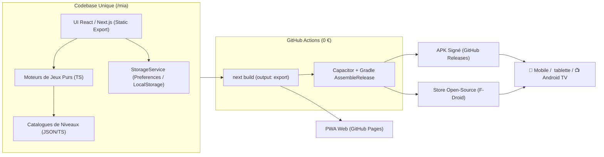
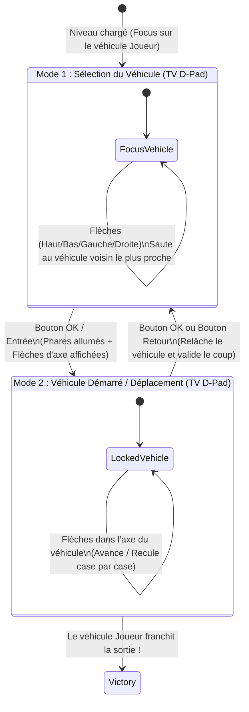
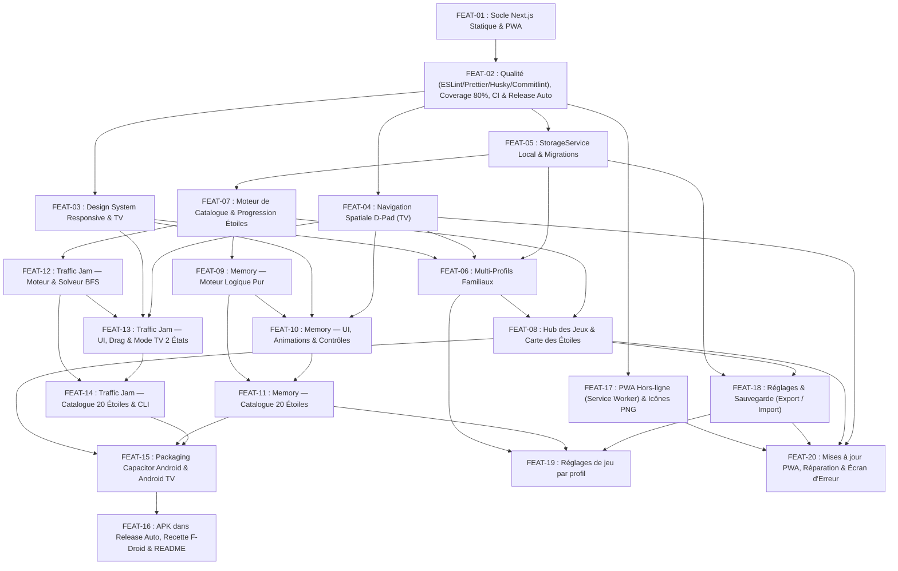

# Spécification Technique & Fonctionnelle — Projet **Mia**

> **Vision** : **Mia** est une application gratuite et open-source d'entraînement et de développement des capacités cérébrales (mémoire de travail, repérage visuo-spatial, planification logique, inhibition cognitive). Elle est conçue pour fonctionner de manière fluide aussi bien sur **Smartphone et Tablette (tactile)** que sur **Android TV (télécommande D-Pad)** et **Navigateur Web (PWA)**, avec un système de progression par étoiles **extensible à l'infini**.

---

## Table des Matières

1. [Principes Directeurs & Contraintes](#1-principes-directeurs--contraintes)
2. [Architecture Technique Globale](#2-architecture-technique-globale)
3. [Modèle de Données & Extensibilité Infinie des Niveaux](#3-modèle-de-données--extensibilité-infinie-des-niveaux)
4. [Conception Détaillée des Jeux (Memory & Traffic Jam)](#4-conception-détaillée-des-jeux-memory--traffic-jam)
5. [Graphe de Dépendances des Features Atomiques](#5-graphe-de-dépendances-des-features-atomiques)
6. [Découpage en Features Atomiques (`FEAT-01` à `FEAT-20`)](#6-découpage-en-features-atomiques-feat-01-à-feat-20)
   - [FEAT-01.md](./FEAT-01.md) — Socle Next.js Statique (PWA) & Structure du Projet
   - [FEAT-02.md](./FEAT-02.md) — Environnement Projet, Bonnes Pratiques Qualité (ESLint Strict, Prettier, Commitlint, Husky, Coverage 80%), CI & Release Automatique (`semantic-release`)
   - [FEAT-03.md](./FEAT-03.md) — Design System Adaptatif (Mobile, Tablette & "10-Foot UI" TV)
   - [FEAT-04.md](./FEAT-04.md) — Moteur de Navigation Spatiale D-Pad (Télécommande TV) & Clavier
   - [FEAT-05.md](./FEAT-05.md) — Service de Stockage Local Résilient & Versionné (`StorageService`)
   - [FEAT-06.md](./FEAT-06.md) — Gestion Multi-Profils Familiaux Locaux
   - [FEAT-07.md](./FEAT-07.md) — Moteur de Catalogue & Progression Extensible par Étoiles (`ProgressionEngine`)
   - [FEAT-08.md](./FEAT-08.md) — Hub des Jeux & Carte de Progression des Étoiles
   - [FEAT-09.md](./FEAT-09.md) — Jeu n°1 (Memory) — Moteur Logique Pur
   - [FEAT-10.md](./FEAT-10.md) — Jeu n°1 (Memory) — Interface, Animations & Contrôles Hybrides
   - [FEAT-11.md](./FEAT-11.md) — Jeu n°1 (Memory) — Catalogue Initial des 20 Étoiles & Générateur
   - [FEAT-12.md](./FEAT-12.md) — Jeu n°2 (Traffic Jam) — Moteur Physique de Grille & Solveur BFS
   - [FEAT-13.md](./FEAT-13.md) — Jeu n°2 (Traffic Jam) — Interface Parking, Drag Tactile & Mode TV à 2 États
   - [FEAT-14.md](./FEAT-14.md) — Jeu n°2 (Traffic Jam) — Catalogue Initial des 20 Étoiles & CLI de Validation
   - [FEAT-15.md](./FEAT-15.md) — Empaquetage Android & Android TV via Capacitor (Conformité F-Droid)
   - [FEAT-16.md](./FEAT-16.md) — Intégration APK dans la Release Automatique, Recette F-Droid & Documentation
   - [FEAT-17.md](./FEAT-17.md) — PWA Hors-ligne (Service Worker) & Icônes d'Installation Multi-Plateformes
   - [FEAT-18.md](./FEAT-18.md) — Écran Réglages & Sauvegarde (Mode TV, Son, Contraste, Export / Import)
   - [FEAT-19.md](./FEAT-19.md) — Réglages de Jeu par Profil (Temps de Mémorisation & d'Affichage des Erreurs de Memory)
   - [FEAT-20.md](./FEAT-20.md) — Mises à jour de la PWA, Réparation & Écran d'Erreur
7. [Guide d'Extension : Comment ajouter de nouveaux niveaux ou un nouveau jeu](#7-guide-dextension--comment-ajouter-de-nouveaux-niveaux-ou-un-nouveau-jeu)

---

## 1. Principes Directeurs & Contraintes

| Pilier | Exigence | Solution Retenue |
| :--- | :--- | :--- |
| **Multi-Supports** | Fonctionner sur Smartphone, Tablette, Android TV et Web. | Code unique **Next.js (Export Statique)** encapsulé par **Capacitor** pour produire un `.apk` compatible Mobile, Tablette et Android TV (`Leanback`). |
| **Double Ergonomie** | Jouable au doigt (Touch) ET à la télécommande TV (D-Pad). | Chaque écran et chaque jeu implémente le **Tap/Drag tactile** ET la **Navigation Spatiale D-Pad** (`Flèches` + `OK` + `Retour`) avec indicateur de focus haute visibilité. |
| **Coût 0 € (100% Gratuit)** | Technologies, hébergement, stockage, CI/CD et Store gratuits. | Licence libre **GPL-3.0-or-later**, aucun backend payant (100% hors-ligne), CI sur **GitHub Actions**, PWA sur **GitHub Pages**, distribution APK sur **GitHub Releases** et **F-Droid**. |
| **Conformité F-Droid** | Aucun SDK propriétaire ni traqueur (pas de Google Play Services). | Dépendances 100% Open Source, compilation reproductible via Gradle + Node.js. |
| **Usage Familial** | Partageable sur la TV du salon ou une tablette familiale. | Gestion **Multi-profils locaux** sans création de compte en ligne. |
| **Extensibilité Infinie** | Pouvoir démarrer avec 20 niveaux/étoiles par jeu et en ajouter des centaines facilement au fil du temps. | Architecture **100% Data-Driven** : les niveaux sont de simples fichiers déclaratifs (JSON/TS) identifiés par un `id` unique immuable. |

---

## 2. Architecture Technique Globale



### Stack Technique Retenue
* **Framework Applicatif** : **Next.js** (App Router configuré avec `output: 'export'` pour générer un bundle HTML/CSS/JS purement statique et autonome).
* **Langage** : **TypeScript** (mode `strict: true`).
* **Styling & Responsive** : **Tailwind CSS** (avec classes utilitaires dédiées aux grands écrans TV `tv:` / `xl:` et gestion des zones sûres `safe-area`).
* **Animations** : **Framer Motion** + Transitions CSS accélérées matériellement (`transform`, `opacity`) pour garantir 60 FPS sur les processeurs modestes des boîtiers Android TV.
* **Icônes & Graphismes** : **Lucide React** + SVG vectoriels inline (poids plume, netteté parfaite en 4K sur TV, 0 dépendance externe).
* **Stockage des Données** :
  * Plugin officiel **`@capacitor/preferences`** (stocke nativement dans les `SharedPreferences` Android sur mobile/TV, évitant tout effacement accidentel du cache WebView par l'OS).
  * Fallback automatique sur **`localStorage`** (avec `navigator.storage.persist()`) lorsque l'application tourne dans un navigateur Web classique.
* **Wrapper Natif Android / Android TV** : **Capacitor** (`@capacitor/core`, `@capacitor/android`, `@capacitor/app` pour intercepter le bouton physique `Retour` de la télécommande TV).
* **Tests Unitaires & Validation** : **Vitest** (exécution ultra-rapide des tests des moteurs de jeu et du validateur de niveaux).

---

## 3. Modèle de Données & Extensibilité Infinie des Niveaux

### 3.1. Pourquoi ce modèle est extensible à l'infini sans casser les sauvegardes ?

1. **Adressage par `levelId` immuable (et non par numéro d'index)** :
   * Si le joueur termine le niveau `"memory-001"`, sa sauvegarde enregistre `completedLevels["memory-001"]`.
   * Si demain vous insérez 10 nouveaux niveaux faciles entre `"memory-001"` et `"memory-002"` (ex: `"memory-001b"`, `"memory-001c"`), la progression du joueur n'est jamais décalée ni corrompue.
2. **Calcul dynamique du plafond d'Étoiles** :
   * **1 Niveau validé = 1 Étoile gagnée** ⭐ (avec un badge " Couronne / Parfait" si résolu sous le seuil de coups optimal).
   * Au lancement : 20 niveaux par jeu = **20 Étoiles** réparties sur les 5 paliers de difficulté (4 niveaux par palier).
   * Plus tard : Ajouter un objet de niveau dans le catalogue fait automatiquement passer le jeu à 21, 50 ou 200 étoiles sans modifier une seule ligne du moteur de progression.
3. **Règle de déblocage hybride (Anti-blocage lors des mises à jour)** :
   * Le premier niveau du palier *Très Facile* est toujours débloqué.
   * Un niveau $N$ est débloqué si :
     * Le niveau précédent dans l'ordre du catalogue est validé, **OU**
     * Le joueur possède déjà un nombre d'étoiles dans ce jeu supérieur ou égal au rang du niveau $N-1$ (ce qui garantit qu'un joueur avancé n'est jamais "bloqué" si on insère des niveaux plus tôt dans le catalogue).

### 3.2. Schéma de Sauvegarde Locale (`MiaSaveState`)

```typescript
export interface MiaSaveState {
  /** Version du schéma pour permettre des migrations transparentes */
  schemaVersion: 1;
  /** ID du profil actuellement actif */
  activeProfileId: string | null;
  /** Liste des profils familiaux créés sur l'appareil */
  profiles: UserProfile[];
  /** Paramètres globaux de l'appareil */
  settings: DeviceSettings;
}

export interface DeviceSettings {
  soundEnabled: boolean;
  highContrastMode: boolean;
  /** Force l'affichage des aides de boutons TV même hors Android TV */
  tvModeOverride: 'auto' | 'always_tv' | 'always_touch';
}

export interface UserProfile {
  id: string;
  name: string;
  avatarId: string; // ex: "fox", "owl", "robot", "star", "cat", "rocket"
  createdAt: string;
  /** Progression indexée par identifiant de jeu ("memory", "traffic-jam", etc.) */
  gamesProgress: Record<string, GameProgress>;
  /** Réglages de jeu du joueur (FEAT-19) : toujours complets, réparés aux valeurs par défaut à la lecture */
  gameSettings: ProfileGameSettings;
}

/** Pas du facteur de temps (FEAT-19), dans l'ordre d'affichage : 1 = temps du niveau tel quel */
export const TIME_FACTORS = [0.5, 1, 1.5, 2] as const;
export type TimeFactor = (typeof TIME_FACTORS)[number];

/** Réglages de Memory propres à un profil, appliqués aux temps de chaque niveau (FEAT-19) */
export interface MemoryGameSettings {
  /** Multiplie l'aperçu du niveau (`previewSeconds`) ; une étoile sans aperçu (0) n'en gagne pas */
  previewFactor: TimeFactor;
  /** Multiplie le temps pendant lequel les cartes d'une erreur restent visibles (900 ms) */
  mismatchFactor: TimeFactor;
}

/** Un objet par jeu qui propose des réglages (Traffic Jam n'en a pas encore) */
export interface ProfileGameSettings {
  memory: MemoryGameSettings;
}

export interface GameProgress {
  gameId: string;
  /** Progression indexée par l'ID immuable du niveau */
  levels: Record<string, LevelCompletion>;
  /** Dernier niveau joué pour proposer le bouton "Continuer" */
  lastPlayedLevelId: string | null;
}

export interface LevelCompletion {
  levelId: string;
  /** Niveau réussi (donne 1 Étoile) */
  completed: boolean;
  /** Résolu avec un score parfait (sans erreur ou en un minimum de coups) */
  isPerfect: boolean;
  /** Meilleur nombre de coups réalisés */
  bestMoves: number;
  /** Meilleur temps en secondes (indicatif uniquement, non pénalisant sur TV) */
  bestTimeSeconds: number;
  /** Nombre de fois où ce niveau a été terminé */
  timesPlayed: number;
  completedAt: string;
}
```

### 3.3. Les 5 Paliers Cognitifs Standardisés

Tous les jeux de **Mia** partagent la même échelle de difficulté à 5 paliers :

| Code Palier (`DifficultyTier`) | Nom Affiché | Couleur Thème | Étoiles Initiales (MVP) | Objectif Cognitif |
| :--- | :--- | :--- | :--- | :--- |
| `very_easy` | **1. Très Facile** *(Éveil)* | Vert Émeraude | ⭐ Étoiles 1 à 4 | Comprendre les règles sans échec, prise en main de la télécommande ou du tactile. |
| `easy` | **2. Facile** *(Initié)* | Bleu Azur | ⭐ Étoiles 5 à 8 | Mobiliser l'attention court-terme avec une faible charge mentale. |
| `medium` | **3. Moyen** *(Confirmé)* | Ambre / Or | ⭐ Étoiles 9 à 12 | Solliciter la mémoire de travail active et l'anticipation à 2-3 coups. |
| `hard` | **4. Difficile** *(Expert)* | Orange Corail | ⭐ Étoiles 13 à 16 | Résister aux interférences visuelles et planifier des séquences longues. |
| `very_hard` | **5. Très Difficile** *(Maître)* | Violet Impérial | ⭐ Étoiles 17 à 20 | Haute charge cognitive, flexibilité mentale et résolution de problèmes complexes. |

---

## 4. Conception Détaillée des Jeux (Memory & Traffic Jam)

### 4.1. Jeu n°1 : Memory (Mémoire visuo-spatiale & Mémoire de travail)

#### Mécaniques & Paramètres d'Extensibilité
Chaque niveau de *Memory* est défini par une structure déclarative permettant de faire varier progressivement la difficulté sur 6 axes :
1. **Dimensions de la grille (`cols x rows`)** : de `2x2` (4 cartes) à `6x6` (36 cartes).
2. **Taille des groupes à associer (`matchSize`)** : Paires (`2` cartes identiques) ou Triplets (`3` cartes identiques dans les niveaux *Difficile* / *Très Difficile*).
3. **Mode de distinction visuelle (`visualMode`)** :
   * `distinct_color_shape` : Chaque groupe a une icône ET une couleur uniques (ex: Soleil Jaune, Pomme Rouge).
   * `thematic_palette` : Icônes d'un même thème avec une palette réduite à 3 couleurs.
   * `monochrome` : Toutes les cartes ont exactement la même couleur ; seule la forme du symbole permet de les différencier.
   * `abstract_orientation` : Formes géométriques proches ou orientées différemment (ex: flèche vers le haut, vers la droite, vers le bas).
4. **Temps d'aperçu initial (`previewSeconds`)** : Au début du niveau, les cartes sont dévoilées pendant $X$ secondes avant de se retourner (`0` = aucun aperçu). Depuis `FEAT-19`, cette durée est multipliée par le facteur de temps du joueur (`previewFactor` du profil, × 0,5 à × 2) ; `0` reste `0`.
5. **Nombre maximal d'erreurs autorisées (`maxMistakes`)** : `null` (illimité en *Très Facile* / *Facile*) ou limité (en *Difficile* / *Très Difficile*) pour encourager la mémorisation plutôt que le clic au hasard.
6. **Mécanique spéciale (`swapEveryNMistakes`)** : Dans les niveaux *Très Difficile*, toutes les $N$ erreurs, deux cartes face cachée échangent visiblement leur position sur le plateau.

#### Progression Initiale des 20 Étoiles de Memory (MVP)

| Étoile | ID Niveau | Palier | Grille | Cartes | Association | Mode Visuel | Aperçu | Erreurs Max | Spécial |
| :---: | :--- | :--- | :---: | :---: | :---: | :--- | :---: | :---: | :--- |
| ⭐ 1 | `mem-001` | Très Facile | `2x2` | 4 | Paires (2) | Couleurs + Formes | 5s | Illimité | — |
| ⭐ 2 | `mem-002` | Très Facile | `3x2` | 6 | Paires (2) | Couleurs + Formes | 5s | Illimité | — |
| ⭐ 3 | `mem-003` | Très Facile | `3x2` | 6 | Paires (2) | Couleurs + Formes | 0s | Illimité | — |
| ⭐ 4 | `mem-004` | Très Facile | `4x2` | 8 | Paires (2) | Couleurs + Formes | 5s | Illimité | — |
| ⭐ 5 | `mem-005` | Facile | `4x2` | 8 | Paires (2) | Thématique | 0s | Illimité | — |
| ⭐ 6 | `mem-006` | Facile | `5x2` | 10 | Paires (2) | Couleurs + Formes | 5s | Illimité | — |
| ⭐ 7 | `mem-007` | Facile | `5x2` | 10 | Paires (2) | Thématique | 0s | Illimité | — |
| ⭐ 8 | `mem-008` | Facile | `4x3` | 12 | Paires (2) | Thématique | 0s | Illimité | — |
| ⭐ 9 | `mem-009` | Moyen | `4x3` | 12 | Paires (2) | Monochrome | 5s | 10 | — |
| ⭐ 10 | `mem-010` | Moyen | `4x4` | 16 | Paires (2) | Thématique | 5s | 12 | — |
| ⭐ 11 | `mem-011` | Moyen | `4x4` | 16 | Paires (2) | Monochrome | 0s | 12 | — |
| ⭐ 12 | `mem-012` | Moyen | `5x4` | 20 | Paires (2) | Thématique | 0s | 14 | — |
| ⭐ 13 | `mem-013` | Difficile | `5x4` | 20 | Paires (2) | Monochrome | 0s | 12 | — |
| ⭐ 14 | `mem-014` | Difficile | `6x4` | 24 | Paires (2) | Thématique | 0s | 15 | — |
| ⭐ 15 | `mem-015` | Difficile | `5x3` | 15 | **Triplets (3)** | Couleurs + Formes | 5s | 10 | — |
| ⭐ 16 | `mem-016` | Difficile | `6x4` | 24 | Paires (2) | Abstrait | 0s | 14 | — |
| ⭐ 17 | `mem-017` | Très Difficile | `6x5` | 30 | Paires (2) | Monochrome | 0s | 18 | — |
| ⭐ 18 | `mem-018` | Très Difficile | `6x4` | 24 | **Triplets (3)** | Thématique | 5s | 14 | — |
| ⭐ 19 | `mem-019` | Très Difficile | `5x4` | 20 | Paires (2) | Monochrome | 0s | 12 | Permutation (4 err.) |
| ⭐ 20 | `mem-020` | Très Difficile | `6x6` | 36 | Paires (2) | Abstrait | 0s | 20 | Permutation (5 err.) |

---

### 4.2. Jeu n°2 : Traffic Jam / Embouteillage (Planification & Logique Séquentielle)

#### Règles & Ergonomie Comparative (Tactile vs Télécommande Android TV)
* **Plateau** : Une grille carrée (standard `6x6`, extensible à `7x7` ou `8x8`) entourée d'un mur, avec une **ouverture de sortie** sur le bord droit à la ligne du véhicule du joueur (ligne 2 en partant de 0).
* **Entités sur la grille** :
  * **Véhicule Joueur (`hero`)** : Voiture horizontale de longueur 2 située sur la ligne de la sortie.
  * **Voitures (`car`)** : Longueur 2 (horizontales `H` ou verticales `V`).
  * **Camions (`truck`)** : Longueur 3 (horizontaux `H` ou verticaux `V`).
  * **Obstacles fixes (`blocker`)** : Plots de chantier / rochers d'une case (`1x1`) totalement immobiles (utilisés dans les niveaux avancés pour renouveler les puzzles).
* **Comptage des coups** : Déplacer un même véhicule de 1, 2 ou 3 cases d'un seul trait compte pour **1 seul mouvement (1 coup)**.



#### Progression Initiale des 20 Étoiles de Traffic Jam (MVP)

| Étoile | ID Niveau | Palier | Grille | Coups Optimaux ($N_{min}$) | Caractéristiques du Puzzle |
| :---: | :--- | :--- | :---: | :---: | :--- |
| ⭐ 1 | `tj-001` | Très Facile | `6x6` | **2 coups** | 1 seul véhicule vertical bloque la sortie. Apprentissage du geste. |
| ⭐ 2 | `tj-002` | Très Facile | `6x6` | **3 coups** | 2 véhicules bloqueurs en chaîne directe. |
| ⭐ 3 | `tj-003` | Très Facile | `6x6` | **4 coups** | Introduction du premier camion (3 cases). |
| ⭐ 4 | `tj-004` | Très Facile | `6x6` | **5 coups** | Nécessite de dégager un véhicule horizontal au bas de la grille. |
| ⭐ 5 | `tj-005` | Facile | `6x6` | **7 coups** | 5 véhicules, premier aller-retour simple. |
| ⭐ 6 | `tj-006` | Facile | `6x6` | **8 coups** | 6 véhicules dont 2 camions. |
| ⭐ 7 | `tj-007` | Facile | `6x6` | **10 coups** | Libération d'un couloir central. |
| ⭐ 8 | `tj-008` | Facile | `6x6` | **12 coups** | Nécessite d'avancer temporairement la voiture rouge à mi-chemin. |
| ⭐ 9 | `tj-009` | Moyen | `6x6` | **14 coups** | 8 véhicules, blocage mutuel en carré. |
| ⭐ 10 | `tj-010` | Moyen | `6x6` | **16 coups** | Introduction d'un plot fixe (`blocker` 1x1) sur la grille. |
| ⭐ 11 | `tj-011` | Moyen | `6x6` | **19 coups** | Nécessite de reculer un véhicule déjà déplacé. |
| ⭐ 12 | `tj-012` | Moyen | `6x6` | **22 coups** | Parking dense (10 véhicules). |
| ⭐ 13 | `tj-013` | Difficile | `6x6` | **25 coups** | Manœuvre d'inversion de deux véhicules sur la même colonne. |
| ⭐ 14 | `tj-014` | Difficile | `6x6` | **28 coups** | 11 véhicules + 1 obstacle fixe. |
| ⭐ 15 | `tj-015` | Difficile | `6x6` | **31 coups** | Goulot d'étranglement central. |
| ⭐ 16 | `tj-016` | Difficile | `6x6` | **34 coups** | Forte dépendance séquentielle (fausse piste évidente au départ). |
| ⭐ 17 | `tj-017` | Très Difficile | `6x6` | **38 coups** | Casse-tête avancé à haute profondeur de recherche. |
| ⭐ 18 | `tj-018` | Très Difficile | `6x6` | **42 coups** | 12 véhicules, utilisation de chaque case libre du plateau. |
| ⭐ 19 | `tj-019` | Très Difficile | `6x6` | **46 coups** | Grille avec 2 obstacles fixes asymétriques. |
| ⭐ 20 | `tj-020` | Très Difficile | `6x6` | **50 coups** | Défi Maître (proche du maximum théorique de 51 coups en 6x6). |

> **Valeurs cibles indicatives.** Les coups optimaux publiés sont ceux de `src/games/traffic-jam/catalog.ts` ([FEAT-14](./FEAT-14.md) §5), mesurés par le solveur BFS dans les plages de [FEAT-14 §3.1](./FEAT-14.md) (2, 3, 4, 5 / 7, 8, 10, 11 / 12, 14, 16, 18 / 19, 22, 25, 28 / 31, 36, 41, 45) ; `npm run validate:levels` les affiche.

---

## 5. Graphe de Dépendances des Features Atomiques

Chaque feature est conçue pour être **atomique** et décrite dans son propre fichier `FEAT-XX.md` : elle possède un périmètre réduit, des entrées/sorties claires et peut être développée, testée et validée indépendamment avant de passer à la suivante.



---

## 6. Découpage en Features Atomiques (`FEAT-01` à `FEAT-20`)

Chacune des 20 features possède sa spécification complète et autonome pour l'IA dans son fichier dédié :

| Ordre | Fichier | Titre de la Feature | Dépendances |
| :---: | :--- | :--- | :--- |
| **01** | [FEAT-01.md](./FEAT-01.md) | **Socle Next.js Statique (PWA) & Structure du Projet** | Aucune |
| **02** | [FEAT-02.md](./FEAT-02.md) | **Environnement Projet, Qualité (ESLint Strict, Prettier, Commitlint, Husky, Coverage 80%), CI & Release Automatique (`semantic-release`)** | `FEAT-01` |
| **03** | [FEAT-03.md](./FEAT-03.md) | **Design System Adaptatif (Mobile, Tablette & "10-Foot UI" TV)** | `FEAT-01`, `FEAT-02` |
| **04** | [FEAT-04.md](./FEAT-04.md) | **Moteur de Navigation Spatiale D-Pad (Télécommande TV) & Clavier** | `FEAT-01`, `FEAT-02` |
| **05** | [FEAT-05.md](./FEAT-05.md) | **Service de Stockage Local Résilient & Versionné (`StorageService`)** | `FEAT-01`, `FEAT-02` |
| **06** | [FEAT-06.md](./FEAT-06.md) | **Gestion Multi-Profils Familiaux Locaux** | `FEAT-03`, `FEAT-04`, `FEAT-05` |
| **07** | [FEAT-07.md](./FEAT-07.md) | **Moteur de Catalogue & Progression Extensible par Étoiles (`ProgressionEngine`)** | `FEAT-05` |
| **08** | [FEAT-08.md](./FEAT-08.md) | **Hub des Jeux & Carte de Progression des Étoiles** | `FEAT-03`, `FEAT-04`, `FEAT-06`, `FEAT-07` |
| **09** | [FEAT-09.md](./FEAT-09.md) | **Jeu n°1 (Memory) — Moteur Logique Pur** | `FEAT-07` |
| **10** | [FEAT-10.md](./FEAT-10.md) | **Jeu n°1 (Memory) — Interface, Animations & Contrôles Hybrides** | `FEAT-03`, `FEAT-04`, `FEAT-08`, `FEAT-09` |
| **11** | [FEAT-11.md](./FEAT-11.md) | **Jeu n°1 (Memory) — Catalogue Initial des 20 Étoiles & Validateur** | `FEAT-08`, `FEAT-09`, `FEAT-10` |
| **12** | [FEAT-12.md](./FEAT-12.md) | **Jeu n°2 (Traffic Jam) — Moteur Physique de Grille, Parseur ASCII & Solveur BFS** | `FEAT-07` |
| **13** | [FEAT-13.md](./FEAT-13.md) | **Jeu n°2 (Traffic Jam) — Interface Parking, Drag Tactile & Mode TV à 2 États** | `FEAT-03`, `FEAT-04`, `FEAT-08`, `FEAT-12` |
| **14** | [FEAT-14.md](./FEAT-14.md) | **Jeu n°2 (Traffic Jam) — Catalogue Initial des 20 Étoiles & CLI `validate:levels`** | `FEAT-08`, `FEAT-11`, `FEAT-12`, `FEAT-13` |
| **15** | [FEAT-15.md](./FEAT-15.md) | **Empaquetage Android & Android TV via Capacitor (Conformité F-Droid)** | `FEAT-08`, `FEAT-11`, `FEAT-14` |
| **16** | [FEAT-16.md](./FEAT-16.md) | **Intégration APK dans la Release Automatique, Recette F-Droid & Documentation** | `FEAT-02`, `FEAT-15` |
| **17** | [FEAT-17.md](./FEAT-17.md) | **PWA Hors-ligne (Service Worker) & Icônes d'Installation Multi-Plateformes** | `FEAT-01`, `FEAT-02` |
| **18** | [FEAT-18.md](./FEAT-18.md) | **Écran Réglages & Sauvegarde (Mode TV, Son, Contraste, Export / Import)** | `FEAT-05`, `FEAT-08` |
| **19** | [FEAT-19.md](./FEAT-19.md) | **Réglages de Jeu par Profil (Temps de Mémorisation & d'Affichage des Erreurs de Memory)** | `FEAT-06`, `FEAT-11`, `FEAT-18` |
| **20** | [FEAT-20.md](./FEAT-20.md) | **Mises à jour de la PWA, Réparation & Écran d'Erreur** | `FEAT-04`, `FEAT-08`, `FEAT-17`, `FEAT-18` |

---

### `FEAT-01` : Socle Next.js Statique (PWA) & Structure du Projet

* **Objectif** : Initialiser le projet dans `/home/alexeiananenko/Workspace/mia` avec Next.js configuré en export statique (`output: 'export'`), TypeScript strict, Tailwind CSS, Vitest, et le manifeste PWA (le fonctionnement hors-ligne de la version Web est traité par `FEAT-17`).
* **Dépendances** : Aucune.
* **Spécifications Techniques** :
  * Configuration `next.config.ts` avec `output: 'export'` et `images: { unoptimized: true }` (indispensable pour fonctionner sans serveur Node.js dans l'APK Capacitor et sur GitHub Pages).
  * Création de l'arborescence normalisée :
    * `src/app/` : Pages et routes statiques.
    * `src/components/ui/` : Composants du Design System.
    * `src/core/navigation/` : Gestion du focus D-Pad TV et du tactile.
    * `src/core/storage/` : Persistance locale et profils.
    * `src/core/progression/` : Moteur d'étoiles et registre des catalogues.
    * `src/games/memory/` : Logique, composants et catalogue de *Memory*.
    * `src/games/traffic-jam/` : Logique, solveur, composants et catalogue de *Traffic Jam*.
  * Manifeste Web `public/manifest.json` configuré en mode `standalone` avec support `any` (portrait sur mobile, paysage sur TV).
* **Critères d'Acceptation (DoD)** :
  * [ ] `npm run build` génère un dossier `out/` 100% statique sans aucune erreur.
  * [ ] `npm run test` exécute Vitest avec succès.
  * [ ] `npm run lint` passe sans avertissement.

---

### `FEAT-02` : Environnement Projet, Bonnes Pratiques Qualité, CI & Release Automatique ([FEAT-02.md](./FEAT-02.md))

* **Objectif** : Mettre en place tous les gardes-fous de qualité et d'automatisation dès le début du projet pour encadrer le travail de l'IA sur toutes les features suivantes.
* **Dépendances** : `FEAT-01`.
* **Spécifications Techniques** :
  * **Standardisation** : `.nvmrc` (Node 22 LTS), `.editorconfig`, champ `engines` strict dans `package.json`.
  * **ESLint 9 Flat Config (Pack Strict Complet)** : `@eslint/js` recommended + `typescript-eslint` (`strictTypeChecked` & `stylisticTypeChecked`) + `eslint-config-next` + `eslint-plugin-jsx-a11y` (`strict` pour garantir l'accessibilité clavier/focus TV) + `eslint-config-prettier`, avec tolérance **0 warning** (`--max-warnings=0`).
  * **Prettier** : Formatage unifié avec `prettier-plugin-organize-imports` et `prettier-plugin-tailwindcss`.
  * **Husky + lint-staged + Commitlint** :
    * `pre-commit` : `lint-staged` (Prettier + ESLint `--fix --max-warnings=0`) + `npm run typecheck`.
    * `commit-msg` : validation **Conventional Commits** (`@commitlint/config-conventional`).
    * `pre-push` : `npm run test:coverage` (seuil minimal de couverture fixé à **80%** via `@vitest/coverage-v8`).
  * **CI, Release Automatique (`semantic-release`) & Déploiement PWA au merge sur `main`** :
    * `.github/workflows/ci.yml` : vérifie chaque PR/push (`format:check`, `lint`, `typecheck`, `test:coverage`, `build`).
    * `.github/workflows/release-and-deploy.yml` : à chaque merge d'un `feat:`/`fix:` sur `main`, `semantic-release` calcule la version SemVer, met à jour `CHANGELOG.md` et `package.json`, crée le tag `vX.Y.Z` et la GitHub Release, et déploie automatiquement la PWA sur **GitHub Pages**.
  * **Dependabot** : `.github/dependabot.yml` pour maintenir les dépendances npm et GitHub Actions à jour chaque semaine.

---

### `FEAT-03` : Design System Adaptatif (Mobile, Tablette & "10-Foot UI" TV) ([FEAT-03.md](./FEAT-03.md))

* **Objectif** : Créer les composants graphiques de base capables de s'adapter automatiquement à un écran de smartphone (tenu à 30 cm en portrait) comme à un téléviseur (regardé à 3 mètres en 16:9 paysage).
* **Dépendances** : `FEAT-01`, `FEAT-02`.
* **Spécifications Fonctionnelles & UX** :
  * **Zone de sécurité TV (Overscan Safe Area)** : Sur grand écran / TV, un padding englobant de `5%` de la largeur/hauteur garantit qu'aucun bouton ou texte n'est coupé sur les bords du téléviseur.
  * **Typographie fluide** : Tailles de police adaptatives (`clamp()`) pour rester lisibles à 3 mètres sur TV sans paraître disproportionnées sur mobile.
  * **Composants atomiques à fournir** : `AppShell`, `FocusableButton`, `FocusableCard`, `StarBadge`, `DifficultyPill`, `ModalDialog`.

---

### `FEAT-04` : Moteur de Navigation Spatiale D-Pad (Télécommande TV) & Clavier ([FEAT-04.md](./FEAT-04.md))

* **Objectif** : Permettre de piloter 100% de l'application uniquement avec 6 touches (`Haut`, `Bas`, `Gauche`, `Droite`, `OK/Entrée`, `Retour/Échap`) sur Android TV, tout en conservant le clic/tap tactile sur Mobile et Tablette.
* **Dépendances** : `FEAT-01`, `FEAT-02`.
* **Spécifications Techniques** :
  * Contexte `NavigationContext`, fonctions géométriques `moveInGrid` & `findNearestTarget`, hook `useGridNavigation`, et bascule automatique `inputMode: 'touch' | 'dpad'`.

---

### `FEAT-05` : Service de Stockage Local Résilient & Versionné (`StorageService`) ([FEAT-05.md](./FEAT-05.md))

* **Objectif** : Sauvegarder et charger l'état de l'application (`MiaSaveState`) de manière 100% hors-ligne, rapide, et résistante aux mises à jour.
* **Dépendances** : `FEAT-01`, `FEAT-02`.
* **Spécifications Techniques** :
  * Persistance via `@capacitor/preferences` + fallback `localStorage`, `navigator.storage.persist()`, migration de schéma et Export/Import JSON.

---

### `FEAT-06` : Gestion Multi-Profils Familiaux Locaux ([FEAT-06.md](./FEAT-06.md))

* **Objectif** : Permettre à plusieurs membres d'un foyer (particulièrement sur une Android TV ou une tablette partagée) d'avoir chacun leur profil et leur propre progression d'étoiles.
* **Dépendances** : `FEAT-03`, `FEAT-04`, `FEAT-05`.

---

### `FEAT-07` : Moteur de Catalogue & Progression Extensible par Étoiles (`ProgressionEngine`) ([FEAT-07.md](./FEAT-07.md))

* **Objectif** : Implémenter le cœur du système d'extensibilité : enregistrer les jeux, agréger leurs catalogues de niveaux, calculer les étoiles gagnées par palier et déterminer quels niveaux sont débloqués.
* **Dépendances** : `FEAT-05`.

---

### `FEAT-08` : Hub des Jeux & Carte de Progression des Étoiles ([FEAT-08.md](./FEAT-08.md))

* **Objectif** : Créer l'écran d'accueil principal (Sélection du jeu + Résumé cognitif du profil) et l'écran "Carte des Étoiles" d'un jeu découpé en 5 paliers cognitifs.
* **Dépendances** : `FEAT-03`, `FEAT-04`, `FEAT-06`, `FEAT-07`.

---

### `FEAT-09` : Jeu n°1 (Memory) — Moteur Logique Pur ([FEAT-09.md](./FEAT-09.md))

* **Objectif** : Développer toute la logique métier du jeu *Memory* en TypeScript pur (paires, triplets, 4 modes visuels, aperçu, limite d'erreurs, permutation de cartes).
* **Dépendances** : `FEAT-07`.

---

### `FEAT-10` : Jeu n°1 (Memory) — Interface, Animations & Contrôles Hybrides ([FEAT-10.md](./FEAT-10.md))

* **Objectif** : Construire l'interface de jeu de *Memory* connectée au `MemoryEngine`, jouable au doigt et à la télécommande TV sans aucun scroll.
* **Dépendances** : `FEAT-03`, `FEAT-04`, `FEAT-08`, `FEAT-09`.

---

### `FEAT-11` : Jeu n°1 (Memory) — Catalogue Initial des 20 Étoiles & Générateur ([FEAT-11.md](./FEAT-11.md))

* **Objectif** : Intégrer le catalogue initial des 20 niveaux progressifs de *Memory* (`mem-001` à `mem-020`) et son validateur mathématique.
* **Dépendances** : `FEAT-08`, `FEAT-09`, `FEAT-10`.

---

### `FEAT-12` : Jeu n°2 (Traffic Jam) — Moteur Physique de Grille & Solveur BFS ([FEAT-12.md](./FEAT-12.md))

* **Objectif** : Développer le moteur logique pur du jeu *Traffic Jam* (déplacements, collisions, parseur ASCII `6x6`, victoire) ainsi que le solveur automatique BFS (`optimalMoves` + fonction Indice).
* **Dépendances** : `FEAT-07`.

---

### `FEAT-13` : Jeu n°2 (Traffic Jam) — Interface Parking, Drag Tactile & Mode TV à 2 États ([FEAT-13.md](./FEAT-13.md))

* **Objectif** : Construire l'interface graphique de *Traffic Jam* avec glisser-déposer fluide au doigt sur Mobile/Tablette et pilotage à 2 états à la télécommande sur Android TV.
* **Dépendances** : `FEAT-03`, `FEAT-04`, `FEAT-08`, `FEAT-12`.

---

### `FEAT-14` : Jeu n°2 (Traffic Jam) — Catalogue Initial des 20 Étoiles & CLI de Validation ([FEAT-14.md](./FEAT-14.md))

* **Objectif** : Intégrer les 20 niveaux progressifs initiaux de *Traffic Jam* (`tj-001` à `tj-020`) et le script CLI `npm run validate:levels`.
* **Dépendances** : `FEAT-08`, `FEAT-11`, `FEAT-12`, `FEAT-13`.

---

### `FEAT-15` : Empaquetage Android & Android TV via Capacitor (Conformité F-Droid) ([FEAT-15.md](./FEAT-15.md))

* **Objectif** : Configurer le projet Android natif via Capacitor (`LEANBACK_LAUNCHER`, `touchscreen required="false"`, bannière TV, gestion du bouton physique `Retour`, métadonnées Fastlane, 0 dépendance propriétaire Google).
* **Dépendances** : `FEAT-08`, `FEAT-11`, `FEAT-14`.

---

### `FEAT-16` : Intégration APK dans la Release Automatique, Recette F-Droid & Documentation ([FEAT-16.md](./FEAT-16.md))

* **Objectif** : Synchroniser automatiquement le `versionCode`/`versionName` Android avec `semantic-release`, attacher l'APK universel (Mobile + Tablette + Android TV) à chaque GitHub Release créée au merge sur `main`, fournir la recette F-Droid (`fdroid/org.mia.braintraining.yml`) et le `README.md` final.
* **Dépendances** : `FEAT-02`, `FEAT-15`.

---

### `FEAT-17` : PWA Hors-ligne (Service Worker) & Icônes d'Installation Multi-Plateformes ([FEAT-17.md](./FEAT-17.md))

* **Objectif** : Rendre la PWA Web (GitHub Pages) installable partout et 100% fonctionnelle hors-ligne : service worker maison sans dépendance runtime qui pré-cache tout l'export `out/` (compatible `basePath`, jamais enregistré dans l'APK Capacitor ni en développement), mises à jour atomiques (jamais deux versions mélangées ; une version prête s'active à la fermeture de toutes les fenêtres, ou à la demande du joueur depuis `FEAT-20`), icônes PNG `any`/`maskable` et `apple-touch-icon` générées depuis les SVG de `FEAT-01`.
* **Dépendances** : `FEAT-01`, `FEAT-02`.

---

### `FEAT-18` : Écran Réglages & Sauvegarde (Mode TV, Son, Contraste, Export / Import) ([FEAT-18.md](./FEAT-18.md))

* **Objectif** : Donner accès, au doigt comme à la télécommande, aux réglages de l'appareil (mode TV forcé, son, contraste élevé) et à la sauvegarde de la progression (export / import JSON, réinitialisation) fournis par `FEAT-05`.
* **Dépendances** : `FEAT-05`, `FEAT-08`.
* **Statut** : cadrée et implémentée ; décisions consignées au §6 de [FEAT-18.md](./FEAT-18.md).

---

### `FEAT-19` : Réglages de Jeu par Profil (Temps de Mémorisation & d'Affichage des Erreurs de Memory) ([FEAT-19.md](./FEAT-19.md))

* **Objectif** : Permettre à chaque profil d'ajuster, depuis une section « Jeux » de l'écran Réglages, deux facteurs de temps de *Memory* (× 0,5 à × 2 : temps de mémorisation appliqué au `previewSeconds` du niveau, temps d'affichage des cartes d'une erreur), enregistrés avec le profil (`UserProfile.gameSettings`, sans montée de version du schéma) et appliqués par le plateau sans modifier la progression ni la logique du catalogue, dont les huit étoiles avec aperçu passent à une base uniforme de 5 s.
* **Dépendances** : `FEAT-06`, `FEAT-11`, `FEAT-18`.
* **Statut** : cadrée et implémentée ; décisions consignées au §6 de [FEAT-19.md](./FEAT-19.md).

---

### `FEAT-20` : Mises à jour de la PWA, Réparation & Écran d'Erreur ([FEAT-20.md](./FEAT-20.md))

* **Objectif** : Faire arriver les nouvelles versions jusqu'à la PWA installée et donner une issue au joueur quand l'application se comporte mal. Une bannière du Hub propose la version prête (le service worker de `FEAT-17` n'appelle toujours pas `skipWaiting()` de lui-même : le joueur accepte, le worker en attente s'active et chaque page ouverte se recharge) ; la recherche part au lancement et à chaque retour au premier plan, au plus une fois par minute. Une section « Application » de l'écran Réglages affiche la version (APK compris), cherche une mise à jour à la demande et répare l'application (désinscrit le service worker de Mia, supprime ses seuls caches, recharge depuis le réseau, sans toucher à la sauvegarde). Un écran d'erreur global (`global-error.tsx`) propose de recharger ou de réparer au lieu de la page d'erreur par défaut de Next.js. L'APK n'est pas concerné : il garde ses mises à jour par F-Droid ou GitHub Releases.
* **Dépendances** : `FEAT-04`, `FEAT-08`, `FEAT-17`, `FEAT-18`.
* **Statut** : cadrée et implémentée ; décisions consignées au §6 de [FEAT-20.md](./FEAT-20.md).

---

## 7. Guide d'Extension : Comment ajouter de nouveaux niveaux ou un nouveau jeu

L'architecture de **Mia** est pensée pour que l'ajout de contenu soit quasi instantané :

### 7.1. Ajouter 1 ou 50 nouveaux niveaux (et donc nouvelles Étoiles) à *Memory*
1. Ouvrir `src/games/memory/catalog.ts`.
2. Ajouter un nouvel objet dans le tableau avec un `id` unique (ex: `"mem-021"`), choisir son palier (`tier: 'easy' | 'medium' | ...`), son `order` et sa configuration (`cols`, `rows`, `visualMode`, etc.).
3. Lancer `npm run validate:levels` : la nouvelle étoile apparaît immédiatement dans le palier correspondant sans toucher au reste du code !

### 7.2. Ajouter 1 ou 50 nouveaux niveaux à *Traffic Jam*
1. Ouvrir `src/games/traffic-jam/catalog.ts`.
2. Déclarer le nouveau plateau (soit via la liste des véhicules, soit via une grille ASCII `6x6` lisible).
3. Lancer `npm run validate:levels` : le solveur BFS vérifie automatiquement que votre niveau est soluble et vous indique son nombre exact de coups optimaux (`optimalMoves`).

### 7.3. Ajouter un 3e, 4e ou 5e jeu cérébral dans le futur
Grâce au découpage modulaire :
1. Créer un dossier `src/games/<nouveau-jeu>/`.
2. Définir son catalogue de niveaux implémentant `BaseLevelDefinition<Config>`.
3. Ajouter son identifiant au type `GameId` (`src/types/mia.ts`), puis l'enregistrer dans le registre central `GAME_REGISTRY` (`src/core/progression/game-registry.ts`) : le compilateur exige son entrée dans ce registre et dans la table des jeux reconnus par la sauvegarde (`KNOWN_GAMES`, FEAT-05), sans laquelle sa progression serait écartée au chargement.
4. Un jeu qui propose ses propres réglages (`FEAT-19`) ajoute son objet à `ProfileGameSettings` (`src/types/mia.ts`), ses valeurs par défaut à `createDefaultGameSettings` (`src/core/storage/default-state.ts`), son assainisseur dans `src/core/storage/migrations.ts` et son bloc dans la section « Jeux » de l'écran Réglages.
5. Le Hub principal, le système multi-profils, la sauvegarde locale et la Carte des Étoiles prendront automatiquement en charge ce nouveau jeu !
